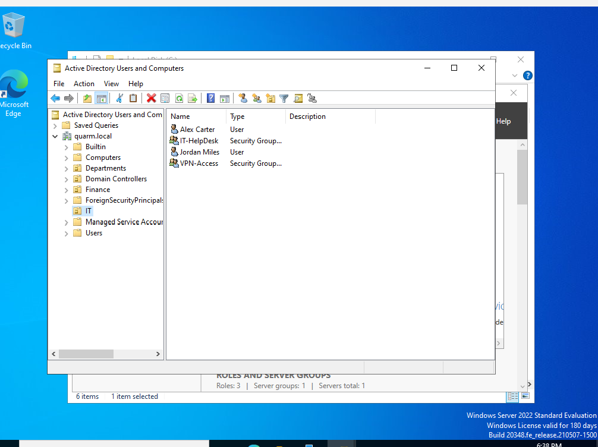
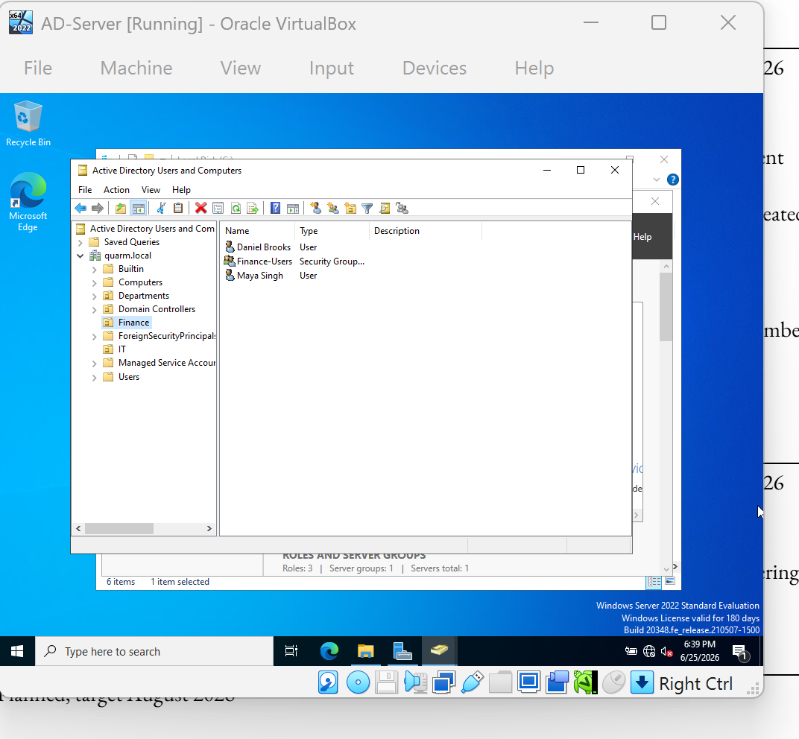
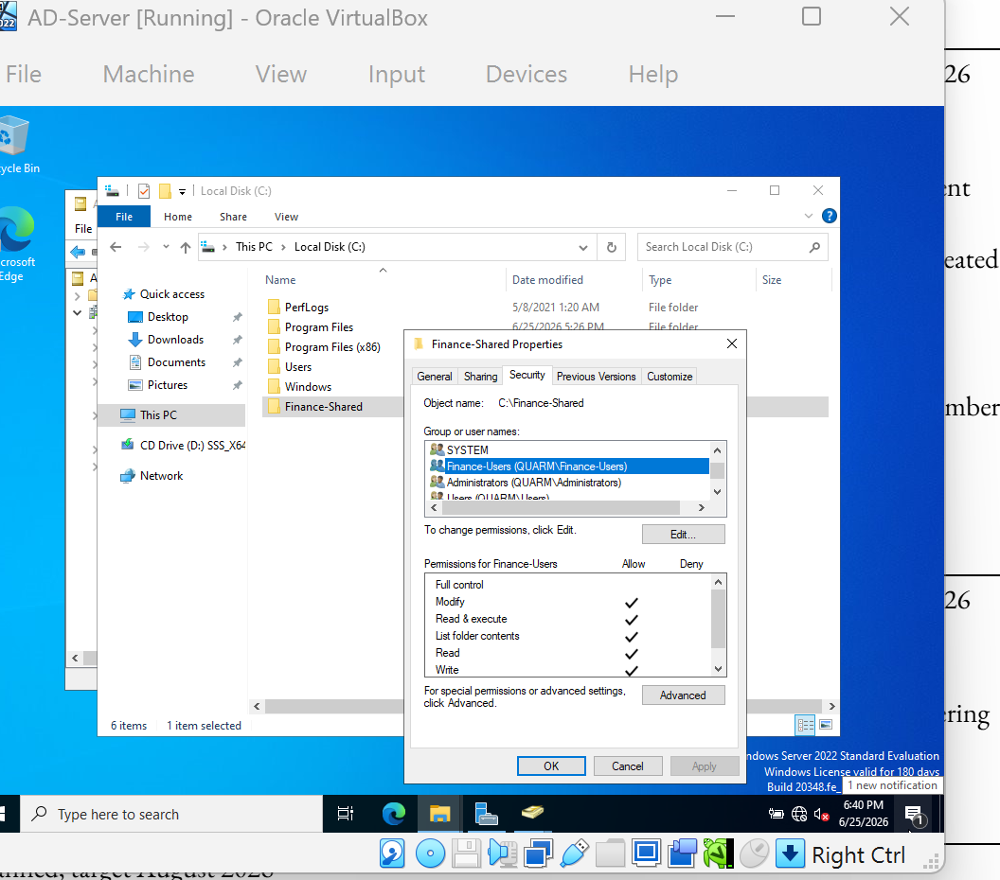

# Active Directory Help Desk Lab

I built a Windows Server 2022 domain controller in VirtualBox and used it to practice four common help desk tasks: a password reset, disabling and re-enabling an account, granting access through a security group, and setting folder permissions for a department.

## Setup

- **Server:** Windows Server 2022 (Standard Evaluation) VM in VirtualBox
- **Roles:** Active Directory Domain Services and DNS
- **Domain:** `quarm.local`, domain controller `DC01`
- **OUs:** I created `IT` and `Finance` OUs, each with test users and a security group:
  - IT: Alex Carter, Jordan Miles, plus the `IT-HelpDesk` and `VPN-Access` groups
  - Finance: Daniel Brooks, Maya Singh, plus the `Finance-Users` group

## Tickets

### 001 — Password reset (m.singh)
Maya couldn't get into her account. I reset her password in Active Directory Users and Computers and checked that the account was still enabled afterward.

### 002 — Disable and re-enable an account (d.brooks)
To practice suspending and restoring access, I disabled Daniel's account and then re-enabled it.

### 003 — VPN access (j.miles)
Jordan was approved for VPN access, so I added him to the `VPN-Access` security group. This covers the AD side only: the group membership that would control access. I didn't test an actual VPN connection.

### 004 — Finance shared folder (Finance-Users)
I created `C:\Finance-Shared` on the server, shared it, and set both share and NTFS permissions for the `Finance-Users` group. The group got **Modify** (read, write, and delete) but not **Full control**, so Finance users can work with the files but can't change the folder's permissions.

## What the screenshots cover

The screenshots show the OU and group structure and the NTFS permissions on the Finance folder. I didn't take screenshots of the password reset, the disable/enable, the VPN group membership change, or the share-level permissions, so those steps are only described in writing here.

## Screenshots

IT OU with users and security groups:

Finance OU with users and the Finance-Users group:

NTFS permissions on `C:\Finance-Shared` for Finance-Users (Modify allowed, Full control not):

