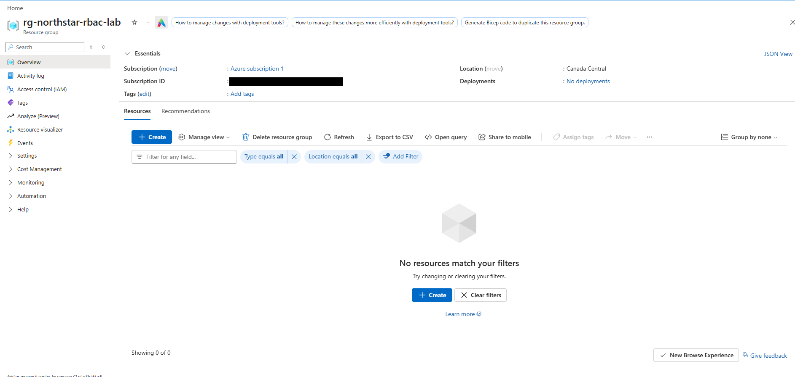
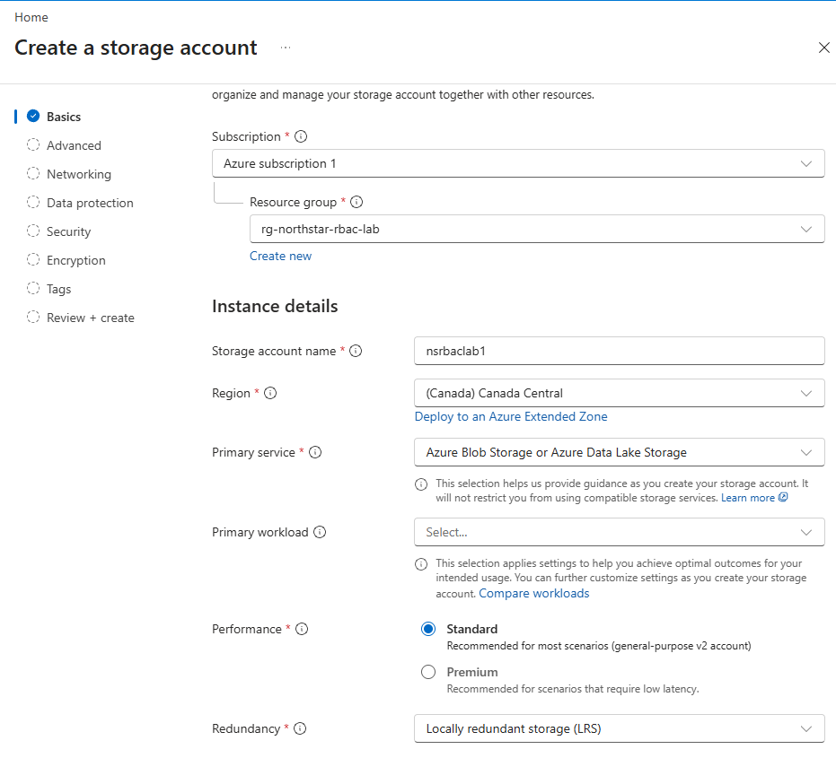
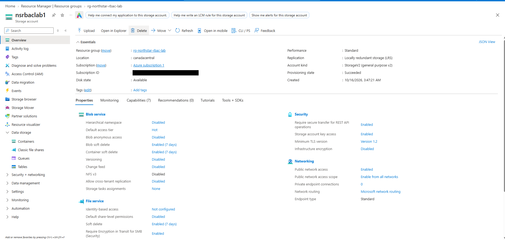
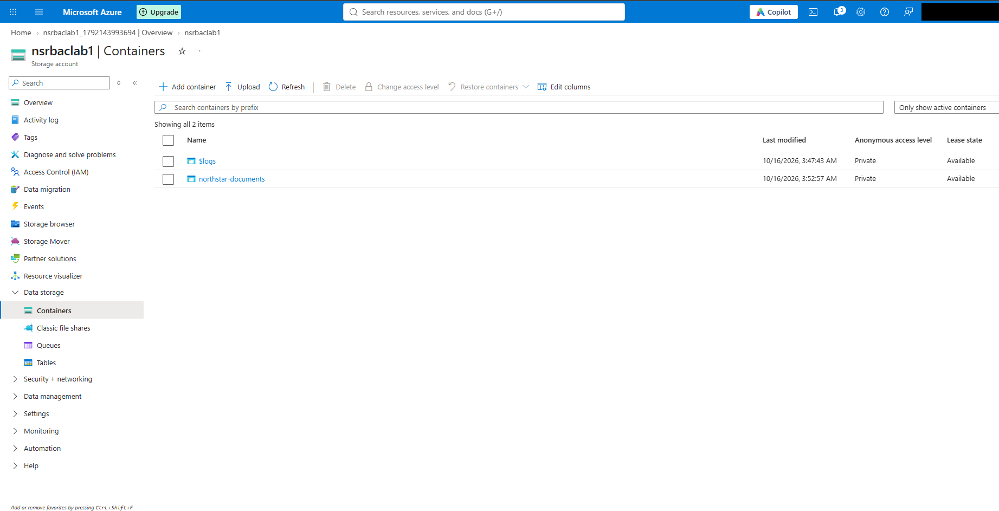

# 01 — Resource Deployment

## Objective

Set up the resources the rest of the lab depends on: a resource group to act as the access boundary, a storage account inside it, and a private Blob container for Northstar's documents.

## What I did

**1. Created the resource group.** I created `rg-northstar-rbac-lab` in Canada Central under Azure subscription 1. Right after creation, its overview showed no resources and no deployments.

**2. Created the storage account.** I created `nsrbaclab1` in that resource group with these Basics settings:

| Setting | Value |
|---|---|
| Region | (Canada) Canada Central |
| Primary service | Azure Blob Storage or Azure Data Lake Storage |
| Performance | Standard |
| Redundancy | Locally redundant storage (LRS) |

The account's overview showed provisioning state **Succeeded**, account kind StorageV2 (general purpose v2), created 10/16/2026 at 3:47:21 AM.

**3. Created the container.** I added a Blob container named `northstar-documents` with anonymous access level **Private**.

## What I observed

- The Containers page listed two containers, both Private: `northstar-documents` and `$logs`. I didn't create `$logs`; it's a system container, and its last-modified time (3:47:43 AM) is from the same minute the account was created.
- The overview also showed hierarchical namespace disabled, default access tier Hot, blob and container soft delete enabled for 7 days, and versioning disabled. I cover the security settings in [05 — Storage Security Review](05-storage-security-review.md).

## Result

The resource group, storage account, and private container were in place, and these were the resources I assigned access to in the next steps.

## Evidence

Resource group right after creation (subscription ID redacted):

Storage account Basics tab:

Storage account overview (subscription ID redacted):

Containers list showing `northstar-documents` as Private:

