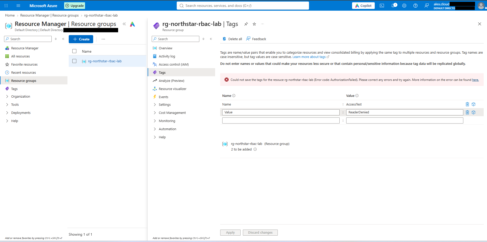
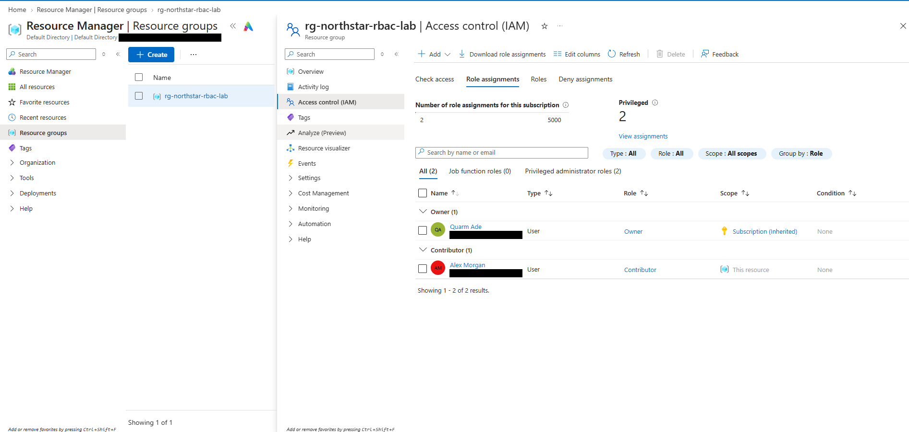
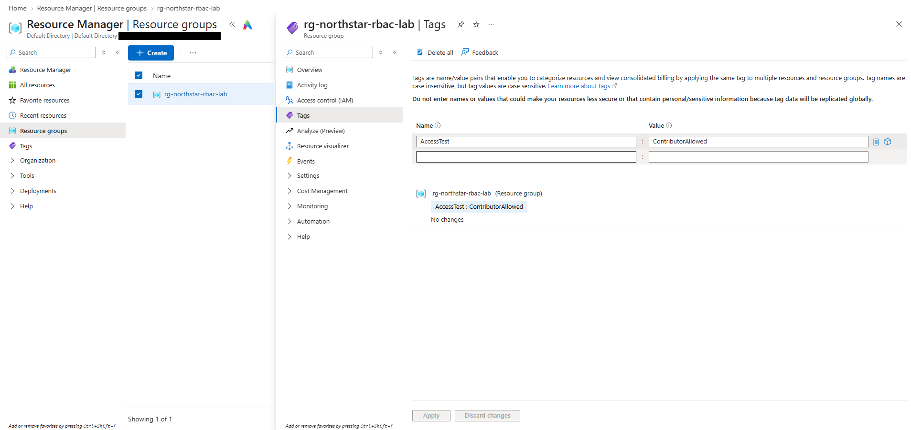

# 02 — RBAC Role Assignment and Tag Tests

## Objective

Give a test user enough access to manage resources in one resource group, without access to anything else in the subscription, and check the result from that user's side.

## What I did

**1. Created a test user.** I created Alex Morgan as a member account in my Entra tenant to stand in for a Northstar employee. The account signs in as `alex.cloud@` on the tenant's default domain.

**2. Tried to write a tag as Alex.** Signed in as Alex, I opened the resource group's Tags page and tried to add `AccessTest = ReaderDenied`. Azure refused:

> Could not save the tags for the resouce rg-northstar-rbac-lab (Error code: AuthorizationFailed). Please correct any errors and try again.

("resouce" is Azure's spelling, not mine.)

The Activity Log shows an earlier **Create role assignment** about nine hours before my 12:29 PM review, and a **Delete role assignment** about ten minutes before it ([06 — Activity Log Review](06-activity-log-review.md)). I don't have a screenshot showing which role that earlier assignment granted, so I'm not naming it here.

**3. Assigned Contributor at resource group scope.** From my admin account, I opened **rg-northstar-rbac-lab → Access control (IAM)** and added a role assignment: **Contributor** for Alex Morgan. The Activity Log recorded it as Create role assignment, Succeeded, at 12:23:39 PM.

The Role assignments tab then listed two entries:

| Name | Role | Scope |
|---|---|---|
| Quarm Ade (my admin account) | Owner | Subscription (Inherited) |
| Alex Morgan | Contributor | This resource |

**4. Tried the tag again as Alex.** With Contributor in place, I added `AccessTest = ContributorAllowed` to the resource group. The Tags page shows the tag saved, and the Activity Log has a **Write tags** event, Succeeded, initiated by Alex's account.

## What I observed

- **Scope matters.** I never assigned myself anything on the resource group. My Owner role is assigned on the subscription and inherited by everything in it, which is why IAM shows it as "Subscription (Inherited)". Alex's Contributor was assigned directly on the resource group ("This resource"), so it applies to that group and its resources, not to the rest of the subscription.
- **The portal groups Contributor with Owner.** Both assignments were counted under "Privileged administrator roles (2)", and none under job function roles.
- **Contributor vs. Owner.** Contributor is meant to let someone manage resources but not grant access to others. My tag test confirms the first part. I don't have a screenshot that clearly shows Alex being blocked from adding a role assignment, so I haven't confirmed the second part.
- **These are Azure RBAC roles, not Entra directory roles.** Contributor gave Alex rights over Azure resources in one resource group. It gave him nothing in the Entra directory itself, like resetting passwords. That's what directory roles such as Helpdesk Administrator are for (see my [Entra project](../../microsoft-entra-id-administration/lab-notes/04-admin-role-assignment.md)).

## Result

With Contributor at resource group scope, Alex could write tags on the group, where his earlier attempt had failed with AuthorizationFailed. I wouldn't call this a full before-and-after test, because I can't show from my evidence exactly which role Alex held during the first attempt.

## Evidence

Tag write denied while signed in as Alex (account domain and tenant redacted):

Role assignments after adding Contributor (object IDs and tenant redacted):

Tag saved after Contributor was assigned:

