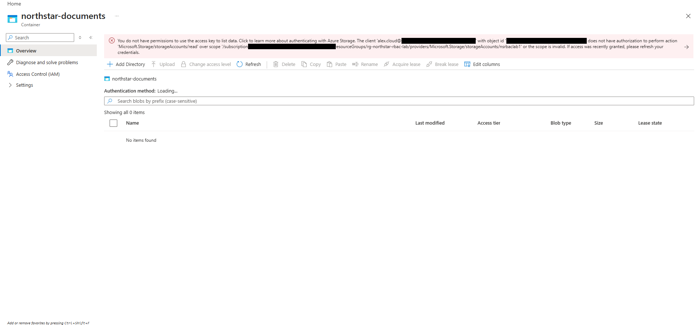

# 03 — Blob Container Access Test

## Objective

See what Alex Morgan gets when he opens the private `northstar-documents` container in the Azure portal.

## What I did

Signed in as Alex, I opened the `northstar-documents` container from the storage account.

## What I observed

The container page opened, but with an error banner, and **Authentication method** was stuck on "Loading...". The blob list showed 0 items. The full message (identifiers replaced in brackets):

> You do not have permissions to use the access key to list data. Click to learn more about authenticating with Azure Storage. The client 'alex.cloud@[tenant domain]' with object id '[object ID]' does not have authorization to perform action 'Microsoft.Storage/storageAccounts/read' over scope '/subscriptions/[subscription ID]/resourceGroups/rg-northstar-rbac-lab/providers/Microsoft.Storage/storageAccounts/nsrbaclab1' or the scope is invalid. If access was recently granted, please refresh your credentials.

Three things in that message are worth pulling out:

| Part of the message | What it tells me |
|---|---|
| "use the access key to list data" | The portal tried to list blobs with the storage account key, not with Alex's Entra identity |
| `Microsoft.Storage/storageAccounts/read` | The denied action is a management action (reading the storage account resource), not a blob data action |
| Scope ending in `/storageAccounts/nsrbaclab1` | The check was against the storage account itself |

## Management permissions vs. Blob data permissions

Azure Storage checks access in two separate layers:

- **Management (Azure Resource Manager):** actions on the storage account as a resource, like reading its properties (`storageAccounts/read`) or listing its keys. Roles like Owner, Contributor, and Reader work here.
- **Data:** the blobs inside the containers. With Entra authorization, reading blobs needs a data role such as Storage Blob Data Reader, which carries data actions like `.../containers/blobs/read`. Owner and Contributor don't include those data actions.

The portal can list blobs two ways. One is the account key, which the portal has to fetch through the management layer first, and which gives full access to the data once you have it. The other is the signed-in user's Entra identity, checked against data roles. On this account, "Default to Microsoft Entra authorization in the Azure portal" was **Disabled** ([05 — Storage Security Review](05-storage-security-review.md)), and the error confirms the portal went for the key. That attempt failed at the management step, before any blob data was involved.

I never assigned Alex a Blob data role, so I didn't test the Entra data path at all.

## What I can't explain from my evidence

I took this screenshot at 12:39 PM. Alex's Contributor assignment was listed in IAM at 12:23 PM, and the screenshot confirming I removed it was taken at 12:40 PM ([04 — Role Removal](04-role-removal-and-verification.md)). Contributor includes `Microsoft.Storage/storageAccounts/read`, so if it was still active, I wouldn't have expected this action to be denied. I don't have a screenshot of Alex's role assignments at the exact moment of the error. That means I can't tell whether the removal had already happened or something else was going on, like a stale session. I didn't troubleshoot it further before deleting the account.

## Result

Alex couldn't list the container's contents through the portal. The error came from the management layer while the portal was trying to use the account key. That shows management access and Blob data access are checked separately, but it isn't a complete test of Alex's permissions before and after the role change.

## Evidence

Container error while signed in as Alex (account domain, object ID, and subscription ID redacted):

