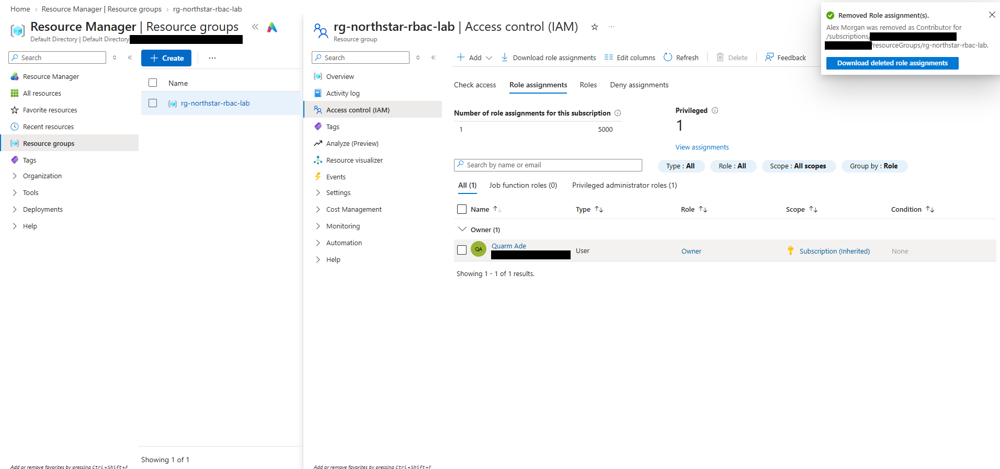

# 04 — Role Removal

## Objective

Remove Alex Morgan's Contributor access once testing was finished, and confirm it was gone.

## What I did

In **rg-northstar-rbac-lab → Access control (IAM) → Role assignments**, I selected Alex Morgan's Contributor assignment and removed it.

## What I observed

- The portal confirmed: "Removed Role assignment(s). Alex Morgan was removed as Contributor for /subscriptions/…/resourceGroups/rg-northstar-rbac-lab."
- The role assignments list dropped to a single entry: my own Owner role, still shown as **Subscription (Inherited)**.
- The counters changed to match. Role assignments for the subscription went from 2 to 1, and Privileged went from 2 to 1.

Removing the assignment on the resource group didn't touch my Owner role, because that one is assigned on the subscription, not the group.

## Result

Alex's Contributor assignment was removed, and IAM showed no remaining assignments for him on the resource group.

I didn't sign back in as Alex to confirm the tag write was blocked again. I deleted his account during cleanup ([07 — Cost Monitoring and Cleanup](07-cost-monitoring-and-cleanup.md)), so the removal is only verified from the admin side.

## Evidence

Removal confirmation and the remaining Owner assignment (subscription ID, object ID, and tenant redacted):

