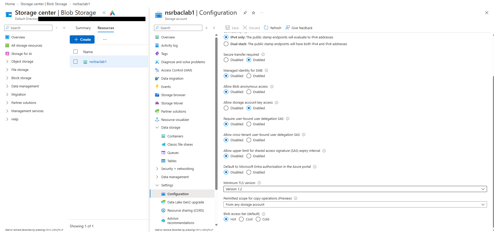

# 05 — Storage Security Review

## Objective

Check how `nsrbaclab1` was configured for transport security, anonymous access, network exposure, and authorization, and note where it's tighter or looser than it could be.

## What I did

I went through the storage account's **Overview** (Properties tab) and **Settings → Configuration**, and checked the access level on the containers.

## What I found

| Setting | Value | Where I saw it |
|---|---|---|
| Secure transfer required | Enabled | Overview, Configuration |
| Allow Blob anonymous access | Disabled | Overview, Configuration |
| Container anonymous access level | Private (both containers) | Containers |
| Minimum TLS version | Version 1.2 | Overview, Configuration |
| Public network access | Enabled from all networks, 0 private endpoint connections | Overview |
| Allow storage account key access | Enabled | Overview, Configuration |
| Default to Microsoft Entra authorization in the Azure portal | Disabled | Configuration |

Other settings on the same pages: infrastructure encryption Disabled, user-bound delegation SAS not required, SAS expiry limit Disabled, and copy operations permitted from any storage account.

## What this means

**Tighter:**

- With secure transfer required and a TLS 1.2 minimum, the account only accepts HTTPS connections using TLS 1.2 or newer.
- With anonymous access disabled at the account level, no container on this account can be made public, whatever its own access level says. Both containers were also Private on their own.

**Looser:**

- **Reachable from any network.** There were no firewall rules and no private endpoint. Anyone on the internet could reach the endpoint, though they'd still need to authenticate.
- **Key access enabled.** Anyone holding an account key gets full access to the data, and RBAC doesn't apply to key-based requests. Disabling key access would force Entra authorization, so data access would depend on roles like Storage Blob Data Reader.
- **The portal defaults to keys.** With Entra authorization not the portal default, the portal tried the account key first. That's exactly what happened in [03 — Blob Container Access Test](03-storage-access-test.md).

This note records the settings as I found them. The account wasn't restricted to private networks, and plenty of storage security controls (firewall rules, private endpoints, disabling key access, infrastructure encryption) weren't in place.

## Result

The account blocked anonymous access and required encrypted transport. Network exposure and key-based access were left open, and those are the first two things I'd change on an account holding real data.

## Evidence

Configuration page (tenant redacted):

The overview with Security and Networking properties is in [01 — Resource Deployment](01-resource-deployment.md#evidence) (`03-storage-account-overview.png`).
