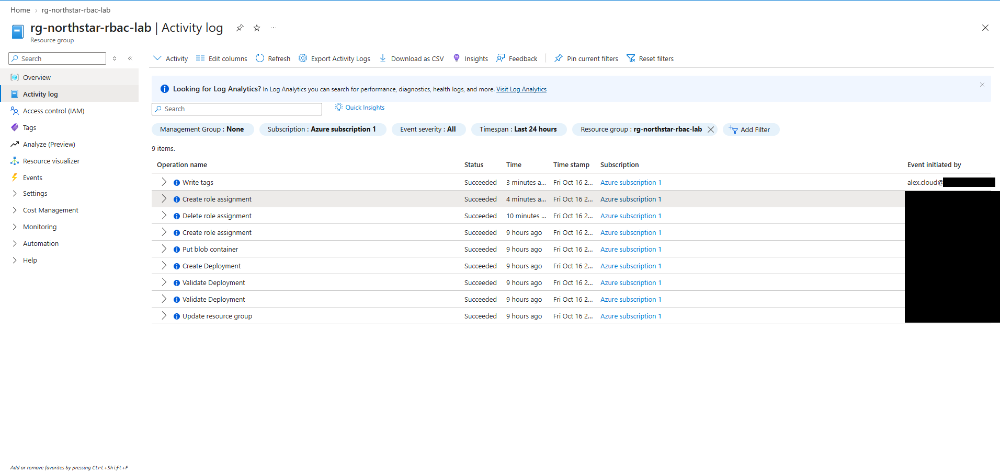

# 06 — Activity Log Review

## Objective

Use the Azure Activity Log to see who changed what in the resource group, especially the role assignments.

## What I did

At about 12:29 PM, I opened **rg-northstar-rbac-lab → Activity log**, filtered to the resource group, the last 24 hours, and all event severities. I opened the most recent **Create role assignment** entry to see its details.

## What I observed

The log had 9 items, all with status **Succeeded**:

| Operation | Time (relative to 12:29 PM) | Initiated by |
|---|---|---|
| Write tags | 3 minutes ago | Alex Morgan |
| Create role assignment | 4 minutes ago | My admin account |
| Delete role assignment | 10 minutes ago | My admin account |
| Create role assignment | 9 hours ago | My admin account |
| Put blob container | 9 hours ago | My admin account |
| Create Deployment | 9 hours ago | My admin account |
| Validate Deployment (×2) | 9 hours ago | My admin account |
| Update resource group | 9 hours ago | My admin account |

Matching these to the lab:

- **Write tags** is Alex's `ContributorAllowed` tag from [02](02-rbac-role-assignment.md), and it's the only event Alex initiated.
- **Create role assignment (4 minutes ago)** is the Contributor assignment. Its details showed 12:23:39 PM, initiated by my account. The summary left the **Role** and **Scope** fields blank ("-"), so I identified the role from the IAM page, not from the log entry.
- **Delete role assignment (10 minutes ago)** happened *before* the Contributor assignment, so it isn't the Contributor removal. That removal came at about 12:40 PM, after this review. I confirmed it in IAM ([04](04-role-removal-and-verification.md)) but didn't capture it in the Activity Log.
- **Create role assignment (9 hours ago)** is the earlier assignment I mention in [02](02-rbac-role-assignment.md). I don't have its details.
- **Put blob container**, **Create Deployment**, and the two **Validate Deployment** entries line up with creating the container and the storage account. **Update resource group** is the name Azure uses for resource group writes, including creating one.

There's no failed **Write tags** entry for Alex's denied attempt at about 4:10 AM. I didn't look into why it was missing.

## Result

The Activity Log showed each role assignment change and the successful tag write, with who made them. The role details, though, had to come from IAM. On its own, the log entry told me *that* a role assignment was created, but not which role or where.

## Evidence

Activity Log for the resource group (email addresses redacted except the start of Alex's account name):

