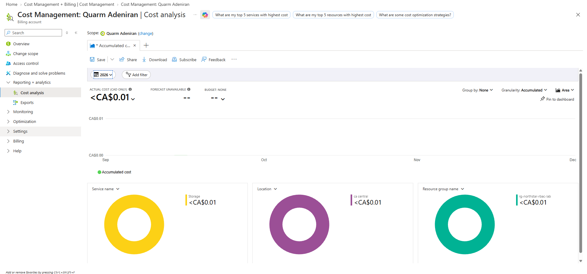
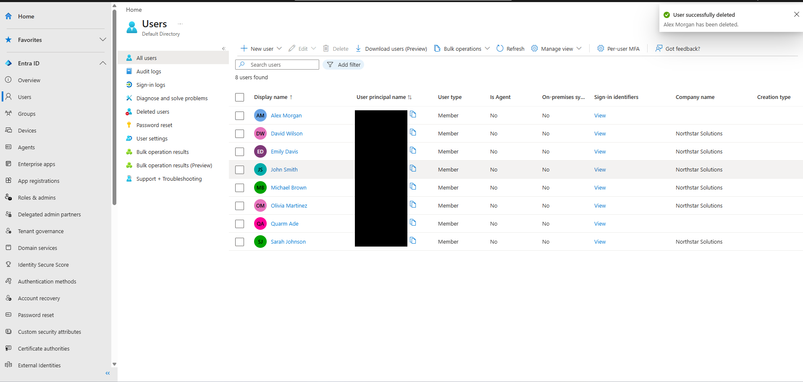
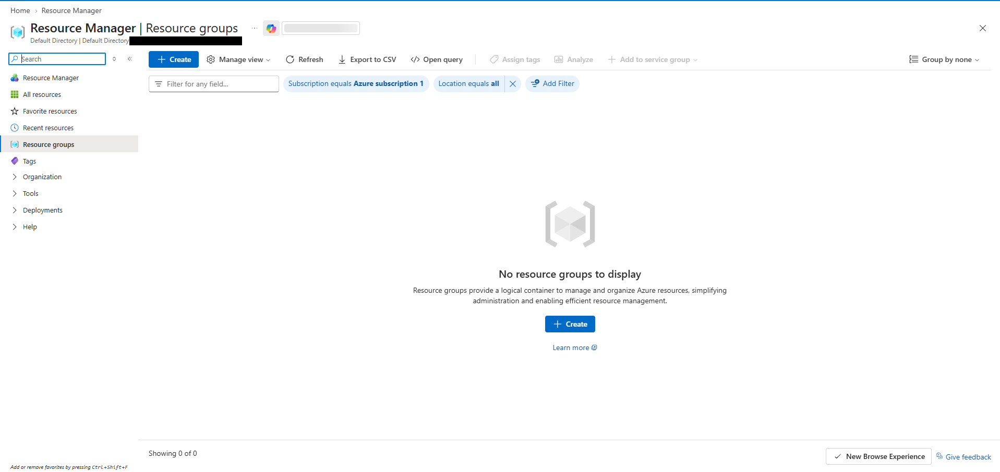
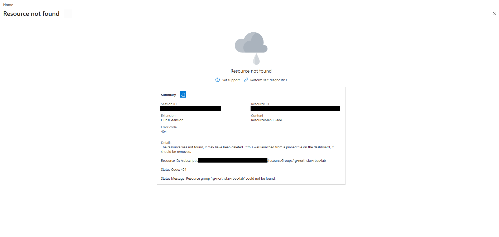

# 07 — Cost Monitoring and Cleanup

## Objective

Check what the lab cost, then remove the test account and every resource I created.

## Cost check

I opened **Cost Management → Cost analysis** at my billing account scope, using the accumulated cost view for 2026.

| Item | Value |
|---|---|
| Actual cost (CAD) | Less than CA$0.01 |
| Service | Storage, less than CA$0.01 |
| Location | Canada Central, less than CA$0.01 |
| Resource group | rg-northstar-rbac-lab, less than CA$0.01 |
| Forecast | Unavailable |
| Budget | None |

The storage account cost less than one cent while it existed, and it was the only thing showing a cost. It came out of my subscription's free credit, so it was still a real charge. Cost data in Azure isn't real-time, so this isn't necessarily the final figure for the lab. I also hadn't set a budget or cost alert.

## Cleanup

I did these in order:

**1. Removed Alex's Contributor role.** Covered in [04 — Role Removal](04-role-removal-and-verification.md).

**2. Deleted Alex Morgan.** In **Entra ID → Users**, I deleted the account and got "User successfully deleted. Alex Morgan has been deleted." The user list behind the notification still shows Alex, and I didn't capture a refreshed list afterward. Entra keeps deleted users under **Deleted users** for 30 days before removing them permanently, and I didn't check that list.

**3. Deleted the resource group.** I deleted `rg-northstar-rbac-lab`, which also removes the storage account and container inside it. Afterward:

- **Resource groups** for Azure subscription 1 showed "No resource groups to display."
- Opening the resource group's old page returned **Resource not found**, with error code 404 and the message "Resource group 'rg-northstar-rbac-lab' could not be found."

## Result

The test account and the resource group were both gone, and the lab cost less than CA$0.01 at the time I checked.

## Evidence

Cost analysis:

Alex Morgan deleted (UPN column redacted):

No resource groups left in the subscription (tenant redacted):

The old resource group page returning 404 (session ID and subscription ID redacted):

