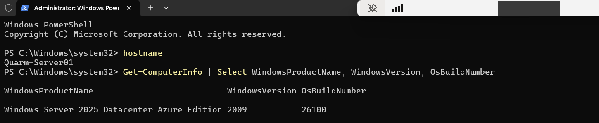
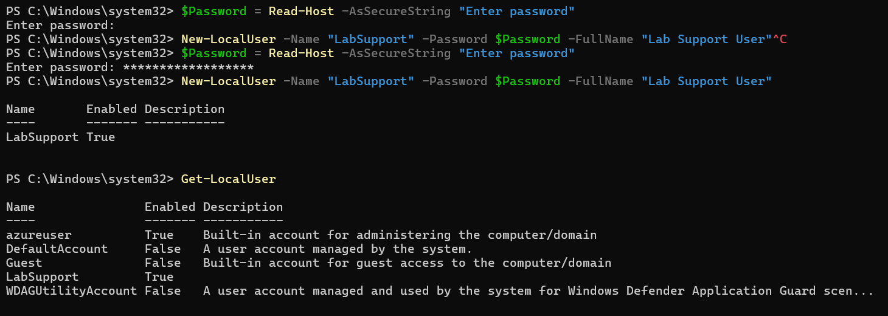
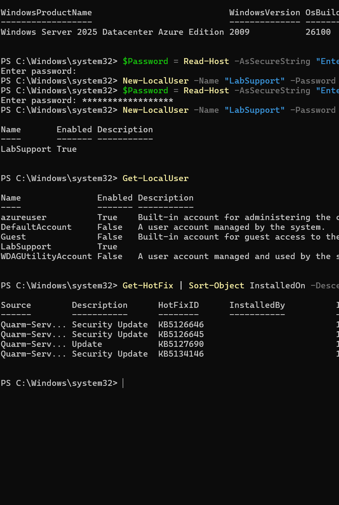
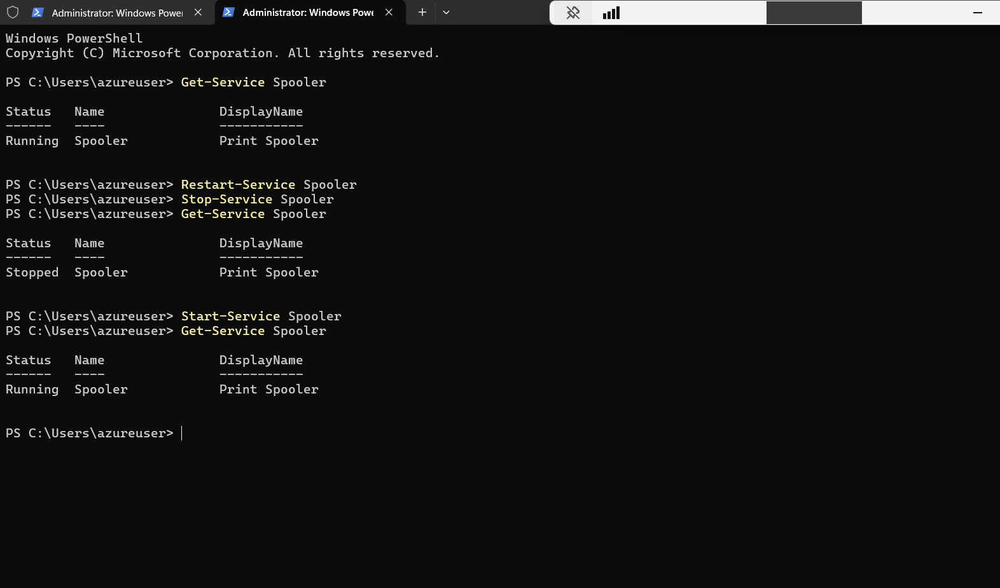

# Azure Windows Server Administration Lab

## Project Overview

This is a hands-on lab I ran in my own Azure subscription. It isn't production experience. I deployed a Windows Server 2025 virtual machine, connected to it over Remote Desktop, and did routine server administration with PowerShell: checking the OS, creating a local user, reviewing updates, and managing services. I then simulated a Print Spooler outage and restored it, checked the server's performance from inside Windows and from the Azure portal, and deleted every resource when I was done.

**Lab date:** October 31, 2026. The VM was created at 10:15 AM UTC, and my last screenshot before cleanup was taken about 30 minutes later.

More detail is in the [docs](docs/) folder:

| Document | What's in it |
|---|---|
| [Lab overview](docs/lab-overview.md) | Scope, environment, and what the lab does and doesn't cover |
| [Deployment](docs/deployment.md) | Creating the VM and connecting over RDP |
| [Administration](docs/administration.md) | OS check, local user, updates, services, and the IIS role |
| [Troubleshooting](docs/troubleshooting.md) | The simulated Print Spooler outage, written up like a ticket |
| [Monitoring](docs/monitoring.md) | Task Manager, Resource Monitor, Event Viewer, and Azure metrics |
| [Lessons learned](docs/lessons-learned.md) | What I'd keep doing and what I'd do differently |

## Objectives

- Deploy a Windows Server VM in Azure and connect to it over RDP
- Do common admin tasks from PowerShell instead of clicking through the GUI
- Work a service outage from detection through to a verified fix
- Check server health from inside the OS and from Azure Monitor
- Delete everything afterward so nothing kept running or costing money

## Environment

| Item | Value |
|---|---|
| Platform | Microsoft Azure (my own subscription), managed in the Azure portal |
| Region | Canada Central |
| Resource group | `RG-ServerLab` |
| Virtual machine | `Quarm-Server01` |
| Size | Standard D2als v7 (2 vCPUs, 4 GiB memory) |
| Operating system | Windows Server 2025 Datacenter: Azure Edition, build 26100 |
| Access | Remote Desktop (RDP) to the VM's public IP, signed in with the local administrator account |
| Tools | PowerShell, Windows Update, Task Manager, Resource Monitor, Event Viewer, Azure Monitor metrics |

## Architecture

Everything lived in one resource group in Canada Central. The VM deployment created six resources: the VM, its OS disk, a network interface, a public IP address, a network security group, and a virtual network.

```
My PC (Remote Desktop client)
        |
        |  RDP (TCP 3389) over the internet
        v
Quarm-Server01-ip            public IP address
        |
Quarm-Server01-nsg           network security group, inbound RDP allowed
        |
quarm-server01909            network interface
                             vnet-canadacentral-1 / snet-canadacentral-1
        |
Quarm-Server01               Windows Server 2025 VM + managed OS disk

All resources: resource group RG-ServerLab, Canada Central
```

## Tasks Completed

| Task | How | Evidence |
|---|---|---|
| Deployed a Windows Server 2025 VM | Azure portal | [vm-deployment.png](screenshots/vm-deployment.png), [vm-overview.png](screenshots/vm-overview.png) |
| Set administrator credentials and RDP access | VM creation settings | [vm-overview.png](screenshots/vm-overview.png) |
| Connected over Remote Desktop | RDP client | [rdp-session.png](screenshots/rdp-session.png) |
| Verified the OS and server name | `hostname`, `Get-ComputerInfo` | [powershell-system-info.png](screenshots/powershell-system-info.png) |
| Created a local user, `LabSupport` | `New-LocalUser` | [local-user.png](screenshots/local-user.png) |
| Checked and installed Windows updates, reviewed hotfixes | Windows Update, `Get-HotFix` | [windows-update.png](screenshots/windows-update.png) |
| Reviewed and restarted the Print Spooler service | `Get-Service`, `Restart-Service` | [service-troubleshooting.png](screenshots/service-troubleshooting.png) |
| Simulated and fixed a Print Spooler outage | `Stop-Service`, `Start-Service`, `Get-Service` | [service-troubleshooting.png](screenshots/service-troubleshooting.png) |
| Installed the Web Server (IIS) role | `Install-WindowsFeature` | [iis-install.png](screenshots/iis-install.png) |
| Monitored CPU, memory, disk, and network | Task Manager, Resource Monitor | [resource-monitor.png](screenshots/resource-monitor.png) |
| Reviewed the System log | Event Viewer | [event-viewer.png](screenshots/event-viewer.png) |
| Reviewed VM CPU metrics | Azure Monitor metrics | [azure-metrics.png](screenshots/azure-metrics.png) |
| Deleted all lab resources | Deleted the resource group | [resource-group.png](screenshots/resource-group.png) |

## Windows Server Administration

After signing in over RDP, I did the admin work from an elevated PowerShell session. These are the commands I ran:

```powershell
# Confirm which server I'm on and what it's running
hostname
Get-ComputerInfo | Select WindowsProductName, WindowsVersion, OsBuildNumber

# Create a local user without typing the password in plain text
$Password = Read-Host -AsSecureString "Enter password"
New-LocalUser -Name "LabSupport" -Password $Password -FullName "Lab Support User"
Get-LocalUser

# Review installed updates
Get-HotFix | Sort-Object InstalledOn -Descending

# Install and confirm the Web Server (IIS) role
Install-WindowsFeature -Name Web-Server -IncludeManagementTools
Get-WindowsFeature Web-Server
```

The server reported Windows Server 2025 Datacenter Azure Edition, build 26100. `LabSupport` was created enabled, and `Get-LocalUser` listed it alongside the built-in accounts. After installing updates through Windows Update, `Get-HotFix` listed four: KB5126646, KB5126645, KB5127690, and KB5134146. The IIS install returned `Success` with no restart needed, and `Get-WindowsFeature` showed Web Server (IIS) as Installed. I didn't go on to test IIS by loading a page.







Full write-up: [docs/administration.md](docs/administration.md)

## Troubleshooting Scenario

I used the Print Spooler service to practise a basic outage, since it's a common help desk issue when printing stops working.

1. **Simulated the outage.** I stopped the service with `Stop-Service Spooler`.
2. **Identified the stopped service.** `Get-Service Spooler` showed the status as `Stopped`.
3. **Restored it with PowerShell.** I started it again with `Start-Service Spooler`.
4. **Verified normal operation.** `Get-Service Spooler` showed `Running` again.

```powershell
Get-Service Spooler       # Running (baseline)
Restart-Service Spooler   # normal restart first
Stop-Service Spooler      # simulate the outage
Get-Service Spooler       # Stopped
Start-Service Spooler     # restore
Get-Service Spooler       # Running
```

This was a controlled simulation on a lab server with no printers or users depending on it. It shows the check, fix, and confirm steps, not a root-cause investigation.



Full write-up: [docs/troubleshooting.md](docs/troubleshooting.md)

## Monitoring

I checked the server's health from two sides:

- **Inside Windows:** Task Manager and Resource Monitor. At the moment of the screenshot, Resource Monitor showed 52% CPU usage, 72% of physical memory in use, 132 KB/sec disk I/O, and 9,824 Kbps network I/O.
- **Event Viewer:** the System log had 466 events. The recent entries were mostly Event ID 7036 from the Service Control Manager, which Windows logs when a service changes state.
- **Azure portal:** the VM's **Monitoring → Metrics** page, showing Avg Percentage CPU. The chart had a short spike just over 40% and a smaller one around 12%.

The two views complement each other. Resource Monitor shows which processes are using resources, while Azure metrics show the VM from the platform side without needing to sign in.


Full write-up: [docs/monitoring.md](docs/monitoring.md)

## Security and Cost Considerations

**Security**

- RDP was enabled only for this lab. The public IP and the network security group allowing RDP were deleted along with everything else in the resource group.
- I entered the `LabSupport` password with `Read-Host -AsSecureString`, so it never appeared in the console, command history, or screenshots.
- In every published screenshot I redacted the VM's public IP address, the subscription ID, the deployment correlation ID, my personal email address, and my tenant domain.
- Outside a lab, I wouldn't leave RDP reachable from the internet. At minimum I'd limit the inbound rule to a known source IP.

**Cost**

- The VM ran only for the length of the lab, about 30 minutes from creation to the cleanup screenshot.
- When I finished, I deleted the `RG-ServerLab` resource group, which removed the VM, OS disk, network interface, public IP, network security group, and virtual network in one step.
- The [resource-group.png](screenshots/resource-group.png) screenshot shows the six resources right before I deleted the group. I don't have a screenshot of the result after deletion.

## Skills Demonstrated

| Skill | Where it shows up |
|---|---|
| Azure Virtual Machines | Deploying `Quarm-Server01` and reviewing its overview page |
| Windows Server administration | OS checks, user management, updates, services, and roles on Server 2025 |
| PowerShell | Every admin and troubleshooting task above |
| RDP | Connecting to and managing the server remotely |
| Windows Update and patching | Installing updates and reviewing hotfixes with `Get-HotFix` |
| Windows Services | Checking, restarting, stopping, and starting the Print Spooler |
| Server monitoring | Task Manager and Resource Monitor |
| Event Viewer | Reviewing the System log and Service Control Manager events |
| Azure Monitor | Reviewing Avg Percentage CPU for the VM |
| Troubleshooting | The Print Spooler outage: detect, restore, verify |
| Local user administration | Creating `LabSupport` and listing local accounts |
| Virtualization | Running and sizing a Windows Server VM in Azure |
| Technical documentation | This README, the docs folder, and redacted evidence |

## Lessons Learned

- Commands like `Stop-Service` and `Start-Service` print nothing when they succeed. Running `Get-Service` afterward is what confirms the change.
- My first `Read-Host` password prompt was submitted empty, so I cancelled the `New-LocalUser` command and re-entered the password before creating the account.
- Event ID 7036 is where service state changes show up in the System log. Next time I'd filter for it around the outage time to tie log entries directly to the Spooler stop and start.
- 72% memory use on a 4 GiB VM with only a few admin tools open is worth noticing when choosing a VM size.
- Deleting the resource group is the simplest way to make sure nothing from a lab is left running.

More in [docs/lessons-learned.md](docs/lessons-learned.md).

## Resume Relevance

This lab lines up with tasks in junior IT support and junior systems administrator roles: connecting to servers remotely, creating accounts, checking patches, restarting and verifying services, reading event logs, and checking performance. It was a lab environment, not production, and I describe it that way.

Example resume bullet:

> Deployed a Windows Server 2025 VM in Azure (lab) and administered it over RDP with PowerShell: created local users, reviewed patches, and restored a stopped Print Spooler service, verifying it with Get-Service. Monitored performance with Resource Monitor, Event Viewer, and Azure Monitor, then deleted all resources to control cost.

## Screenshots

All screenshots are in [screenshots/](screenshots/). The [screenshots README](screenshots/README.md) lists what each one shows and what was redacted.
