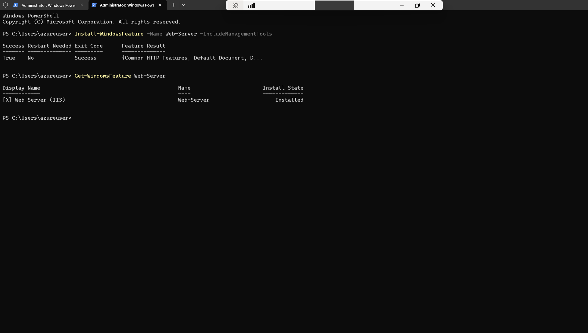

# Windows Server Administration

## Objective

Do routine admin tasks on the server from PowerShell: confirm the OS, create a local user, review updates, manage a service, and add a server role.

All of these ran in an elevated PowerShell session inside the RDP connection.

## 1. Verify the server and OS

```powershell
hostname
Get-ComputerInfo | Select WindowsProductName, WindowsVersion, OsBuildNumber
```

| Field | Result |
|---|---|
| Hostname | `Quarm-Server01` |
| WindowsProductName | Windows Server 2025 Datacenter Azure Edition |
| WindowsVersion | 2009 |
| OsBuildNumber | 26100 |

`WindowsVersion` reports 2009 on current Windows releases, so the build number is the more useful value here.


## 2. Create a local user

```powershell
$Password = Read-Host -AsSecureString "Enter password"
New-LocalUser -Name "LabSupport" -Password $Password -FullName "Lab Support User"
Get-LocalUser
```

`Read-Host -AsSecureString` keeps the password out of the console and command history. The first time, the prompt was submitted empty, so I cancelled the `New-LocalUser` command with Ctrl+C, ran the prompt again, and then created the account.

`New-LocalUser` returned `LabSupport` with `Enabled` set to `True`. `Get-LocalUser` then listed it with the built-in accounts: the administrator account, DefaultAccount, Guest, and WDAGUtilityAccount, the last three disabled.


## 3. Windows updates and hotfixes

I checked for updates in Windows Update and installed what was available, then listed the installed hotfixes:

```powershell
Get-HotFix | Sort-Object InstalledOn -Descending
```

| HotFixID | Description |
|---|---|
| KB5126646 | Security Update |
| KB5126645 | Security Update |
| KB5127690 | Update |
| KB5134146 | Security Update |


## 4. Windows services

I used the Print Spooler service for service management:

```powershell
Get-Service Spooler
Restart-Service Spooler
```

The service started out `Running`, and I restarted it once as a normal maintenance step. I then used the same service for the simulated outage in [troubleshooting.md](troubleshooting.md).

## 5. Install the Web Server (IIS) role

```powershell
Install-WindowsFeature -Name Web-Server -IncludeManagementTools
Get-WindowsFeature Web-Server
```

The install returned `Success` with `Restart Needed: No`. `Get-WindowsFeature` showed `[X] Web Server (IIS)` with an install state of `Installed`. I confirmed the role was installed but didn't test it by browsing to a page.


