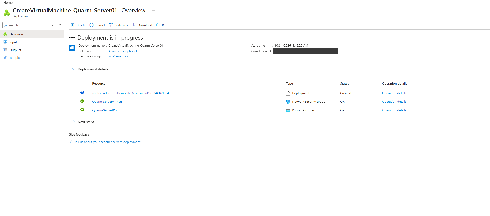
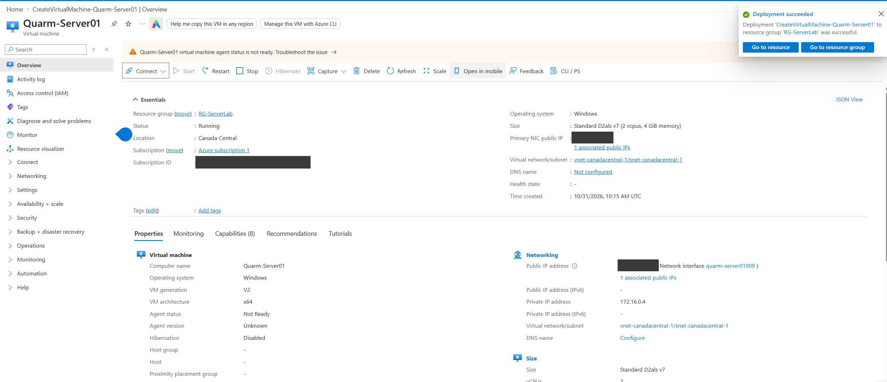
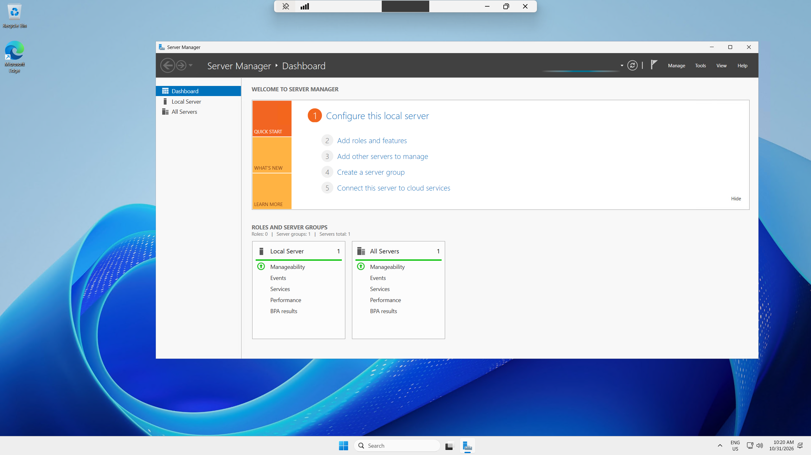
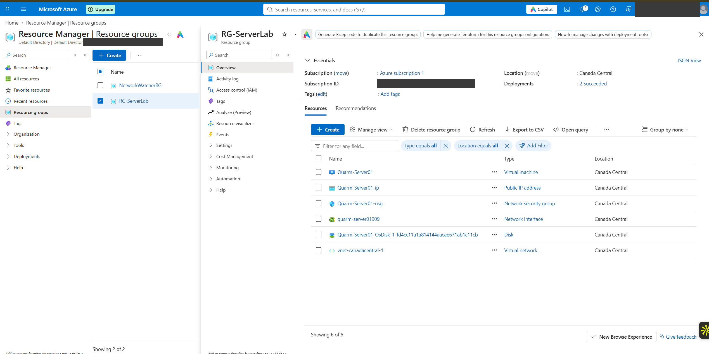

# Deployment

## Objective

Create a Windows Server 2025 VM in Azure and connect to it over Remote Desktop.

## Creating the VM

In the Azure portal I created a virtual machine with these settings:

| Setting | Value |
|---|---|
| Resource group | `RG-ServerLab` |
| VM name | `Quarm-Server01` |
| Region | Canada Central |
| Image | Windows Server 2025 Datacenter: Azure Edition |
| Size | Standard D2als v7 (2 vCPUs, 4 GiB memory) |
| Administrator account | Local admin username and password set during creation |
| Inbound ports | RDP allowed, so I could connect |

The deployment, `CreateVirtualMachine-Quarm-Server01`, started at 4:15 AM my local time. While it ran, the portal showed the network security group and public IP being created, along with a separate deployment for the virtual network.

When it finished, the VM overview showed:

- Status: Running
- Location: Canada Central
- Size: Standard D2als v7 (2 vCPUs, 4 GiB memory)
- Virtual network/subnet: `vnet-canadacentral-1/snet-canadacentral-1`
- Time created: 10/31/2026, 10:15 AM UTC

The screenshot was taken right after deployment, while the VM agent status still showed Not Ready.

## Resources created

The resource group ended up with six resources, all in Canada Central:

| Resource | Type |
|---|---|
| `Quarm-Server01` | Virtual machine |
| `Quarm-Server01-ip` | Public IP address |
| `Quarm-Server01-nsg` | Network security group |
| `quarm-server01909` | Network interface |
| `Quarm-Server01_OsDisk_1_...` | Disk |
| `vnet-canadacentral-1` | Virtual network |

## Connecting over RDP

I connected with the Remote Desktop client using the VM's public IP address and the administrator account I set during creation. Server Manager opened on sign-in and showed the local server with no roles installed yet.

## Cleanup

After finishing the rest of the lab, I deleted `RG-ServerLab`. Deleting the resource group removes everything in it, so the VM, disk, network interface, public IP, NSG, and virtual network all went with it. The screenshot below shows the group's contents right before I deleted it.

