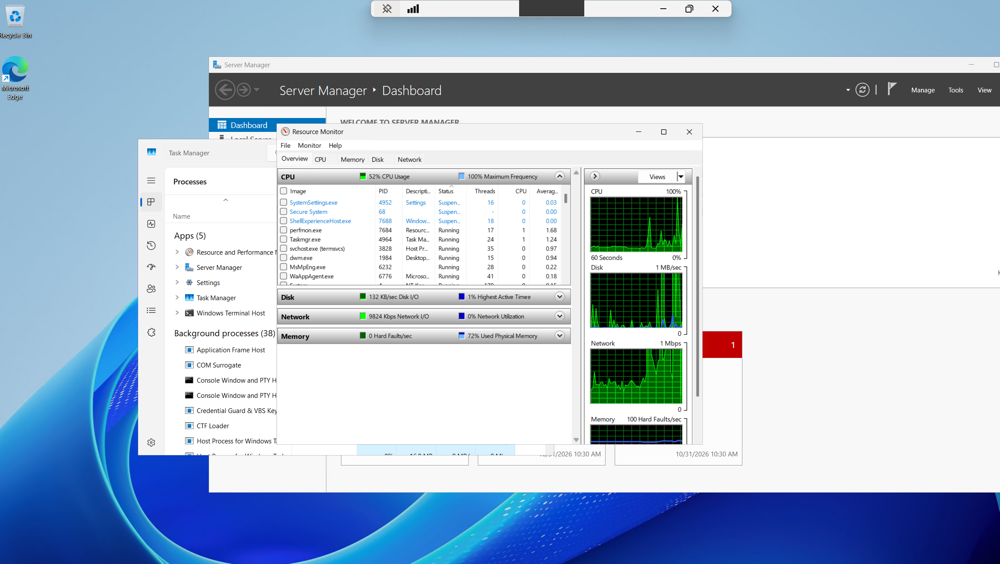
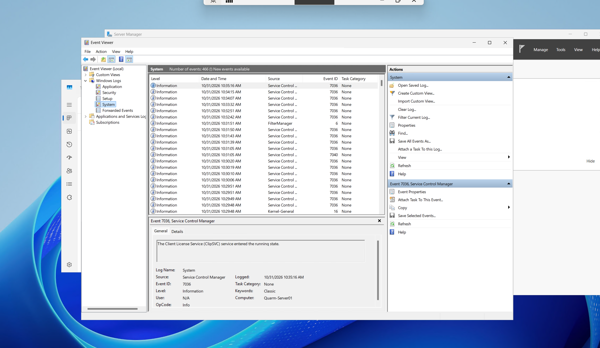
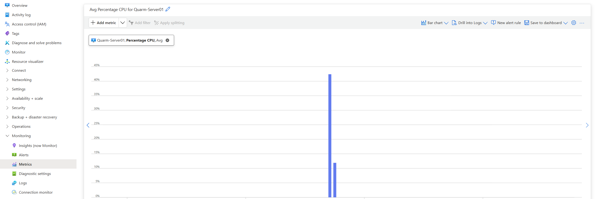

# Monitoring

## Objective

Check the server's resource use and logs from inside Windows, and compare that with what Azure reports for the VM.

## Task Manager and Resource Monitor

I opened Task Manager and then Resource Monitor to look at CPU, memory, disk, and network activity. Resource Monitor's overview showed these readings when I took the screenshot:

| Resource | Reading |
|---|---|
| CPU | 52% usage, 100% maximum frequency |
| Memory | 72% physical memory used, 0 hard faults/sec |
| Disk | 132 KB/sec disk I/O, 1% highest active time |
| Network | 9,824 Kbps network I/O, 0% network utilization |

These are a single moment, not an average. The open apps at the time were Server Manager, Task Manager, Resource Monitor, Settings, and Windows Terminal. Of the processes visible in the CPU list, `perfmon.exe` (Resource Monitor) and `Taskmgr.exe` had the highest average CPU.

## Event Viewer

In **Event Viewer → Windows Logs → System**, the log had 466 events. The most recent ones were almost all Information-level Event ID 7036 entries from the Service Control Manager, plus a 7040, a FilterManager event 6, and a Kernel-General event 16. Event 7036 is logged each time a service enters the running or stopped state. The one I opened read "The Client License Service (ClipSVC) service entered the running state."

## Azure Monitor metrics

In the Azure portal, I opened the VM's **Monitoring → Metrics** page and viewed **Avg Percentage CPU** for `Quarm-Server01`. The chart showed a short spike just over 40% and a smaller bar around 12%, with no other data in the time range shown.

## Inside the VM vs. the Azure portal

| | Task Manager / Resource Monitor | Azure Monitor metrics |
|---|---|---|
| Needs sign-in to the server | Yes | No |
| Shows individual processes | Yes | No |
| History | Short-term, while the tool is open | Kept in the portal |

Resource Monitor answers "what's using the CPU right now". Azure metrics answer "how busy has this VM been", even when nobody is signed in.
