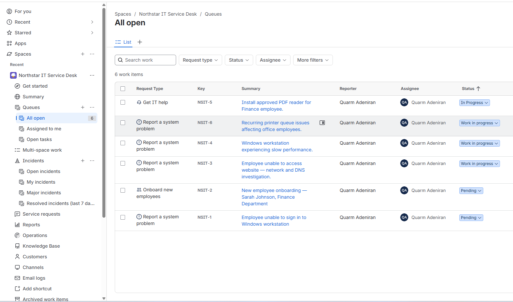
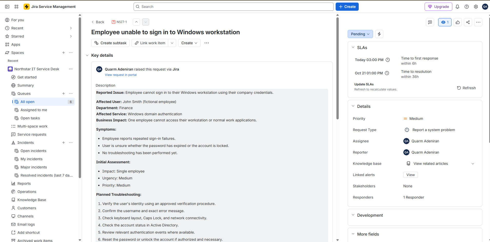

# Enterprise Help Desk Simulation

I set up an IT service desk in Jira Service Management Cloud for Northstar Solutions, a fictional 50-person company, and worked through six tickets as a Tier 1 technician. The company, employees, and their reported problems are made up. The troubleshooting was real: I ran the checks on my Active Directory lab server or on my own Windows 11 laptop, and every result below comes from those tests.

None of the tickets are closed. In each case I could check the systems I had access to, but I couldn't confirm with the "employee" that their problem was gone, so they're still sitting at Pending or Work in progress in Jira. I'd rather leave them open than mark them resolved without proof.

## Setup

- Created the **Northstar IT Service Desk** project (key `NSIT`) from Jira's IT Service Management template
- Used the built-in request types (Get IT help, Report a system problem, Onboard new employees)
- Used the default SLAs. For example, NSIT-1 had a 6-hour first-response target and a 36-hour resolution target
- Assigned every ticket to myself

## Tickets

| Ticket | Issue | What I actually did | Jira status |
|---|---|---|---|
| [NSIT-1](tickets/NSIT-1-windows-login.md) | Employee can't sign in to Windows | Checked the AD account with PowerShell, reviewed Event ID 4625 logs, reset the password | Pending |
| [NSIT-2](tickets/NSIT-2-employee-onboarding.md) | New hire onboarding | Logged and scoped the request; no account was created | Pending |
| [NSIT-3](tickets/NSIT-3-network-troubleshooting.md) | Can't reach a website | Ran `ipconfig /all`, `ping`, `nslookup`, and `tracert`; all succeeded | Work in progress |
| [NSIT-4](tickets/NSIT-4-windows-performance.md) | Slow workstation | Reviewed Task Manager; CPU and disk low, memory at 78% | Work in progress |
| [NSIT-5](tickets/NSIT-5-software-installation.md) | Needs a PDF reader | Found Adobe Acrobat already installed and opened a PDF; nothing installed | In Progress |
| [NSIT-6](tickets/NSIT-6-printer-investigation.md) | Recurring printer problems | Print Spooler running (Automatic); print queue empty | Work in progress |

## Knowledge base

Each article is based on one of the tickets:

- [KB-001 — Active Directory Password Reset](knowledge-base/KB-001-password-reset.md)
- [KB-002 — Network and DNS Troubleshooting](knowledge-base/KB-002-network-troubleshooting.md)
- [KB-003 — Printer and Print Spooler Troubleshooting](knowledge-base/KB-003-printer-troubleshooting.md)

## Tools

Jira Service Management, Active Directory Users and Computers, PowerShell (`Get-ADUser`, `Get-WinEvent`), Event Viewer, Command Prompt networking tools, Task Manager, `services.msc`, Windows Settings.

## Screenshots

**Service desk queue** — all six tickets and their current status:

**SLA tracking on NSIT-1:**

Each ticket report has its own screenshots, and all of them are in the [evidence folder](evidence/).
