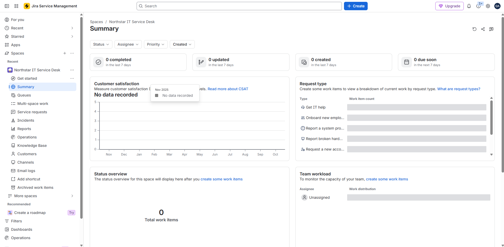
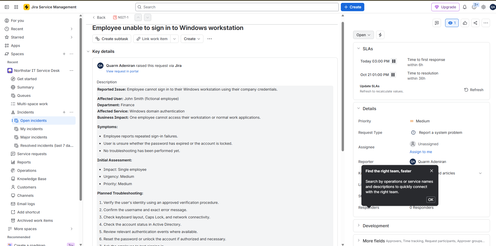
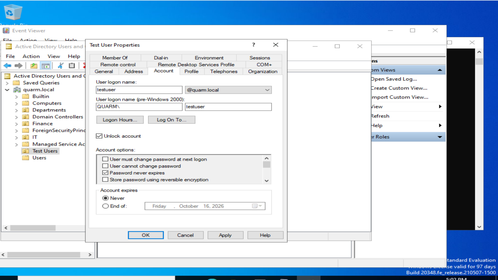
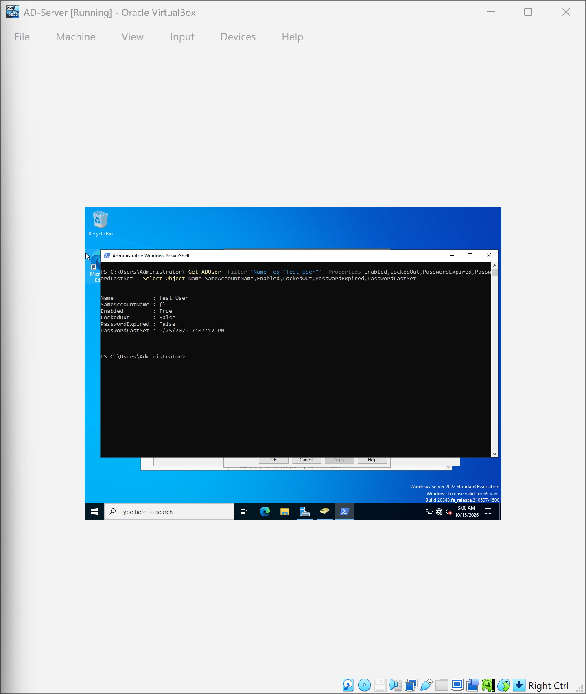
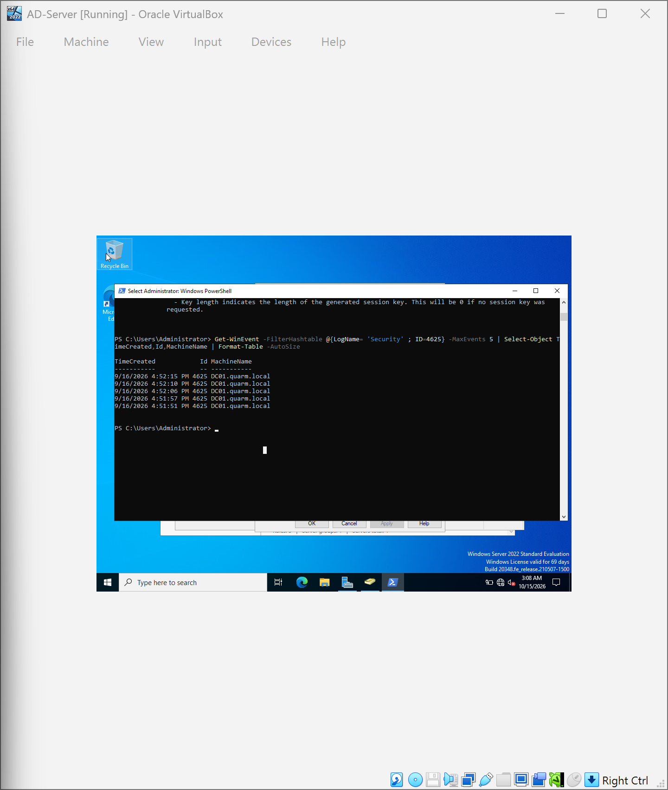
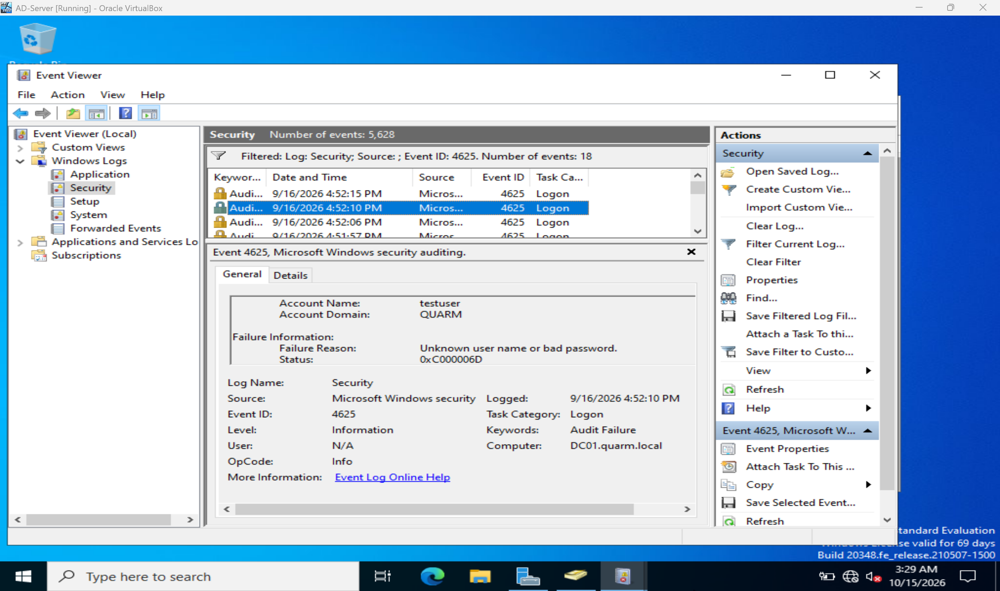
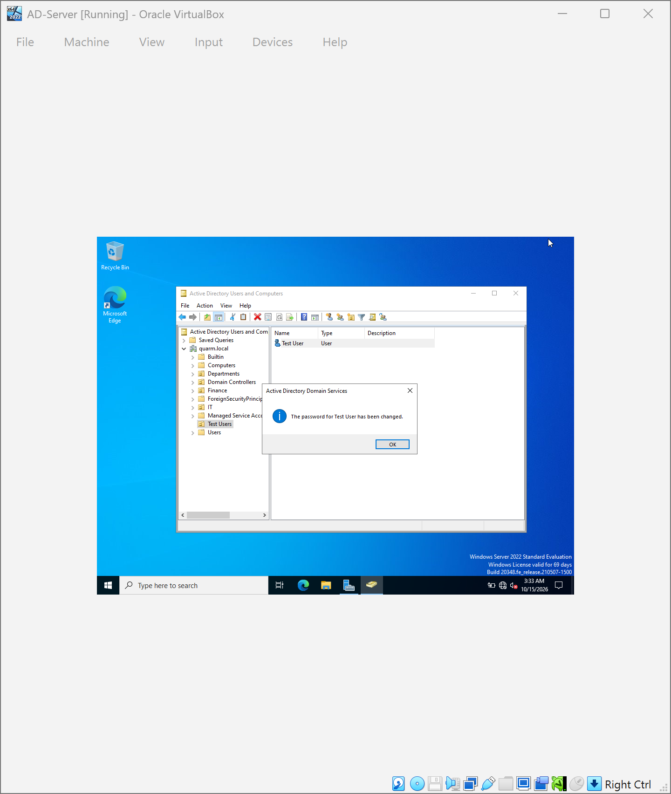

# NSIT-1 — Windows Domain Login Investigation

## Incident Overview

**Organization:** Northstar Solutions (fictional)  
**Environment:** Windows Server 2022 / Active Directory  
**Domain:** quarm.local  
**Ticketing platform:** Jira Service Management  
**Ticket reference:** NSIT-1
**Classification:** Incident  
**Impact:** Single user  
**Urgency:** Medium  
**Jira Status:** Pending — Awaiting user sign-in verification
**Lab Exercise Status:** Password-reset procedure completed
**Root Cause:** Not conclusively established

## Business Scenario

A fictional Finance employee reported being unable to sign in to their Windows workstation using domain credentials.

As the simulated Level 1 IT Support Technician, I investigated the account's status, reviewed available authentication logs, and performed an administrative password-reset exercise.

## Investigation

### 1. Account Identification

Opened Active Directory Users and Computers and located the Test User account under the Test Users organizational unit.

### 2. Account Status Verification

Used the Active Directory PowerShell module to check the account.

**Verified results:**

| Property | Result |
|---|---|
| Enabled | True |
| LockedOut | False |
| PasswordExpired | False |
| PasswordLastSet | June 25, 2026 |

The account was active, not locked, and its password was not expired.

### 3. Authentication Log Investigation

Queried Windows Security Event ID 4625 on the domain controller.

Five historical failed-logon events were identified on DC01.quarm.local, dated September 16, 2026.

The events were reviewed using Windows Event Viewer.

These historical events were not conclusively linked to the fictional employee's reported sign-in problem.

### 4. Corrective Action

Performed an administrative password reset for the test account using Active Directory Users and Computers.

The password-reset operation completed successfully.

### 5. Verification and Limitations

The administrative password-reset operation was confirmed.

A successful interactive sign-in from a domain-joined Windows workstation was not tested.

The root cause of the simulated sign-in problem was not conclusively established.

## ITIL Incident Management

The exercise demonstrated:

- Incident registration and prioritization
- Initial investigation and diagnosis
- Account-status verification
- Authentication-log review
- Administrative account recovery
- Internal ticket documentation
- Recording verification limitations

## Evidence

### 01 — Jira Service Desk Setup

### 02 — Incident Created

### 03 — Active Directory User Properties

### 04 — Account Status Verification

### 05 — Authentication Event Check

### 06 — Failed Login Analysis

### 07 — Password Reset Confirmation

## Conclusion

This simulated incident demonstrated a structured Level 1 IT support investigation using Jira Service Management, Active Directory, PowerShell, and Windows Event Viewer.

The account recovery procedure was completed, while workstation authentication verification and definitive root-cause identification remained outside the completed scope.

**Disclaimer:** This is a training simulation, not a production support incident.
