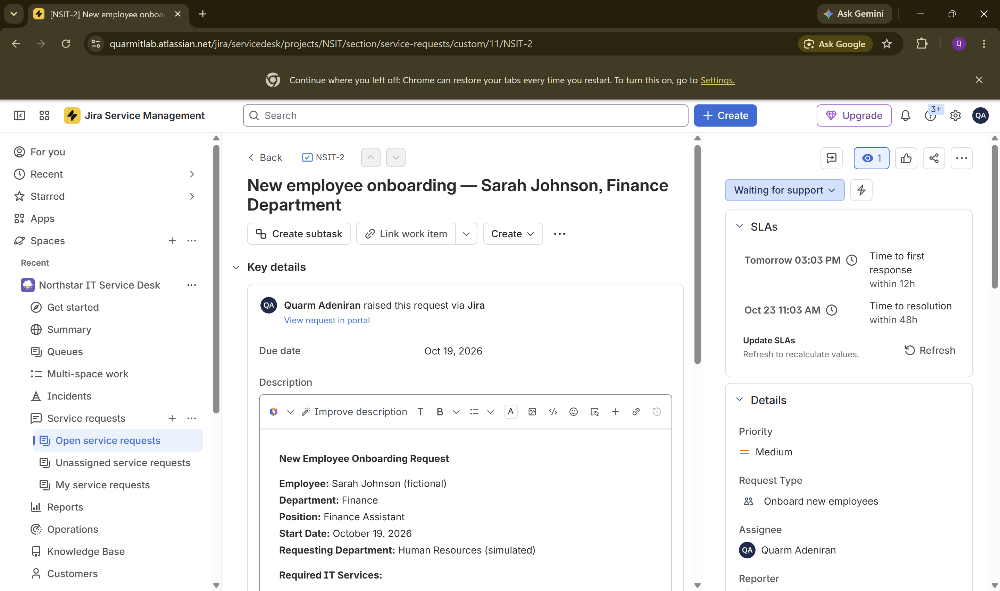

# NSIT-2 — New Employee Onboarding

**Type:** Service request (Onboard new employees) · **Priority:** Medium · **Jira status:** Pending

## The request

HR (simulated) sent in an onboarding request for "Sarah Johnson", a fictional Finance Assistant starting October 19, 2026. The request asked for:

- A user account
- Membership in the approved Finance security group
- Microsoft 365 access
- A prepared workstation with the needed applications
- Confirmation that everything worked before her first day

## What I did

This ticket was about the intake and request-handling side of onboarding, not the technical setup. I:

- Logged the request in Jira under the **Onboard new employees** request type
- Set the due date to the start date (Oct 19, 2026) and assigned it to myself
- Noted the SLA targets Jira applied: 12 hours to first response, 48 hours to resolution

I didn't create an account, add anyone to a group, or set up Microsoft 365 or a workstation. There was no manager approval either, since the requester and approver are both fictional. In a real onboarding I'd wait for that approval before touching any accounts, then verify access with the new hire before closing the request.

## Result

The request is logged and tracked but not fulfilled. It's in **Pending** status in Jira.

## Screenshot

