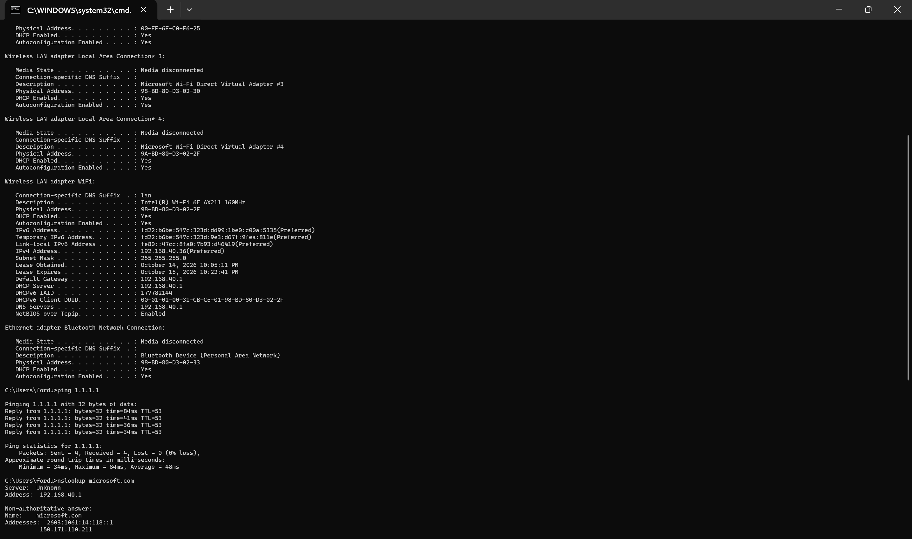

# NSIT-3 — Network and DNS Troubleshooting

## Ticket Information

**Jira Ticket:** NSIT-3 (confirm actual ID)  
**Organization:** Northstar Solutions (fictional)  
**Classification:** Incident  
**Priority:** Medium  
**ITIL Practice:** Incident Management  
**Status:** In Progress

## Business Scenario

A fictional Sales employee reports being unable to access a business website. A Level 1 IT support investigation is initiated to evaluate network connectivity and DNS resolution.

## Tools Used

- Windows Command Prompt
- `ipconfig /all`
- `ping`
- `nslookup`
- `tracert` 
- Jira Service Management

## Investigation and Findings

| Diagnostic Test | Result | Interpretation |
|---|---|---|
| IPv4 configuration | 192.168.40.3/24 | Private IPv4 address configured |
| Default gateway | 192.168.40.1 | Gateway configured |
| DNS server | 192.168.40.1 | DNS server configured |
| External IP ping | 4/4 replies, 0% packet loss | Successful ICMP connectivity |
| Average latency | 48 ms | External endpoint responded |
| DNS lookup | microsoft.com resolved successfully | DNS resolution functioning for tested hostname |

## Technical Assessment

The local Windows workstation successfully communicated with an external IP address and resolved a public hostname.

The diagnostic results did not reveal an external IP connectivity or DNS resolution failure on the tested workstation.

Because the affected employee is fictional and their workstation was not tested, the original incident remains unverified.

## Outcome

**Lab diagnostic exercise:** Completed.

**Incident resolution:** Not confirmed.

**Root cause:** Not established for the fictional reported issue.

## Evidence

## Skills Demonstrated

- Windows network configuration analysis
- IPv4 addressing and default gateway identification
- ICMP connectivity testing
- DNS troubleshooting
- Incident documentation
- ITIL-aligned service desk investigation

---

*This project uses a fictional service desk scenario and actual diagnostic testing on a personal Windows workstation.*
