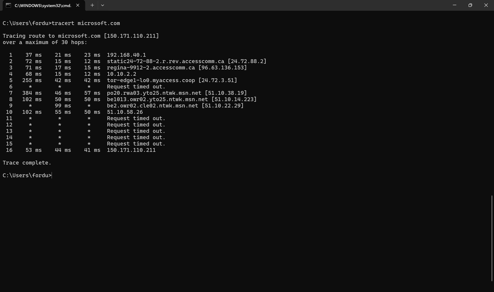

# NSIT-3 — Can't Access a Website (Network and DNS)

**Type:** Incident · **Priority:** Medium · **Jira status:** Work in progress

## The ticket

A fictional Sales employee reported that they couldn't reach a business website. I worked through the basic connectivity checks on my own Windows 11 laptop. The employee's machine doesn't exist, so these results show how my laptop behaved, not theirs.

## What I ran

**`ipconfig /all`** — checked the Wi-Fi adapter (Intel Wi-Fi 6E AX211):

| Setting | Value |
|---|---|
| IPv4 address | 192.168.40.36 |
| Subnet mask | 255.255.255.0 |
| Default gateway | 192.168.40.1 |
| DHCP server | 192.168.40.1 |
| DNS server | 192.168.40.1 |

The address came from DHCP, and the gateway, DHCP server, and DNS server were all the same local router (192.168.40.1).

**`ping 1.1.1.1`** — 4 sent, 4 received, 0% loss. Round-trip times were 34–84 ms, averaging 48 ms. That confirmed basic internet connectivity by IP, without involving DNS.

**`nslookup microsoft.com`** — the router (192.168.40.1) answered and returned `150.171.110.211` plus an IPv6 address. So DNS resolution was working.

**`tracert microsoft.com`** — reached `150.171.110.211` at hop 16 with "Trace complete." The final hop answered in 53, 44, and 41 ms. Hops 6 and 11–15 timed out. I didn't treat that as a fault, because the trace still finished and a lot of routers just don't reply to traceroute probes.

## Result

Nothing failed. IP connectivity, DNS, and routing to an external site all worked from my laptop. That rules out a general internet or DNS outage on this kind of setup, but it doesn't explain the user's problem. With a real user, my next questions would be which site they were trying to reach, what error they saw, and whether other sites worked.

The ticket stays in **Work in progress** because there's no real user's machine to test or confirm a fix on.

## Screenshots

`ipconfig /all`, `ping`, and `nslookup` output:

`tracert` to microsoft.com:

Related KB article: [KB-002 — Network and DNS Troubleshooting](../knowledge-base/KB-002-network-troubleshooting.md)
