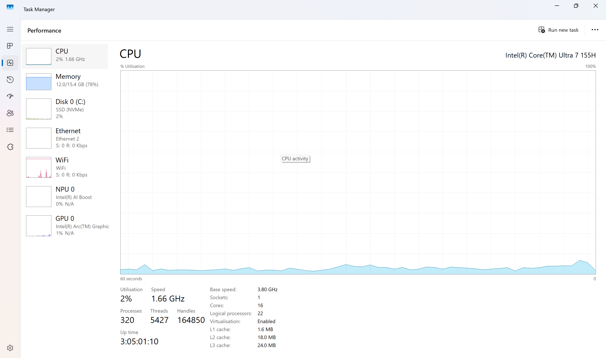
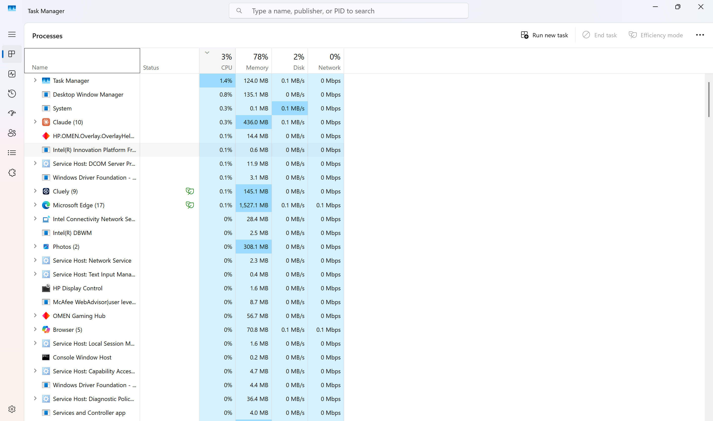

# NSIT-4 — Windows Performance Troubleshooting

## Project Overview

This lab simulates a Level 1 IT support investigation into a Windows workstation experiencing slow performance.

The objective is to use built-in Windows diagnostic tools to identify resource utilization patterns, investigate potential performance bottlenecks, and document findings through an ITIL-aligned service desk workflow.

## Ticket Information

| Field | Value |
|---|---|
| Jira Ticket | NSIT-4 (verify actual ticket ID) |
| Organization | Northstar Solutions (fictional) |
| Ticket Type | Incident |
| Priority | Medium |
| ITIL Practice | Incident Management |
| Status | In Progress |
| Environment | Windows 11 workstation |

## Reported Issue

A fictional Administration employee reports that their workstation experiences slow application launches and reduced responsiveness during routine work.

The support technician is tasked with reviewing system performance and identifying possible contributing factors.

## Tools Used

- Windows Task Manager
- Performance monitoring
- Running process inspection
- Jira Service Management

## Investigation Procedure

### 1. CPU Utilization

Opened Task Manager using `Ctrl + Shift + Esc` and navigated to the Performance tab.

**Observed CPU:** Intel Core Ultra 7 155H  
**Utilization:** Approximately 2–3%

CPU activity was low during the observation period.

### 2. Memory Utilization

Reviewed memory consumption in Task Manager.

**Memory in use:** 12.0 GB  
**Usable memory:** 15.4 GB  
**Utilization:** 78%

Memory utilization was relatively elevated and may warrant further investigation if the device experiences slowdowns.

### 3. Disk Utilization

Reviewed disk activity in Task Manager.

**Storage type:** NVMe SSD  
**Observed disk activity:** Approximately 2%

No sustained disk activity bottleneck was evident in the captured observation.

### 4. Running Processes

Inspected the Processes tab to identify applications consuming system resources.

| Application | Approximate Memory Usage |
|---|---|
| Microsoft Edge | 1,527 MB |
| Claude | 436 MB |
| Photos | 308 MB |

The system displayed approximately 320 running processes.

## Technical Assessment

CPU and disk utilization were low during testing.

Memory utilization was relatively high at 78%, with multiple applications consuming memory.

The screenshots did not establish a definitive cause of slow performance. Further investigation would require observing resource usage while symptoms occur.

## Actions Completed

- [x] Opened Windows Task Manager
- [x] Inspected CPU utilization
- [x] Inspected memory utilization
- [x] Inspected disk activity
- [x] Reviewed running processes
- [x] Documented diagnostic findings
- [ ] Confirmed root cause
- [ ] Verified resolution of the fictional employee's issue

## Outcome

**Technical diagnostic exercise:** Completed.

**Root cause:** Not conclusively established.

**Incident resolution:** Not verified.

The investigation demonstrates how a Level 1 support technician can use built-in Windows tools to evaluate workstation performance and document findings.

## Evidence

### Performance Overview

### Running Processes

## Skills Demonstrated

- Windows 11 troubleshooting
- Task Manager and system monitoring
- CPU, memory, and disk analysis
- Application resource investigation
- Technical documentation
- ITIL Incident Management
- Jira Service Management

---

*This is a fictional service desk scenario supported by real diagnostic observations from a personal Windows workstation.*
