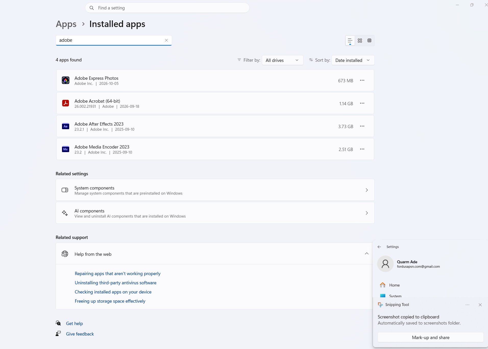
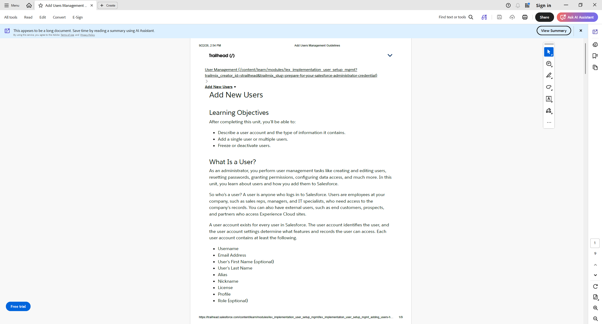

# NSIT-5 — Software Installation and Verification

## Project Overview

This exercise simulates a Level 1 IT support request for a PDF reader. The technician checks software inventory, confirms whether installation is required, and performs an application functionality test.

## Ticket Information

**Jira Ticket:** NSIT-5 (verify actual ticket ID)  
**Ticket Type:** Service Request  
**ITIL Practice:** Service Request Management  
**Environment:** Windows 11 workstation  
**Status:** In Progress

## Business Scenario

A fictional Finance employee requests a PDF reader to open and review business documents.

The technician must confirm whether an approved application is already available before attempting a new installation.

## Software Inventory Investigation

Navigated to:

**Windows Settings → Apps → Installed apps**

Searched for Adobe applications.

### Findings

| Attribute | Result |
|---|---|
| Application | Adobe Acrobat (64-bit) |
| Version | 26.002.21931 |
| Installation date | September 18, 2026 |
| Installed size | 1.14 GB |
| Installation required | No, application already present |

## Functional Verification

**Procedure:**
1. Launch Adobe Acrobat.
2. Open a sample PDF document.
3. Verify that the document renders correctly.

**Result:** [Record actual test outcome.]

## Technical Assessment

Adobe Acrobat was already installed on the tested workstation.

This demonstrates the importance of verifying existing software before attempting installations, avoiding unnecessary changes and duplicate software.

## Outcome

**Software inventory check:** Completed.

**Functional verification:** [Record actual result.]

**New installation performed:** No.

**Production request fulfilled:** Not verified; the employee and corporate environment are fictional.

## Evidence

### Installed Software

### Functional Test

## Skills Demonstrated

- Windows software inventory
- Application troubleshooting
- Software request assessment
- Functional verification
- ITIL Service Request Management
- Jira Service Management
- Technical documentation

---

*This exercise uses a fictional service request and actual software verification on a personal Windows workstation.*
