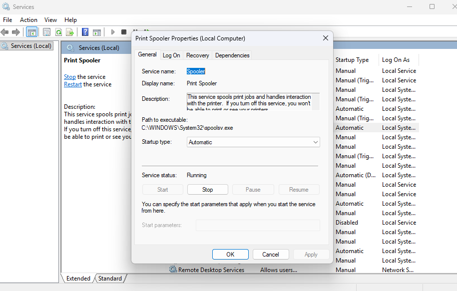

# NSIT-6 — Windows Printer Troubleshooting

## Project Overview

This lab simulates a Level 1 IT support investigation into recurring printer issues affecting employees in a fictional organization.

The objective is to inspect Windows printing services, assess potential causes, and document troubleshooting findings using an ITIL-aligned incident management workflow.

## Ticket Information

| Field | Value |
|---|---|
| Jira Ticket | NSIT-6 (verify actual ticket ID) |
| Organization | Northstar Solutions (fictional) |
| Ticket Type | Incident |
| Priority | Medium |
| ITIL Practices | Incident Management / Problem Management |
| Status | In Progress |
| Environment | Windows workstation |

## Business Scenario

Multiple fictional employees report intermittent printing failures. Documents may remain in the print queue or fail to reach a shared office printer.

The support technician begins investigating whether the Windows Print Spooler service could be contributing to the issue.

## Tools Used

- Windows Services (`services.msc`)
- Print Spooler service properties
- Windows printer settings
- Jira Service Management

## Investigation Procedure

### 1. Open Windows Services

Pressed `Windows + R`, entered `services.msc`, and opened the Services management console.

### 2. Inspect Print Spooler

Located the **Print Spooler** service and opened its Properties window.

### 3. Record Service Configuration

| Attribute | Observation |
|---|---|
| Service name | Spooler |
| Display name | Print Spooler |
| Startup type | Automatic |
| Service status | Running |
| Executable | `C:\Windows\System32\spoolsv.exe` |

### 4. Printer Queue Investigation

**Printer inspected:** [Enter actual printer name or Not tested]

**Queue status:** [Enter actual observation or Not tested]

**Pending jobs:** [Enter actual observation or Not tested]

## Technical Assessment

The Print Spooler service was running and configured for automatic startup.

This indicates that the service was operational at the time of inspection. It does not rule out intermittent spooler failures, printer connectivity issues, driver problems, or stuck print jobs.

Further investigation would require access to the affected printer and its print queue.

## Actions Completed

- [x] Opened Windows Services
- [x] Located the Print Spooler service
- [x] Verified service startup configuration
- [x] Verified service running status
- [x] Documented diagnostic findings
- [x] Confirmed printer queue status
- [ ] Identified root cause
- [ ] Verified resolution of the fictional incident

## ITIL Application

**Incident Management:** Investigated a reported disruption to office printing.

**Problem Management:** Recurring incidents may warrant a separate problem record to investigate their underlying cause.

**Escalation:** Printer hardware, network connectivity, and driver issues may require additional support if initial troubleshooting is inconclusive.

## Outcome

**Print Spooler diagnostic check:** Completed.

**Root cause:** Not established.

**Incident resolution:** Not verified.

The exercise demonstrates how to inspect Windows printing services and document troubleshooting findings accurately.

## Evidence

### Print Spooler Service

###Printer Queue Investigation

Opened the Windows Print Queue to inspect pending print jobs.

**Observed status:** No print jobs.

**Pending jobs:** None visible.

**Stuck jobs:** None observed.

**Assessment:** No print queue backlog was present during testing. This does not rule out intermittent printing problems or issues affecting a different printer.

### Evidence — Printer Queue

## Skills Demonstrated

- Windows Services administration
- Print Spooler troubleshooting
- Printer incident investigation
- Windows support diagnostics
- ITIL Incident Management
- ITIL Problem Management concepts
- Jira Service Management
- Technical documentation

---

*This is a fictional service desk scenario supported by real Windows diagnostic observations.*
