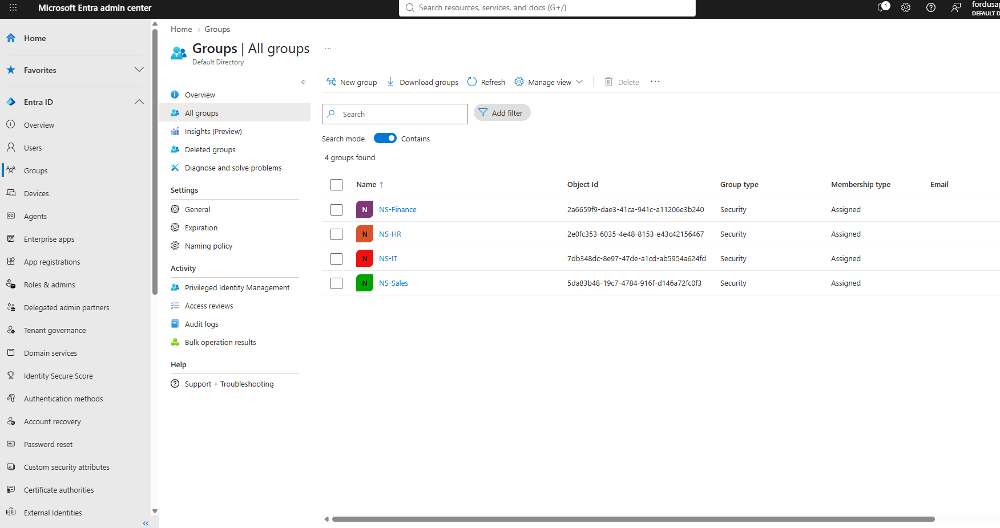
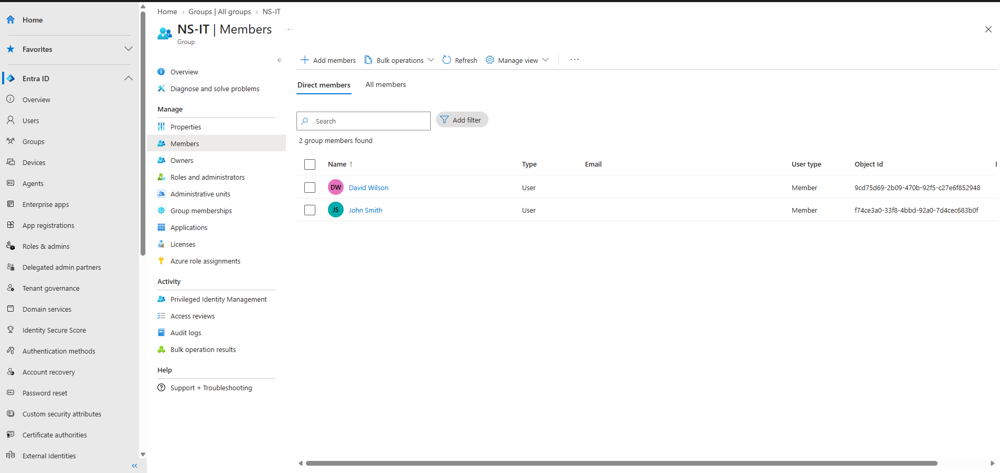

# Microsoft Entra ID Administration

I set up my own Microsoft Entra tenant and worked through the identity tasks a help desk or junior admin handles most often: creating users and groups, resetting a password, assigning an admin role, onboarding a new hire, and offboarding someone who's leaving. I also reviewed the tenant's authentication settings and checked my changes in the audit logs.

Northstar Solutions and its employees are fictional, and so are the reasons behind each task (a forgotten password, a new hire, someone leaving). The accounts, groups, role assignment, and changes are real. I made them in my tenant through the Microsoft Entra admin center, and the screenshots show the results.

## Environment

- **Tenant:** my own Microsoft Entra tenant ("Default Directory"), managed through the Microsoft Entra admin center
- **Admin account:** my own account, which I used for every change
- **Test users:** five fictional Northstar Solutions employees, plus one more added during onboarding

## What I did

### Users and groups

I created five member accounts with the company name set to Northstar Solutions: David Wilson, Emily Davis, John Smith, Michael Brown, and Sarah Johnson.

I then created four security groups with assigned (manual) membership: **NS-IT**, **NS-HR**, **NS-Finance**, and **NS-Sales**. I added employees to the groups and checked the Members page for each one I documented:

| Group | Members |
|---|---|
| NS-IT | David Wilson, John Smith |
| NS-Finance | Sarah Johnson (and Olivia Martinez after onboarding) |
| NS-Sales | Michael Brown, until I removed him during offboarding (the published screenshot shows the group empty afterward) |
| NS-HR | Not captured |

I didn't screenshot NS-HR's members or Emily Davis's group membership, so I can't show those here.

### Password reset (Sarah Johnson)

I reset Sarah's password from her user page, and Entra generated a temporary password. I left out the screenshot of the reset panel because it contains the temporary password field. Instead, I confirmed the reset in the audit logs:

- **Activity:** Reset user password, logged 10/15/2026 at 10:45 PM
- **Status:** success
- **Target:** Sarah Johnson's account
- **Initiated by:** "Microsoft password reset service" (an application), which is how the reset was recorded in this log entry

Other entries logged in the same second include Reset password (by admin), Update PasswordProfile, Update user, and Update StsRefreshTokenValidFrom. I only opened the Reset user password entry, so I haven't confirmed the targets of the others.

I didn't sign in as Sarah with the temporary password, so I didn't test the first sign-in or the password change.

### Admin role assignment (John Smith)

I assigned John the **Helpdesk Administrator** role. His Assigned roles page shows it as a built-in role, assigned **Direct** (not through a group), scoped to the whole directory.

Before assigning it, I compared Helpdesk Administrator with Global Administrator:

- **Global Administrator** can manage everything in Entra ID and the Microsoft services connected to it. Its description says only Global Administrators can assign other admin roles, and that whoever signs up for the tenant gets this role.
- **Helpdesk Administrator** is still marked privileged, but it's much narrower. It can reset passwords and invalidate refresh tokens (forcing a re-sign-in), but only for non-admins and for users holding a short list of low-level roles such as Directory Readers, Password Administrator, and other Helpdesk Administrators. It can also read BitLocker recovery keys on devices, which is one of the permissions that makes it privileged.

That's why Helpdesk Administrator was the right fit for a help desk employee rather than Global Administrator. I didn't sign in as John to try the role's permissions.

### Authentication methods and security defaults

I reviewed the tenant's authentication method policies without changing them:

| Method | Enabled | Target |
|---|---|---|
| Passkey (FIDO2) | Yes | All users |
| Microsoft Authenticator | Yes | All users |
| Temporary Access Pass | Yes | All users |
| Software OATH tokens | Yes | All users |
| Email OTP | Yes | All users |
| SMS, voice call, hardware OATH tokens, certificate-based authentication, Verified ID, QR code | No | — |

In the Microsoft Authenticator settings, registration was **Optional** and the authentication mode was **Any** (push or passwordless).

I also checked the tenant properties. **Security defaults were enabled**, and the page reported that the organization is protected by them. Security defaults are Microsoft's baseline protections, including requiring users to register for MFA and requiring MFA for admins. I confirmed the setting was on, but I didn't sign in as a test user to watch an MFA prompt happen. I also didn't set up or test any Conditional Access policies.

### Onboarding (Olivia Martinez)

For a fictional new Finance hire, I created Olivia Martinez's account and added her to **NS-Finance**. The audit log shows an **Add user** entry at 11:29 PM targeting her account, and NS-Finance's Members page lists her alongside Sarah Johnson.

### Offboarding (Michael Brown)

For a fictional departing Sales employee, I:

1. **Disabled his account.** His profile shows Account status: Disabled. The audit log also has a **Disable account** entry at 11:43 PM, though I didn't open that entry to confirm its target.
2. **Removed him from NS-Sales.** Entra warned that the change might take a little time to show up. When I checked again, NS-Sales had 0 members and his profile showed 0 group memberships.
3. **Revoked his sign-in sessions.** Entra confirmed "Successfully revoked sign-in sessions for Michael Brown."

None of Michael's sign-ins appeared in the interactive sign-in log I reviewed, so there was nothing visible for the revocation to end. The screenshot shows that Entra accepted the revocation, not what effect it had.

### Sign-in logs

I reviewed the interactive user sign-ins for the last 24 hours. All five entries were my own admin account: four sign-ins to the Azure Portal and one to Microsoft Azure Signup. None of the test users appeared. In the event I opened, the sign-in succeeded, with the authentication requirement listed as single-factor and the note "MFA requirement satisfied by claim in the token." I've left that screenshot out because it shows my personal email and session identifiers.

## Results

| Task | Verified by |
|---|---|
| 5 test users created | Users list |
| 4 security groups created | Groups list |
| Group memberships | NS-IT and NS-Finance member pages (NS-HR not captured) |
| Sarah Johnson's password reset | Audit log: Reset user password, success, target Sarah Johnson |
| John Smith assigned Helpdesk Administrator | Assigned roles: Direct, built-in, directory scope |
| Security defaults enabled | Tenant properties |
| Olivia Martinez onboarded | Audit log Add user entry, NS-Finance members |
| Michael Brown offboarded | Disabled status, 0 groups, NS-Sales empty, session revocation confirmed |

## Limitations

- I didn't sign in as any test user. That means the temporary password, John's admin role, MFA registration, and Michael's blocked access were all checked from the admin side only.
- I didn't configure or test Conditional Access, and I didn't trigger an MFA challenge.
- NS-HR's membership isn't captured in a screenshot.

## Screenshots

**Users:** the five Northstar test accounts:

**Security groups:**

**NS-IT members:**

**Password reset in the audit log:** activity details and target:

**John Smith's Helpdesk Administrator assignment:**

**Role descriptions:**

**Authentication methods:**

**Security defaults:**

**Onboarding:** NS-Finance members and the audit log entry for Olivia's account:

**Offboarding:** Michael Brown disabled with sessions revoked, and NS-Sales empty:

