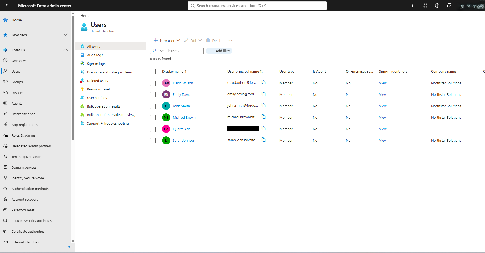

# 01 — User Accounts

## Scenario

Northstar Solutions needed accounts for five employees before any group, role, or onboarding work could happen.

## What I did

In the Microsoft Entra admin center, under **Users → New user**, I created five member accounts and set **Company name** to Northstar Solutions on each:

- David Wilson
- Emily Davis
- John Smith
- Michael Brown
- Sarah Johnson

I added a sixth employee, Olivia Martinez, later as part of [06 — Onboarding](06-onboarding.md).

## What I observed

- The Users list showed 6 users: the five Northstar accounts plus my own admin account, which has no company name.
- All six are **Member** user type, and none are synced from on-premises.
- The accounts use the tenant's default `onmicrosoft.com` domain. That domain is built from my personal email address, so I've redacted it where it appears in full.
- Michael Brown's profile shows he was created Oct 15, 2026 at 10:14 PM. The audit log has several **Add user** entries from around that time ([08 — Audit Log Review](08-audit-log-review.md)), but I didn't open them to match each one to an account.

The rest of the lab manages these same accounts: a password reset for Sarah ([03](03-password-reset.md)), an admin role for John ([04](04-admin-role-assignment.md)), and offboarding for Michael ([07](07-offboarding.md)).

## Result

All five Northstar accounts existed in the tenant with the right company name.

## Evidence

Users list with the five Northstar accounts and my admin account (admin UPN redacted):

