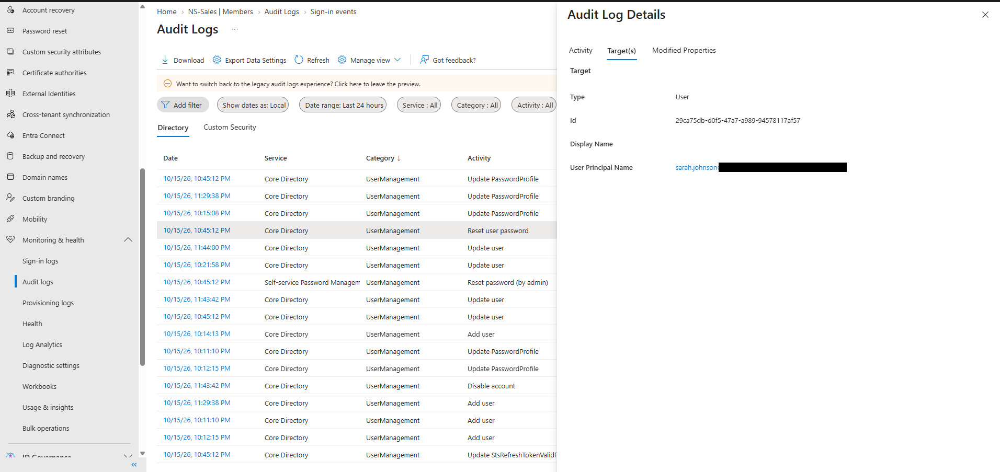

# 03 — Password Reset and Audit Verification

## Scenario

Sarah Johnson in Finance forgot her password and needed a reset.

## What I did

I opened Sarah's user page, chose **Reset password**, and Entra generated a temporary password. I left out the screenshot of the reset panel because it contains the temporary password field. Instead, I confirmed the reset in the audit logs.

## What I observed

The **Reset user password** audit entry:

| Field | Value |
|---|---|
| Date | 10/15/2026, 10:45 PM |
| Activity type | Reset user password |
| Category | UserManagement |
| Status | success |
| Target | Sarah Johnson's account (user) |
| Initiated by | "Microsoft password reset service" (type: Application) |

I made the reset from my admin account, but this log entry records the actor as the password reset service application. That's just how this entry was logged.

Other entries were logged in the same second (10:45:12 PM): **Reset password (by admin)** from the Self-service Password Management service, **Update PasswordProfile**, **Update user**, and **Update StsRefreshTokenValidFrom**. I only opened the Reset user password entry, so I haven't confirmed the targets of the others.

## Result

The audit log confirms a successful password reset targeting Sarah Johnson's account.

I didn't sign in as Sarah with the temporary password, so I didn't test the first sign-in or the forced password change.

## Evidence

Audit log entry, Activity tab:

Same entry, Target(s) tab (tenant domain redacted from the UPN):

