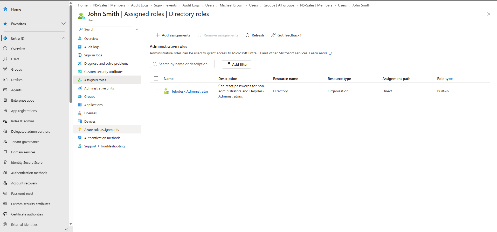
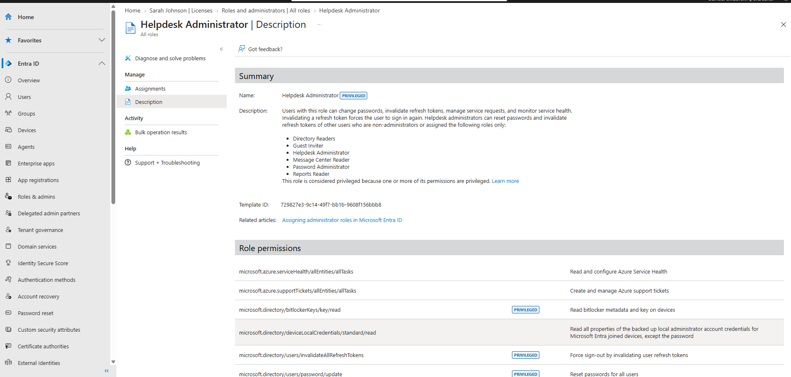
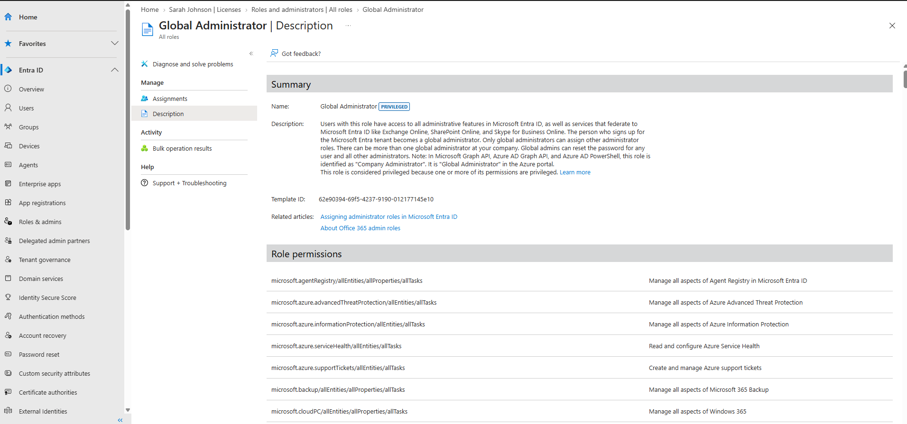

# 04 — Administrative Role Assignment

## Scenario

John Smith joined Northstar's IT team and needed to handle help desk tasks like password resets, without full control of the tenant.

## What I did

Before assigning anything, I compared two built-in roles under **Roles & admins**:

- **Global Administrator** can manage everything in Entra ID and the Microsoft services connected to it. Its description says only Global Administrators can assign other admin roles, and that whoever signs up for the tenant gets this role.
- **Helpdesk Administrator** is still marked privileged, but it's much narrower. It can reset passwords and invalidate refresh tokens (forcing a re-sign-in), but only for non-admins and for users holding a short list of roles: Directory Readers, Guest Inviter, Helpdesk Administrator, Message Center Reader, Password Administrator, and Reports Reader. It can also read BitLocker recovery keys on devices, which is one of the permissions that makes it privileged.

Helpdesk Administrator was the right fit for a help desk employee, so I assigned it to John.

## What I observed

John's **Assigned roles** page lists:

| Role | Resource | Assignment path | Role type |
|---|---|---|---|
| Helpdesk Administrator | Directory (Organization) | Direct | Built-in |

"Direct" means it was assigned to John himself, not through a group.

## Directory roles vs. Azure RBAC roles

Helpdesk Administrator is a **Microsoft Entra directory role**. It controls what John can do with identities in the directory, like resetting another user's password. It gives him no rights over Azure resources like virtual machines or storage accounts. Those are controlled separately by **Azure RBAC roles** (Owner, Contributor, Reader, and so on) assigned on a subscription, resource group, or resource. John's user page even lists the two separately, as **Assigned roles** and **Azure role assignments**.

I worked with Azure RBAC roles in a separate project: [Azure RBAC & Storage Security Lab](../../azure-rbac-storage-security-lab/).

## Result

John has the Helpdesk Administrator role, assigned directly, scoped to the whole directory.

I didn't sign in as John to try the role's permissions.

## Evidence

John Smith's assigned directory roles:

Helpdesk Administrator description and permissions:

Global Administrator description and permissions:

