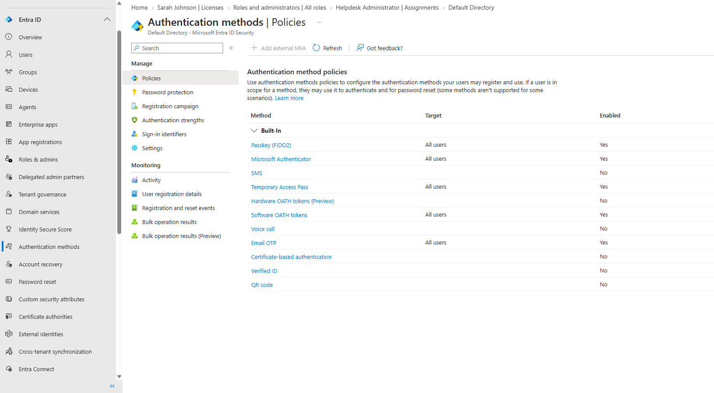
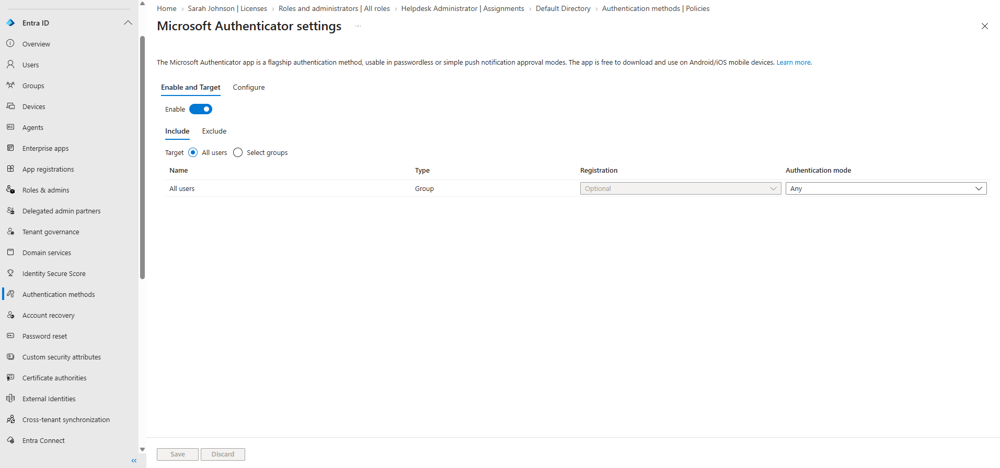
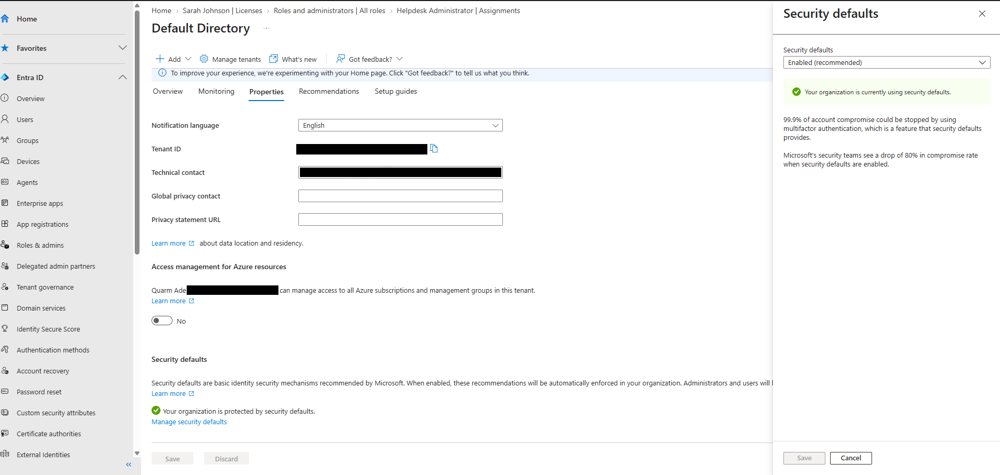

# 05 — Authentication Methods and Security Defaults

## Scenario

Before relying on the tenant for anything, I wanted to know which sign-in methods it allowed and what baseline protection was turned on.

## What I did

I reviewed the tenant's **Authentication methods → Policies** and the Microsoft Authenticator settings without changing them. Then I opened the tenant's **Properties** and the **Security defaults** panel.

## What I observed

**Authentication method policies:**

| Method | Enabled | Target |
|---|---|---|
| Passkey (FIDO2) | Yes | All users |
| Microsoft Authenticator | Yes | All users |
| Temporary Access Pass | Yes | All users |
| Software OATH tokens | Yes | All users |
| Email OTP | Yes | All users |
| SMS, voice call, hardware OATH tokens (Preview), certificate-based authentication, Verified ID, QR code | No | — |

**Microsoft Authenticator settings:** enabled for all users, with registration **Optional** and authentication mode **Any** (push or passwordless).

**Security defaults:** set to **Enabled (recommended)**. The Properties page said "Your organization is protected by security defaults." Security defaults are Microsoft's baseline protections, which include requiring users to register for MFA and requiring MFA for admins.

## Result

Five authentication methods were available to all users, and security defaults were on.

I only confirmed these settings. I didn't sign in as a test user to see an MFA registration or MFA prompt, so I haven't seen MFA enforced on a specific sign-in. I also didn't set up or test any Conditional Access policies.

## Evidence

Authentication method policies:

Microsoft Authenticator settings:

Tenant properties with security defaults enabled (tenant ID, technical contact, and email redacted):

