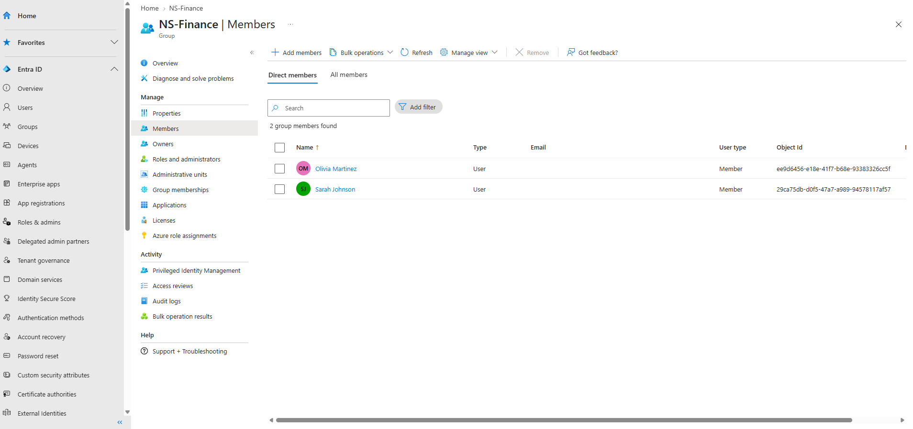
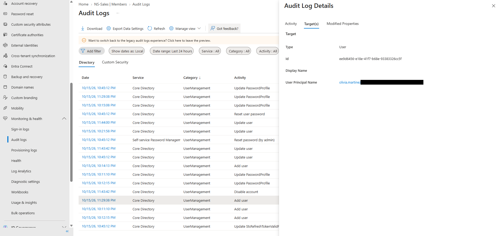

# 06 — Employee Onboarding

## Scenario

Olivia Martinez was a new hire joining Northstar's Finance team, so she needed an account and access to Finance resources.

## What I did

1. Created Olivia Martinez's user account.
2. Added her to **NS-Finance**.

## What I observed

- The audit log has an **Add user** entry at 11:29:38 PM on 10/15/2026. Its Target(s) tab shows Olivia's account.
- NS-Finance's **Members** page lists two direct members: Olivia Martinez and Sarah Johnson.

## Result

Olivia's account exists, and she's a member of NS-Finance alongside Sarah.

I didn't sign in as Olivia, so I haven't seen what she can reach through the group.

## Evidence

NS-Finance members after onboarding:

Audit log Add user entry, Target(s) tab (tenant domain redacted from the UPN):

