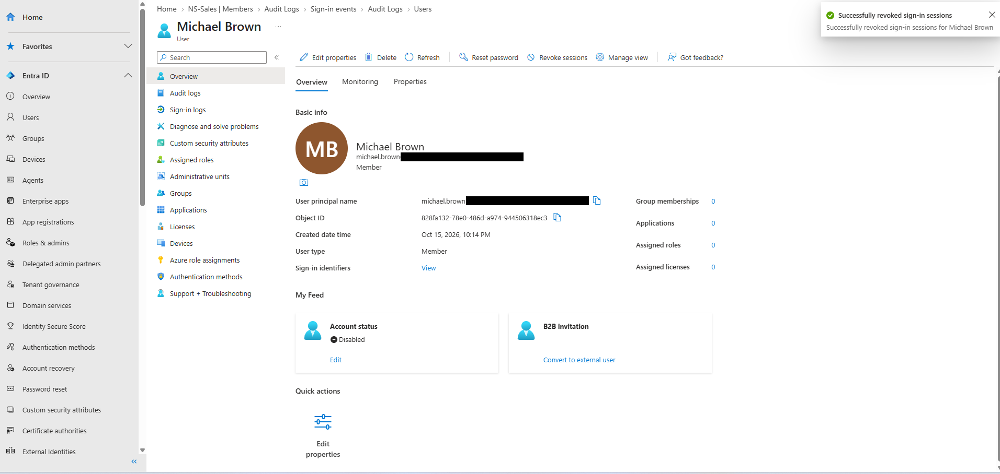
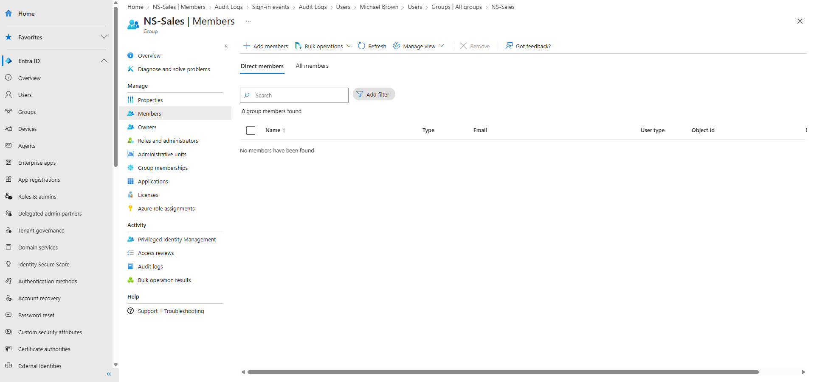

# 07 — Employee Offboarding

## Scenario

Michael Brown was leaving Northstar's Sales team, so his access needed to be shut off.

## What I did

1. **Disabled his account.** I set the account to disabled from his user page.
2. **Removed him from NS-Sales.** Entra warned that the change might take a little time to show up.
3. **Revoked his sign-in sessions** with **Revoke sessions** on his user page.

## What I observed

- His profile shows **Account status: Disabled**. The audit log also has a **Disable account** entry at 11:43:42 PM, though I didn't open that entry to confirm its target.
- After the removal, NS-Sales showed **0 group members** ("No members have been found"), and Michael's profile showed **0 group memberships**.
- Entra confirmed "Successfully revoked sign-in sessions for Michael Brown."

Michael's account didn't appear in the interactive sign-in log I reviewed ([08 — Audit Log Review](08-audit-log-review.md)), so there were no visible sessions for the revocation to end. The screenshot shows that Entra accepted the revocation, not what effect it had.

## Result

Michael's account is disabled, he's out of NS-Sales, and his sessions were revoked.

I didn't try signing in as Michael afterward, so I haven't tested that the disabled account and revoked sessions actually block access.

## Evidence

Michael Brown's profile: disabled, 0 group memberships, and the session revocation confirmation (tenant domain redacted from the UPN):

NS-Sales with no members:

