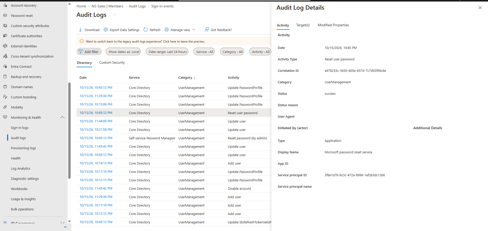

# 08 — Audit and Sign-in Log Review

## Scenario

After making all the changes in this lab, I went back through the logs to see how Entra recorded them, and who had actually been signing in.

## Audit logs

I opened **Monitoring & health → Audit logs** with the date range set to the last 24 hours and dates shown in local time. The list was sorted by **Category**, not by date, so entries appear out of time order.

The part of the list I captured is all **UserManagement** entries from Core Directory, plus one from Self-service Password Management. Grouped by time, they line up with the lab work:

| Time (10/15/2026) | Activities | Matches |
|---|---|---|
| 10:11 – 10:15 PM | Add user, Update PasswordProfile | Creating the Northstar accounts ([01](01-user-accounts.md)) |
| 10:21:58 PM | Update user | Not matched to a specific step |
| 10:45:12 PM | Reset user password, Reset password (by admin), Update PasswordProfile, Update user, Update StsRefreshTokenValidFrom | Sarah Johnson's password reset ([03](03-password-reset.md)) |
| 11:29:38 PM | Add user, Update PasswordProfile | Olivia Martinez's onboarding ([06](06-onboarding.md)) |
| 11:43:42 – 11:44:00 PM | Disable account, Update user | Michael Brown's offboarding ([07](07-offboarding.md)) |

I opened two of these entries in detail: the Reset user password entry (target Sarah Johnson) and the 11:29:38 PM Add user entry (target Olivia Martinez). For the rest, the match is based on timing, not on checking each entry's target.

The group membership changes and John's role assignment would be logged under other categories, like GroupManagement and RoleManagement. I didn't capture those parts of the list.

## Sign-in logs

I reviewed **User sign-ins (interactive)** for the last 24 hours. There were five entries, and all of them were my own admin account: four sign-ins to the Azure Portal and one to Microsoft Azure Signup. None of the Northstar test users appeared.

In the event I opened, the sign-in succeeded. The authentication requirement was listed as **Single-factor authentication**, with the note "MFA requirement satisfied by claim in the token." I've left that screenshot out because it shows my personal email address and session identifiers.

## Result

Every change I documented in the earlier notes has a matching UserManagement entry in the audit log, though I only checked the target on two of them. The sign-in log confirms that no test user signed in, which fits with every check in this lab being done from the admin side.

## Evidence

The audit log list is visible behind the detail panels in the password reset and onboarding screenshots:

The same list with the Add user entry for Olivia open is in [06 — Onboarding](06-onboarding.md#evidence).

No sign-in log screenshot is published. See above for the reason.
