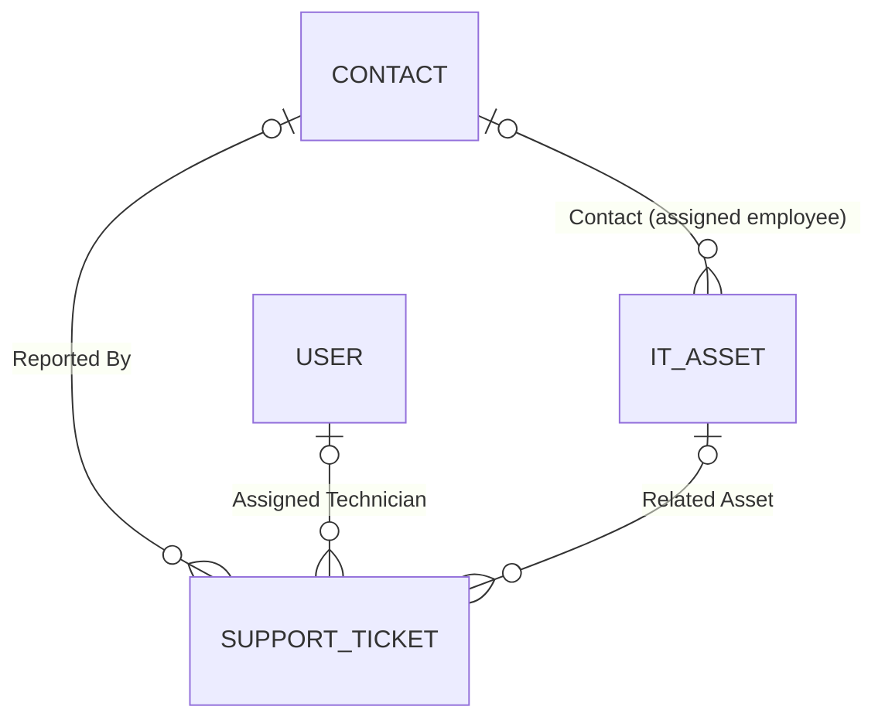
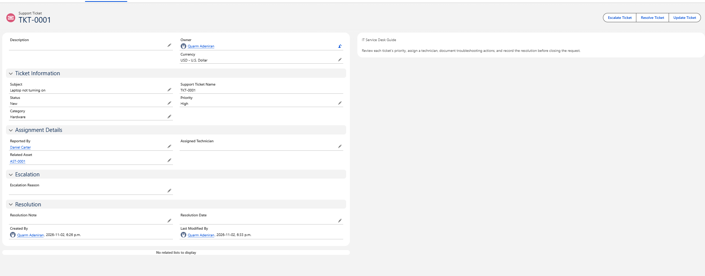
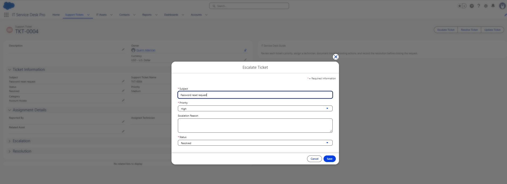
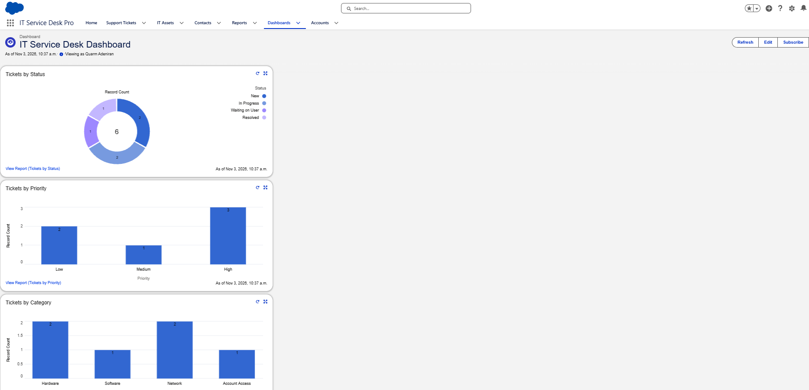

# Salesforce IT Service Desk Pro

IT Service Desk Pro is a small help desk application I built in a Salesforce Trailhead Playground. Support staff can log a ticket and link it to the employee who reported it, the technician working on it, and the device involved. From there, they can escalate, update, or resolve it with Quick Actions. Two record-triggered Flows handle simple field updates, and three reports feed a dashboard.

I built everything with Salesforce's point-and-click tools: Object Manager, Lightning App Builder, Flow Builder, and Reports and Dashboards. There's no Apex or other code.

**This is a Trailhead Playground lab, not a production service desk.** The employee, tickets, and equipment are fictional, and I was the only user.

## The problem I wanted to solve

In a company without a central system, IT requests come in through email, chat, and conversations in the hallway. Someone can't connect to the VPN, a laptop won't turn on, Microsoft Teams won't open, a password needs resetting, or the office printer stops responding. Requests get lost, nobody can see who's working on what, and there's no record of how anything was fixed.

I wanted an app where support staff could record the problem, assign a technician, track progress, connect the request to the equipment involved, and write down the fix.

## Why Salesforce

I'd been working through Trailhead modules on custom objects, relationships, Lightning App Builder, and automation, and I wanted to put those pieces together in something I designed myself instead of another guided exercise. A help desk app made sense because IT support and systems administration are the areas I'm most interested in. Salesforce let me build the data model, screens, automation, and reporting without writing code, and a Trailhead Playground gave me a free org to build in.

## Environment

| Item | Details |
|---|---|
| Platform | Salesforce Lightning Experience |
| Org | Salesforce Trailhead Playground (labelled Developer Edition in the org) |
| Tools | App Manager, Object Manager, Lightning App Builder, Flow Builder, Reports, Dashboards |
| My role | Org administrator, also acting as the support technician |
| Sample data | Six fictional tickets, two fictional IT assets, one fictional contact (Daniel Carter) |
| Build dates | Flows saved 2026-11-01, sample records created 2026-11-02, reports and dashboard captured 2026-11-03 |

## What I built

| Area | What's in the org |
|---|---|
| Lightning app | IT Service Desk Pro, with Home, Support Tickets, IT Assets, Contacts, Reports, Dashboards, and Accounts tabs |
| Custom objects | Support Ticket (`Support_Ticket__c`) and IT Asset (`IT_Asset__c`) |
| Custom fields | 11 on Support Ticket and 7 on IT Asset, including picklists for priority, status, category, asset type, and asset status |
| Relationships | Four lookup fields: a ticket points to a Contact, a User, and an IT Asset, and an asset points to a Contact |
| Record pages | A Support Ticket page layout with four sections, and a Lightning record page with an IT Service Desk Guide panel |
| Quick Actions | Escalate Ticket, Resolve Ticket, and Update Ticket |
| Flows | Stamp Ticket Resolution Date and Prioritize Network Tickets, both record-triggered and active |
| Reporting | Ticket reports grouped by status, priority, and category, shown on the IT Service Desk Dashboard |
| Home page | A custom Lightning home page with a welcome message and a dashboard component |

## How it fits together

Support Ticket is the centre of the app. Each ticket can point to three existing records through lookup fields, and each IT Asset can point to the employee who has it.

| Lookup field | On object | Points to | Used for |
|---|---|---|---|
| Reported By (`Reported_By__c`) | Support Ticket | Contact | The employee who reported the issue |
| Assigned Technician (`Assigned_Technician__c`) | Support Ticket | User | The technician working the ticket |
| Related Asset (`Related_Asset__c`) | Support Ticket | IT Asset | The device the issue is about |
| Contact (`Contact__c`) | IT Asset | Contact | The employee the device is assigned to |

I used lookups instead of master-detail relationships because none of these records depend on a ticket. A laptop exists whether or not it has an open ticket, and it can collect several tickets over its life: a battery problem now, a software problem later. The same goes for people: one employee can report many tickets, and one technician can work many. Master-detail would make the child record depend on its parent, which doesn't match how equipment and people relate to tickets.

## Main features

**Ticket tracking.** Each ticket gets an automatic name in the format `TKT-0001` and has a subject, description, priority, status, and category.

- Priority: Low, Medium, High, Critical
- Status: New, In Progress, Waiting on User, Resolved, Closed
- Category: Hardware, Software, Network, Account Access, Other

**IT asset inventory.** Assets are named `AST-0001` onward and store the asset name, type, serial number, status, manufacturer, purchase date, and assigned employee. My two sample assets are a Dell Latitude 5440 and an HP LaserJet Pro.

**Quick Actions.** Three "Update a Record" actions sit in the ticket header, so a technician can make common changes without opening the full edit form:

- Escalate Ticket opens with Priority already set to High and a box for the escalation reason.
- Resolve Ticket sets Status to Resolved and asks for a resolution note.
- Update Ticket changes the status, priority, assigned technician, and category.

**Record page.** The ticket page groups fields into Ticket Information, Assignment Details, Escalation, and Resolution sections, with a short support guide on the right.

**List views.** I changed the list columns so the ticket list shows subject, priority, category, and technician, and the asset list shows the asset name, type, status, and manufacturer. Before that, the lists only showed record names like TKT-0001.

**Reporting.** Three summary reports grouped by status, priority, and category, on one dashboard.

## Automation

| Flow | Runs when | Condition | What it does |
|---|---|---|---|
| Stamp Ticket Resolution Date | A Support Ticket is updated | Status equals Resolved, only when the record is updated to meet the condition | Sets Resolution Date to the current date and time |
| Prioritize Network Tickets | A Support Ticket is created | Category equals Network | Sets Priority to High |

Both are set to optimize for Fast Field Updates, which makes them before-save Flows. They change the ticket during the same save, so they don't need an Update Records element.

Both Flows are active, but **I haven't yet captured a test that shows either one changing a record.** The details and the test steps I still need to run are in [Flow automation](docs/07-flow-automation.md) and [Testing and validation](docs/09-testing-and-validation.md).

The network rule is deliberately simple. A real service desk would set priority from impact, urgency, how many people are affected, and SLA targets, not from category alone. I built it to learn how record-triggered Flows work.

## Testing and current status

| Item | Status | Evidence |
|---|---|---|
| Objects, fields, picklists | Confirmed | Fields & Relationships screens for both objects |
| Lookup relationships | All four fields exist. Two are filled in on a record | TKT-0001 links to Daniel Carter and AST-0001. No ticket has an Assigned Technician, and AST-0001 has no contact |
| Record naming | Records show TKT-0001 to TKT-0006 and AST-0001 to AST-0002 | IT Asset's name field is Auto Number. The data type of the Support Ticket name field isn't captured yet |
| Page layout and Lightning record page | Confirmed | Ticket records and Lightning App Builder |
| Quick Actions | All three are on the record page. Escalate and Resolve open with the expected fields | No screenshot of a saved escalation or resolution |
| Resolution Date Flow | Active | Not verified. No screenshot shows a filled-in Resolution Date |
| Network Priority Flow | Active | Not verified. Both Network tickets are High, but I didn't record what priority I entered when I created them |
| Reports | Tickets by Status confirmed with all six tickets | Priority and Category reports only appear through the dashboard |
| Dashboard | Three charts | The data is from 10:37 a.m. on Nov 3 and is older than the report screenshot |
| Home page | Welcome text and dashboard component appear | The component shows the dashboard title and a View Dashboard link, but no charts |

## Selected screenshots

TKT-0001 on the custom Lightning record page. The ticket links to Daniel Carter and asset AST-0001. The three Quick Actions are in the header, and the support guide panel is on the right:

The Escalate Ticket action opened on TKT-0004. The record behind the dialog is Medium priority, and the action opens with Priority already set to High:

The IT Service Desk Dashboard: tickets by status, priority, and category:

The other screenshots are in the docs below.

## Problems I ran into

- **Fields outside the new sections.** I added four sections to the page layout, but the existing fields stayed where they were. I had to drag each field into its section.
- **Required fields missing from the layout.** At one point, Salesforce warned that Subject and Status, both required, weren't on the layout. I moved them back into Ticket Information and saved.
- **Page layouts and Lightning pages.** At first I thought they were the same thing. Working with both showed me they control different parts of the page.
- **"No data available" in Lightning App Builder.** The preview showed placeholders because there was no record selected to preview, not because the page was broken.
- **Lists only showed record names.** The ticket and asset lists showed TKT-0001 and AST-0001 and nothing useful. I changed the search layouts and list view columns.
- **Dashboard wouldn't load on the home page.** Lightning App Builder showed an Invalid Component message, and the dashboard picker found no matches. I checked that the dashboard was saved, which folder it was in, and whether I had access. The error is gone in my final screenshot, but the component shows a link instead of charts.

More detail is in [Troubleshooting and lessons](docs/10-troubleshooting-and-lessons.md).

## What I learned

- A page layout isn't just about appearance. If a required field isn't on it, users can't fill it in, and the record can't be saved.
- Page layouts decide which fields and sections appear. Lightning App Builder decides the page structure and which components go where.
- Salesforce controls list and search columns separately from the record page.
- Lookups connect records that live independently. Master-detail is for children that can't exist without their parent.
- A before-save Flow can change the record that triggered it without an Update Records element.
- Even a basic Flow rule shows how a trigger, an entry condition, and an Assignment work together.

## Limitations

- It's a Trailhead Playground with one user (me, as System Administrator). I didn't create technician or employee profiles, and I didn't test anything as another user.
- Neither Flow has a captured test result yet.
- No screenshot shows a saved Quick Action result.
- The Assigned Technician field is empty on every ticket, and neither asset has a contact, so two of the four lookups haven't been used on a real record.
- Some field labels ended up different from my plan: the ticket name field is labelled Support Ticket Name instead of Ticket Number, the resolution field is Resolution Note instead of Resolution Notes, and the asset's employee lookup is Contact instead of Assigned To.
- The network priority rule uses category alone, and it would lower a Network ticket entered as Critical to High.
- The Resolution Date Flow only runs on update, so a ticket created with Status already set to Resolved never gets a Resolution Date.
- This repository holds screenshots and documentation, not Salesforce metadata. It can't be deployed to another org.

## Future improvements

None of these are built yet.

- Assign tickets to technicians automatically based on category.
- Send email notifications when a ticket is assigned or escalated.
- Set up separate permissions for IT technicians and employees.
- Use a Screen Flow to guide employees through reporting an issue.
- Add service-level targets and notifications for overdue tickets.
- Compare this design with Salesforce's standard Case object, which may suit some of this better.
- Export the metadata with Salesforce CLI so the repository has the actual configuration files alongside the screenshots.

## Documentation

| # | Document | What's in it |
|---|---|---|
| 01 | [Project overview](docs/01-project-overview.md) | Goal, scope, environment, and timeline |
| 02 | [Application architecture](docs/02-application-architecture.md) | The app, its layers, and why I built a custom object instead of using Case |
| 03 | [Custom objects and fields](docs/03-custom-objects-and-fields.md) | Every custom field, API name, data type, and picklist value |
| 04 | [Relationships and data model](docs/04-relationships-and-data-model.md) | The four lookups, why lookup and not master-detail, and the sample data |
| 05 | [Page layouts and Lightning pages](docs/05-page-layouts-and-lightning-pages.md) | Layout sections, the Lightning record page, list views, and the home page |
| 06 | [Quick Actions](docs/06-quick-actions.md) | Escalate, Resolve, and Update Ticket, planned and as captured |
| 07 | [Flow automation](docs/07-flow-automation.md) | Both record-triggered Flows and what's still unverified |
| 08 | [Reports and dashboard](docs/08-reports-and-dashboard.md) | Three reports, the dashboard, and the home page component |
| 09 | [Testing and validation](docs/09-testing-and-validation.md) | Each test case, its result, and the steps still to run |
| 10 | [Troubleshooting and lessons](docs/10-troubleshooting-and-lessons.md) | Problems, causes, fixes, and what I'd do differently |

## Resume summary

> **Salesforce IT Service Desk Pro** (Salesforce Trailhead Playground): Built a custom Lightning app for IT ticket and equipment tracking with two custom objects, 18 custom fields, and four lookup relationships to Contacts, Users, and IT assets. Designed a sectioned page layout and a Lightning record page, created three record-update Quick Actions, and built two before-save record-triggered Flows. Created ticket reports by status, priority, and category, and an IT Service Desk Dashboard.

## Evidence

The screenshots are in [evidence/](evidence/), and each document links to the ones it uses. [evidence-checklist.md](evidence-checklist.md) lists what's captured and what I still need to capture.

I checked every screenshot before adding it. None show a browser address bar, org URL, email address, password, token, or session ID. My name appears as the record owner and dashboard viewer. Daniel Carter and the asset serial numbers (`DEMO-DELL-001`, `DEMO-HP-002`) are fictional. I left two screenshots out: a close-up of the field list that duplicated `06-support-ticket-fields.png`, and a screenshot of TKT-0004 with the Resolution section collapsed. That one doesn't show a Resolution Date, so it isn't evidence that the Flow ran. The unedited originals stay in `evidence-raw/`, which is excluded from the repository by `.gitignore`.
