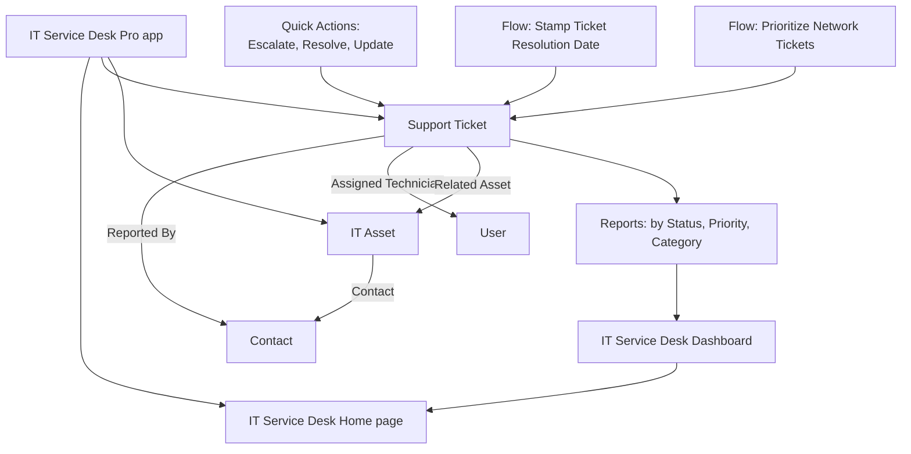
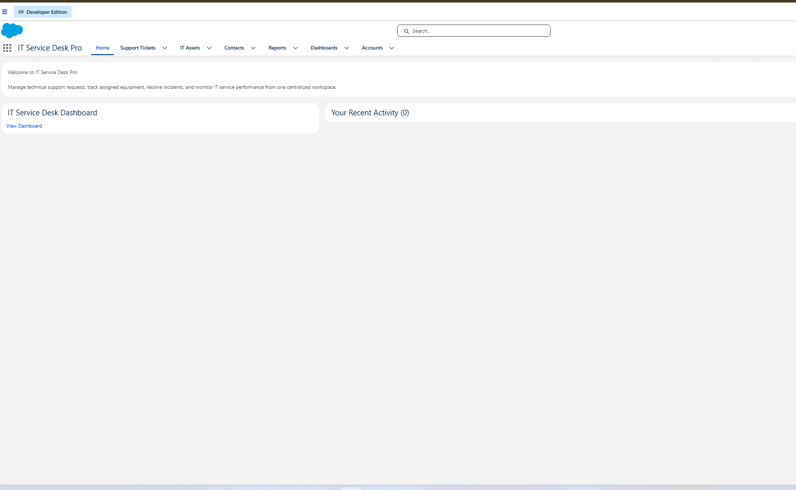

# 02 — Application Architecture

## Overview

The app has four layers, all built with Salesforce's standard setup tools:

| Layer | What's in it | Built with |
|---|---|---|
| Data | Support Ticket and IT Asset custom objects, plus the standard Contact and User objects | Object Manager |
| Interface | The Lightning app, a page layout, a Lightning record page, list columns, and a home page | App Manager, Object Manager, Lightning App Builder |
| Automation | Three Quick Actions and two record-triggered Flows | Object Manager (Buttons, Links, and Actions), Flow Builder |
| Reporting | Three ticket reports and a dashboard | Reports, Dashboards |

## The Lightning app

I created the app in **Setup → App Manager → New Lightning App**.

| Setting | Value | Confirmed in a screenshot? |
|---|---|---|
| App name | IT Service Desk Pro | Yes, in the navigation bar |
| Developer name | `IT_Service_Desk_Pro` | No |
| Navigation style | Standard Navigation | Yes, the tabs run across the top |
| Description | Custom application for managing IT support tickets, assets, and service requests | No |
| Assigned to | System Administrator profile | No, but I opened the app as that user |

The navigation bar in the screenshots has **Home, Support Tickets, IT Assets, Contacts, Reports, Dashboards, and Accounts**. I planned the first six. Accounts is also in the final app.

## Why a custom Support Ticket object instead of Case

Salesforce has a standard Case object that already handles support requests, with case numbers, status, priority, and assignment built in. I built my own Support Ticket object instead because creating objects, fields, picklists, and relationships myself was the point of the project. Using Case would have skipped most of what I wanted to practise.

The trade-off is that I rebuilt things Case already has, and I don't get Case-specific features like assignment rules, escalation rules, or email-to-case. Comparing the two is on my [future improvements](../README.md#future-improvements) list.

## How a ticket moves through the app

1. A technician creates a Support Ticket with a subject, category, and priority. Status defaults to New.
2. They link it to the employee who reported it (Contact), the device involved (IT Asset), and the technician working on it (User).
3. If the category is Network, the Prioritize Network Tickets Flow is designed to set Priority to High as the ticket is created.
4. While working the ticket, the technician uses **Update Ticket** to change the status or the technician, or **Escalate Ticket** to raise the priority and record why.
5. When it's fixed, **Resolve Ticket** sets Status to Resolved and captures a resolution note.
6. The Stamp Ticket Resolution Date Flow is designed to fill in Resolution Date when the status changes to Resolved.
7. The reports and dashboard show the current workload by status, priority, and category.

Steps 3 and 6 describe what the Flows are configured to do. Neither has a captured test yet. See [Flow automation](07-flow-automation.md).
