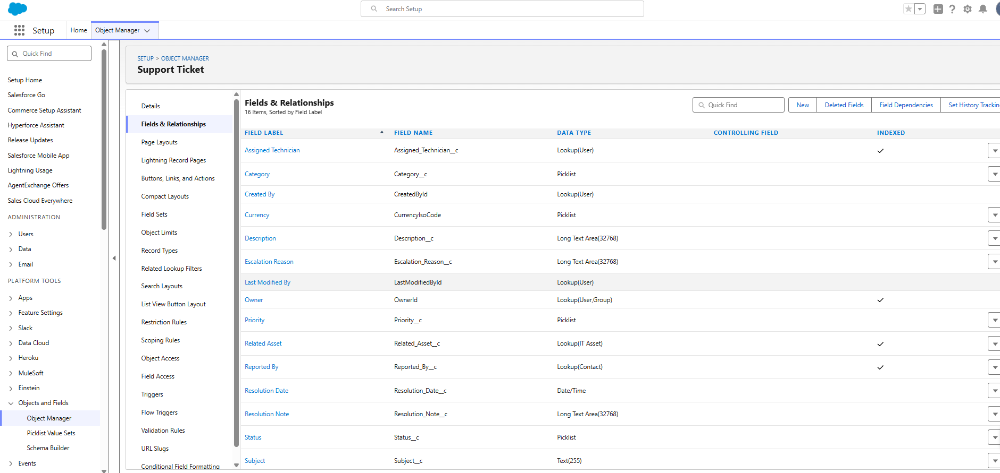
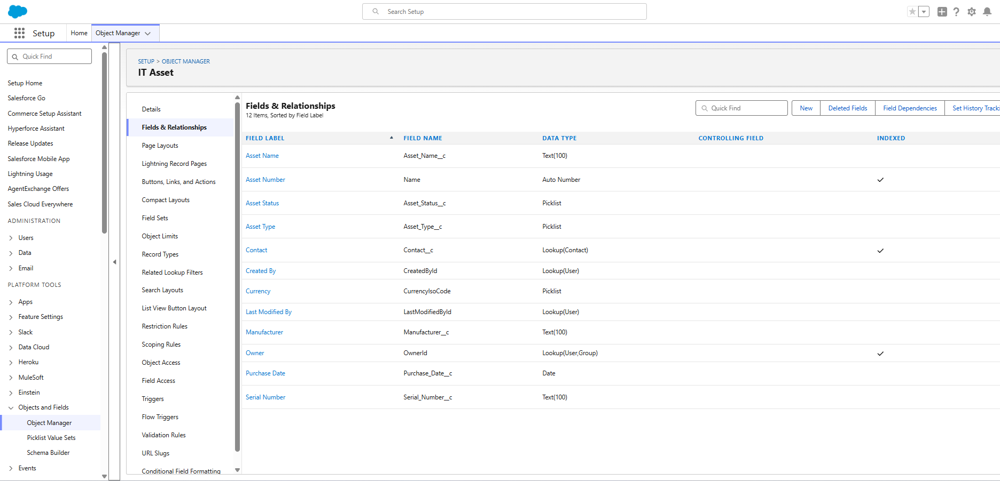

# 03 — Custom Objects and Fields

I created both objects in **Setup → Object Manager → Create → Custom Object**. The field labels, API names, and data types below come from the Fields & Relationships screenshots. Purposes, picklist values, and defaults come from my build notes.

## Support Ticket (`Support_Ticket__c`)

The main object. Each record is one technical problem, tracked from creation to resolution.

### Object settings

| Setting | Planned | What the screenshots show |
|---|---|---|
| Label / plural label | Support Ticket / Support Tickets | Support Ticket / Support Tickets |
| API name | `Support_Ticket__c` | Support Ticket appears in Object Manager. The API name is from my notes |
| Record name label | Ticket Number | **Support Ticket Name** |
| Record name type | Auto Number, format `TKT-{0000}`, starting at 1 | Records are named TKT-0001 to TKT-0006, in creation order, and the field has no edit pencil on the record. That fits an auto-number field, but the data type row is cut off at the bottom of the field list screenshot |

To fully confirm the numbering, I still need a screenshot of the Support Ticket Name field definition. It's item 2 in the [evidence checklist](../evidence-checklist.md).

### Custom fields

| Field label | API name | Data type | Purpose |
|---|---|---|---|
| Subject | `Subject__c` | Text(255) | Short description of the issue |
| Description | `Description__c` | Long Text Area(32768) | Full explanation of the issue |
| Priority | `Priority__c` | Picklist | How urgent the issue is |
| Status | `Status__c` | Picklist | Where the ticket is in its lifecycle |
| Category | `Category__c` | Picklist | Type of problem |
| Reported By | `Reported_By__c` | Lookup(Contact) | Employee who reported the issue |
| Assigned Technician | `Assigned_Technician__c` | Lookup(User) | Technician responsible for the ticket |
| Related Asset | `Related_Asset__c` | Lookup(IT Asset) | Device the issue is about |
| Escalation Reason | `Escalation_Reason__c` | Long Text Area(32768) | Why the ticket was escalated |
| Resolution Note | `Resolution_Note__c` | Long Text Area(32768) | How the problem was fixed |
| Resolution Date | `Resolution_Date__c` | Date/Time | When the ticket was resolved |

The object also has the standard fields Salesforce adds: Owner, Created By, Last Modified By, and Currency. Currency appears because the org has multiple currencies turned on. I didn't add it.

I planned the resolution field as "Resolution Notes". It was created as **Resolution Note**, and that's the label on the record page and in the Resolve Ticket action.

### Picklist values

| Field | Values | Default (from notes) |
|---|---|---|
| Priority | Low, Medium, High, Critical | Medium |
| Status | New, In Progress, Waiting on User, Resolved, Closed | New |
| Category | Hardware, Software, Network, Account Access, Other | None |

The values Low, Medium, High, New, In Progress, Waiting on User, Resolved, Hardware, Software, Network, and Account Access all appear on sample records. Critical, Closed, and Other exist in my notes but aren't used on any record in the screenshots.

Subject, Priority, and Status are marked as required in the Quick Action dialogs (red asterisk).

## IT Asset (`IT_Asset__c`)

Tracks equipment like laptops, printers, and phones, so a ticket can point to a specific device instead of describing it in a text field.

### Object settings

| Setting | Planned | What the screenshots show |
|---|---|---|
| Label / plural label | IT Asset / IT Assets | IT Asset / IT Assets |
| Record name | Asset Number, Auto Number, format `AST-{0000}` | Asset Number (`Name`), **Auto Number**. Records are AST-0001 and AST-0002 |

### Custom fields

| Field label | API name | Data type | Purpose |
|---|---|---|---|
| Asset Name | `Asset_Name__c` | Text(100) | Equipment name, e.g. Dell Latitude 5440 |
| Asset Type | `Asset_Type__c` | Picklist | Equipment category |
| Serial Number | `Serial_Number__c` | Text(100) | Device identifier |
| Asset Status | `Asset_Status__c` | Picklist | Equipment condition |
| Contact | `Contact__c` | Lookup(Contact) | Employee the device is assigned to |
| Purchase Date | `Purchase_Date__c` | Date | When the equipment was bought |
| Manufacturer | `Manufacturer__c` | Text(100) | Equipment maker |

I planned the employee lookup as "Assigned To". It was created with the label **Contact** and the API name `Contact__c`. It does the same job, but the label doesn't say what the relationship means. Renaming it to Assigned To would make the record page clearer. The API name would stay `Contact__c` unless I recreated the field.

### Picklist values (from notes)

| Field | Values | Default |
|---|---|---|
| Asset Type | Laptop, Desktop, Printer, Mobile Device, Network Device, Other | None |
| Asset Status | Available, Assigned, Under Repair, Retired | Available |

Only Laptop, Printer, and Under Repair are visible on the sample records.

## Why picklists

Priority, status, category, asset type, and asset status are all picklists rather than free text. That keeps the values consistent, so reports can group on them, list views can filter on them, and Flows can test them. A Flow condition like `Category equals Network` only works if everyone spells "Network" the same way.
