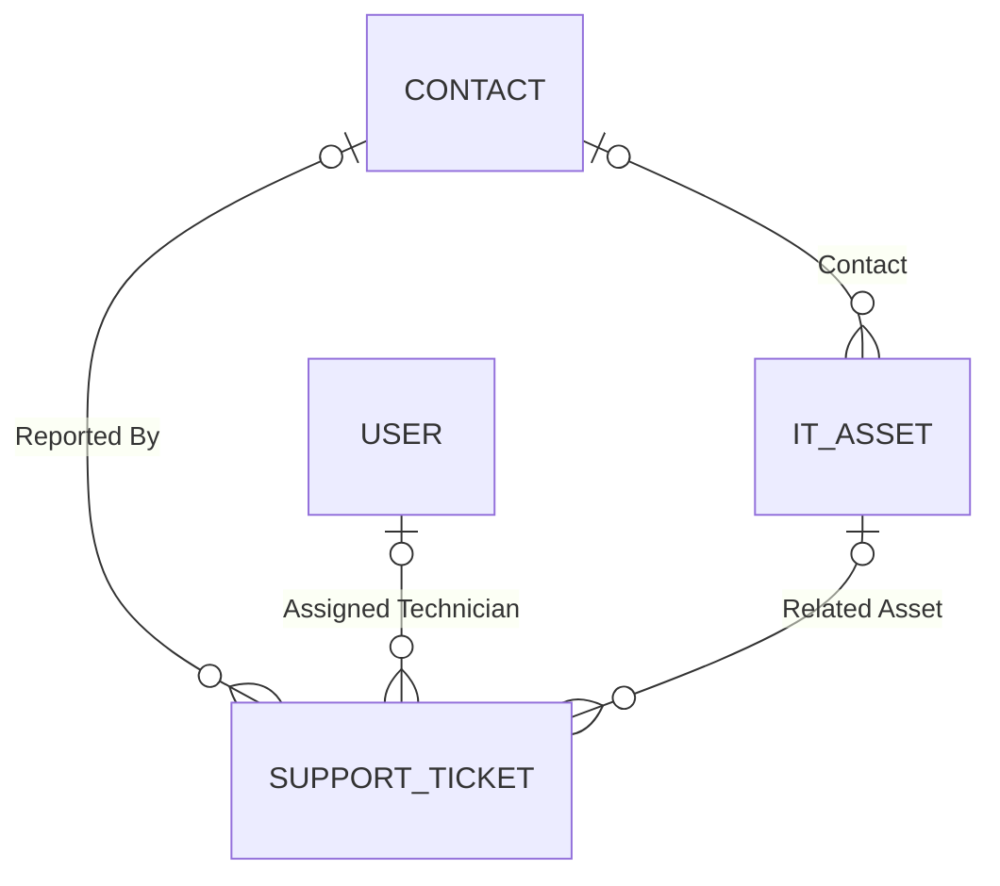
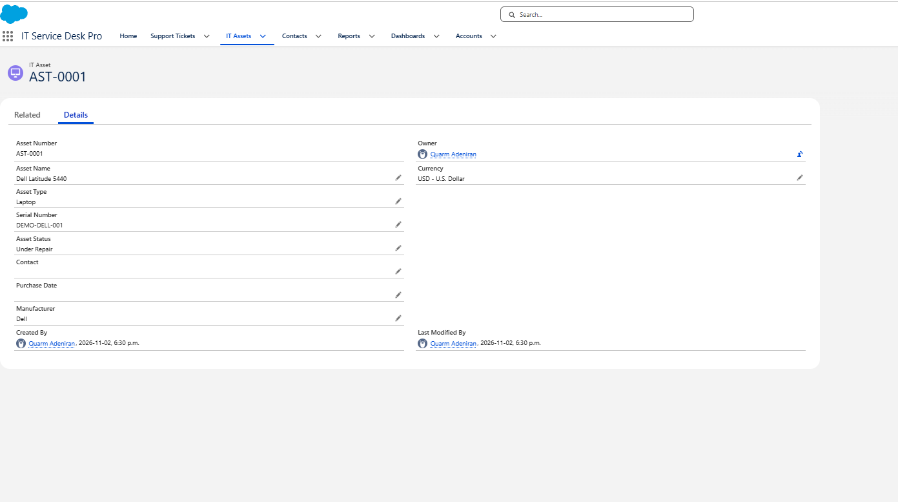
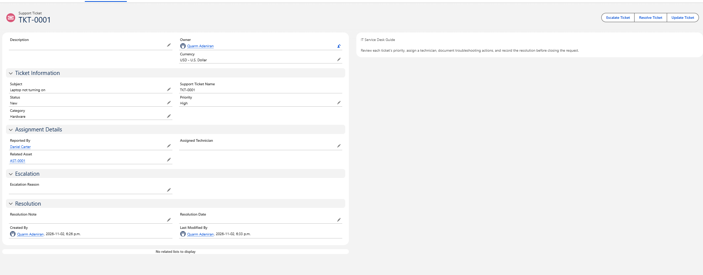

# 04 — Relationships and Data Model

## The four lookups

| Source object | Field | API name | Related object |
|---|---|---|---|
| Support Ticket | Reported By | `Reported_By__c` | Contact |
| Support Ticket | Assigned Technician | `Assigned_Technician__c` | User |
| Support Ticket | Related Asset | `Related_Asset__c` | IT Asset |
| IT Asset | Contact | `Contact__c` | Contact |

All four appear in Object Manager with the right related object. Salesforce indexes lookup fields automatically, which is why they have a tick in the Indexed column. See [Custom objects and fields](03-custom-objects-and-fields.md).

Reading the diagram: a ticket has at most one reporter, one technician, and one asset, and each of those can appear on many tickets. Each field is optional.

## Why Contact for employees and User for technicians

Technicians log in to Salesforce and work the tickets, so they're **Users**. Employees who report problems don't need a Salesforce login, so they're stored as **Contacts**. That matches how an internal help desk usually works: the support team has licences, and the rest of the company doesn't.

## Why lookup and not master-detail

The records exist independently:

- An IT Asset exists whether or not it has a ticket, and it can have many tickets over time. A laptop might have a battery ticket now and a software ticket later.
- One employee can report many tickets, and one technician can be assigned many.
- Deleting a ticket shouldn't delete the laptop or the employee, and an asset shouldn't need a ticket to exist.

In a master-detail relationship, the detail record can't exist without its master, and it's deleted when the master is deleted. That would be wrong for every one of these relationships, so I used lookups.

## Sample data

### Contact

| Name | Notes |
|---|---|
| Daniel Carter | Fictional employee. Reported TKT-0001 |

### IT Assets

| Asset | Asset Name | Type | Serial Number | Status | Manufacturer | Contact |
|---|---|---|---|---|---|---|
| AST-0001 | Dell Latitude 5440 | Laptop | DEMO-DELL-001 | Under Repair | Dell | (empty) |
| AST-0002 | HP LaserJet Pro | Printer | DEMO-HP-002 (from notes) | Under Repair | HP | Not captured |

### Support Tickets

Values from the Tickets by Status report on 2026-11-03:

| Ticket | Subject | Category | Priority | Status |
|---|---|---|---|---|
| TKT-0001 | Laptop not turning on | Hardware | High | Resolved |
| TKT-0002 | VPN connection failure | Network | High | Resolved |
| TKT-0003 | Microsoft Teams won't open | Software | Low | In Progress |
| TKT-0004 | Password reset request | Account Access | Medium | Resolved |
| TKT-0005 | Office printer offline | Hardware | Low | Waiting on User |
| TKT-0006 | Shared drive inaccessible | Network | High | In Progress |

TKT-0001 and TKT-0002 were still **New** in the screenshots taken earlier. They were moved to Resolved later on 2026-11-03.

My notes planned the VPN ticket (TKT-0002) with a starting priority of Medium, so the network Flow would raise it to High. It shows High, but I don't have a record of what I entered when I created it. See [Flow automation](07-flow-automation.md).

## How the relationships look on a record

TKT-0001 shows the lookups working: **Reported By** links to Daniel Carter, and **Related Asset** links to AST-0001, the Dell Latitude 5440. Both are clickable links to those records.

What the screenshots don't show yet:

- **Assigned Technician** is empty on every ticket, including in the list view's Assigned Technician column.
- **AST-0001's Contact** field is empty, so the asset-to-employee lookup hasn't been used.
- I planned to link TKT-0005 (Office printer offline) to AST-0002 (HP LaserJet Pro), but I don't have a screenshot of TKT-0005 or AST-0002.
- I haven't checked whether AST-0001's **Related** tab lists TKT-0001 as a related ticket. That would show the relationship from the asset's side.

These are on the [evidence checklist](../evidence-checklist.md).
