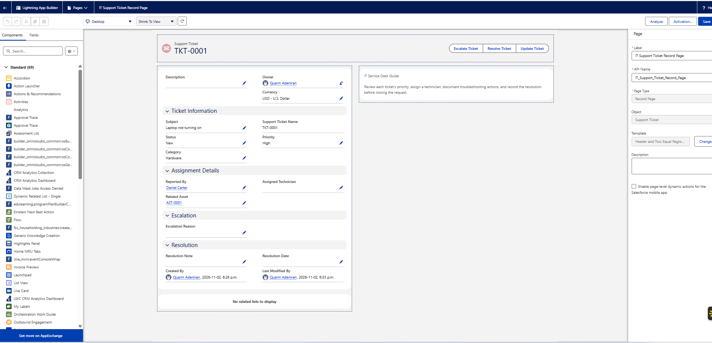
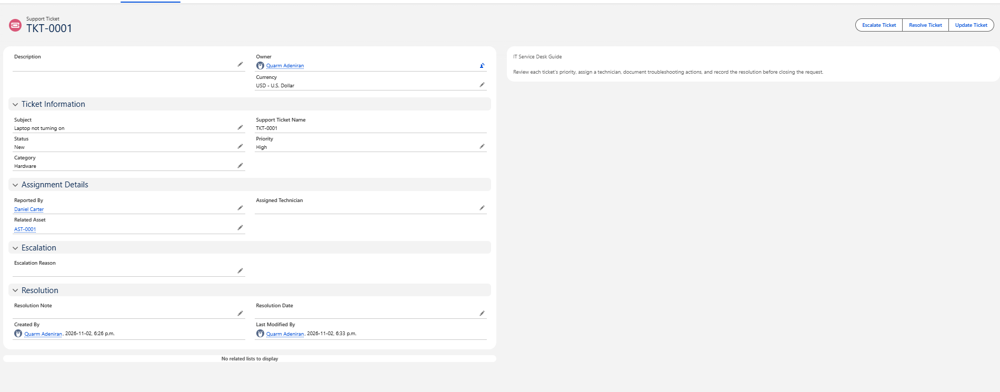
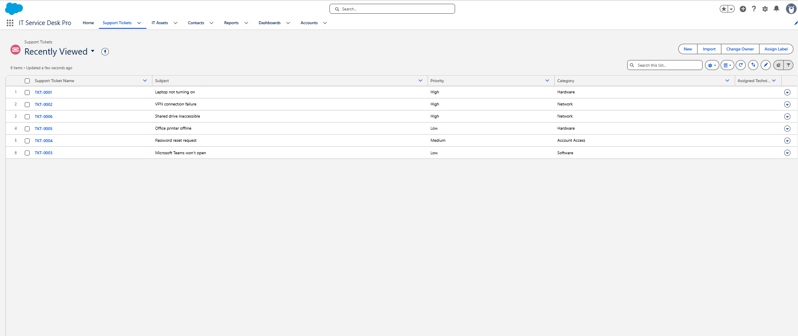
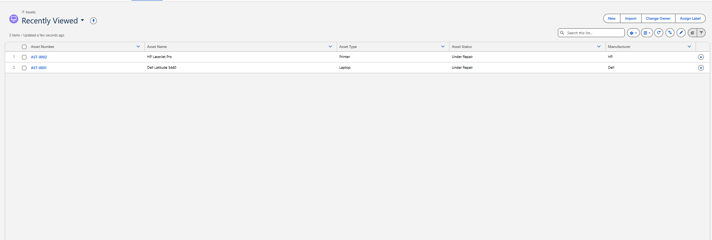

# 05 — Page Layouts and Lightning Pages

Salesforce has two separate tools that shape a record page. At first I thought page layouts and Lightning record pages were basically the same thing. Working with both made the difference clearer.

| Tool | What it controls |
|---|---|
| Page layout (Object Manager) | Which fields appear, how they're grouped into sections, and some actions |
| Lightning record page (Lightning App Builder) | The structure of the page: regions, and components like the Highlights Panel, Record Detail, related lists, and rich text |

The Lightning record page decides where the Record Detail component goes. The page layout decides what's inside it.

## Support Ticket page layout

**Setup → Object Manager → Support Ticket → Page Layouts → Support Ticket Layout**

I organized the fields into four sections with two columns each:

| Section | Planned fields | What the record page shows |
|---|---|---|
| Ticket Information | Ticket Number, Subject, Description, Status, Priority, Category | Subject, Support Ticket Name, Status, Priority, Category |
| Assignment Details | Reported By, Assigned Technician, Related Asset | Same as planned |
| Escalation | Escalation Reason | Same as planned |
| Resolution | Resolution Notes, Resolution Date | Resolution Note, Resolution Date |

The one difference is **Description**. I planned it for Ticket Information, but on the record it sits in the top section with Owner and Currency, above the four named sections. It's still on the layout and editable, just not where I meant to put it.

I don't have a screenshot of the page layout editor itself. The record page screenshots show the result.

### What went wrong while building it

The Page Layout Editor confused me at first. I created the four sections, but the existing fields didn't move into them. They stayed in the original section, and I had to drag each one into place.

At one point, Salesforce warned that **Subject** and **Status** were missing from the layout. Both are required fields, and I'd moved them out while rearranging things. I dragged them back into Ticket Information and saved.

What I took from it: a layout isn't only about appearance. If a required field isn't on the layout, someone using that layout can't fill it in, and the record can't be saved.

## Lightning record page

**Setup → Lightning App Builder → New → Record Page**

| Setting | Value |
|---|---|
| Label | IT Support Ticket Record Page |
| API name | `IT_Support_Ticket_Record_Page` |
| Object | Support Ticket |
| Template | Header and Two Equal Regions |

### Components

| Region | Component | What it shows |
|---|---|---|
| Header | Highlights Panel | The ticket name (e.g. TKT-0001) and the Escalate, Resolve, and Update Ticket buttons |
| Left | Record Detail | The page layout's fields and sections |
| Left | Related Lists | Currently "No related lists to display" |
| Right | Rich Text | The IT Service Desk Guide panel |

I considered adding an Activity component. It isn't on the final page.

The guide panel reads:

> IT Service Desk Guide
>
> Review each ticket's priority, assign a technician, document troubleshooting actions, and record the resolution before closing the request.

### "No data available" in the preview

While building the page, some components showed **No data available** in the Lightning App Builder preview. That happens when the builder has no record to preview, so the components have nothing to display. It didn't mean the page was broken. In the screenshot below, the builder is previewing TKT-0001, and the fields show real values.

### Activation

I meant to activate the page as the app default for IT Service Desk Pro. The ticket records I opened in the app use this page: same template, same guide panel, same Quick Actions. So it's active for at least my user in this app. I don't have a screenshot of the activation settings showing whether it's assigned as the app default, the org default, or by profile.

## IT Asset record page

I didn't build a custom Lightning page or sectioned layout for IT Asset. AST-0001 uses Salesforce's default page, with Related and Details tabs and all fields in one section.

## List views and search layouts

At first, the Support Tickets and IT Assets lists only showed record names like TKT-0001 and AST-0001. To tell which ticket was which, I had to open each record.

I changed the columns through the objects' **Search Layouts** and by editing list view columns. The **Recently Viewed** lists in the screenshots now show:

| List | Columns in the screenshots | Planned but not visible |
|---|---|---|
| Support Tickets | Support Ticket Name, Subject, Priority, Category, Assigned Technician | Status |
| IT Assets | Asset Number, Asset Name, Asset Type, Asset Status, Manufacturer | Assigned To (Contact) |

Salesforce controls how records look one at a time (page layouts and Lightning pages) separately from how they look in lists and search results (search layouts and list views).

My notes say I also created custom list views. The screenshots only show Recently Viewed, so I haven't confirmed a named custom list view.

## Home page

The custom Lightning home page is covered in [Reports and dashboard](08-reports-and-dashboard.md), because its main component is the dashboard.
