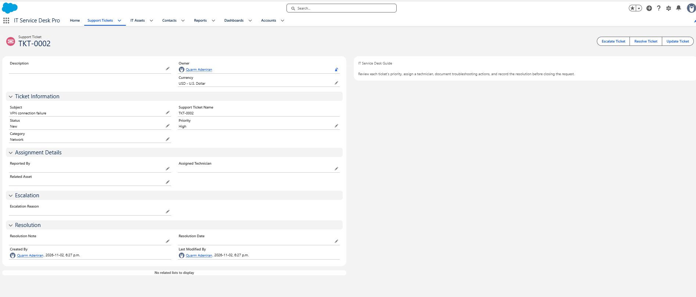
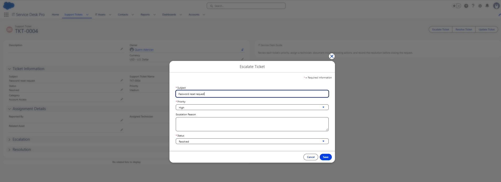
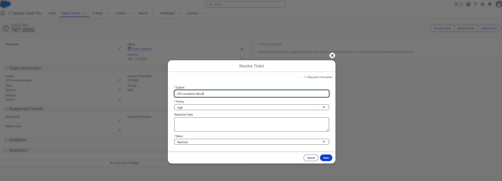

# 06 — Quick Actions

**Setup → Object Manager → Support Ticket → Buttons, Links, and Actions → New Action**

Quick Actions let a technician make a common change from a small dialog instead of opening the full edit form. All three are the **Update a Record** type, so they change the ticket they're opened from.

All three buttons appear in the ticket header on the Lightning record page: **Escalate Ticket, Resolve Ticket, Update Ticket**. I worked through adding them either with Dynamic Actions or through the page layout's action section. The screenshots show the buttons, but not which method put them there.

## Escalate Ticket

| Setting | Planned | What the screenshot shows |
|---|---|---|
| Action type | Update a Record | Not shown in the dialog |
| Label / API name | Escalate Ticket / `Escalate_Ticket` | Label confirmed |
| Fields on the action | Priority, Escalation Reason | Subject, Priority, Escalation Reason, Status |
| Predefined value | Priority = High | The dialog opens with Priority set to **High** on TKT-0004, which is Medium on the record behind it |

Use: a technician finds out a Medium ticket affects several people and needs to raise it quickly and record why.

The predefined value is working: the record says Medium, and the action opens with High already selected. The screenshot shows the dialog before saving, and TKT-0004 is still Medium in a later screenshot. So I haven't captured a saved escalation.

## Resolve Ticket

| Setting | Planned | What the screenshot shows |
|---|---|---|
| Action type | Update a Record | Not shown in the dialog |
| Label / API name | Resolve Ticket / `Resolve_Ticket` | Label confirmed |
| Fields on the action | Resolution Notes | Subject, Priority, Resolution Note, Status |
| Predefined value | Status = Resolved | The dialog shows Status = Resolved |

Use: record how the problem was fixed and close it out in one step. Example resolution note from my notes:

> Restarted the VPN client, cleared the cached connection settings, and verified that the employee could reconnect successfully.

The screenshot is on TKT-0002, which was **already Resolved** when I opened the dialog. That means I can't tell from it whether Resolved came from the predefined value or the record's existing status. The Resolution Note box is empty, and no saved result is captured.

The Stamp Ticket Resolution Date Flow is meant to work alongside this action: Resolve Ticket changes the status, and the Flow fills in the date. See [Flow automation](07-flow-automation.md).

## Update Ticket

| Setting | Planned |
|---|---|
| Action type | Update a Record |
| Label / API name | Update Ticket / `Update_Ticket` |
| Fields on the action | Status, Priority, Assigned Technician, Category |

Use: assign a new ticket to a technician and move it to In Progress without opening the full form.

The button is on the record page, but I don't have a screenshot of its dialog yet.

## Why Subject and Status are on every action

I planned Escalate Ticket with only Priority and Escalation Reason, and Resolve Ticket with only Resolution Note. Both dialogs also show **Subject**, **Priority**, and **Status**, marked with red asterisks as required. Salesforce adds required fields to an action layout by default. That's the likely reason they're there, the same way Subject and Status had to stay on the page layout.

That has a practical effect. Escalate Ticket shows a Status field, so a technician could change the status while escalating. Resolve Ticket shows Priority, so it could be changed while resolving. Neither is harmful, but the dialogs aren't as focused as I planned. If I tidy them up, I'd first check whether the action still saves with those fields removed.
