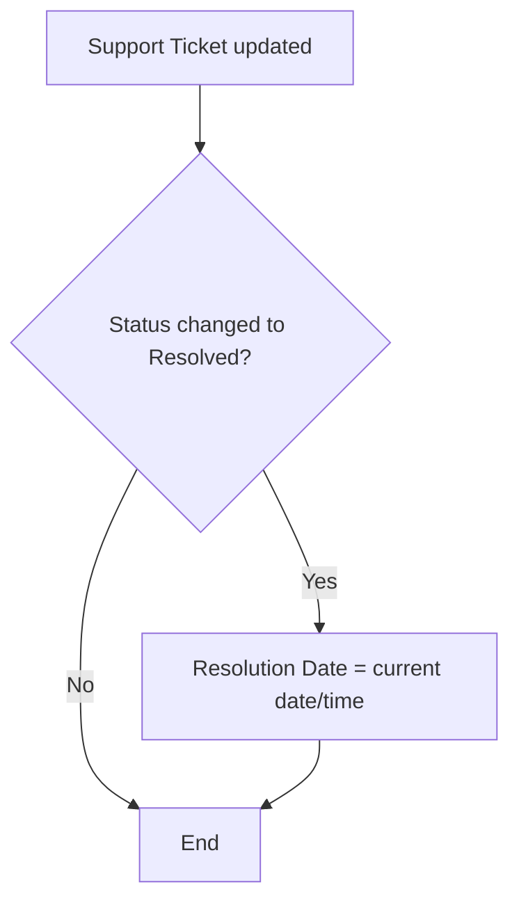
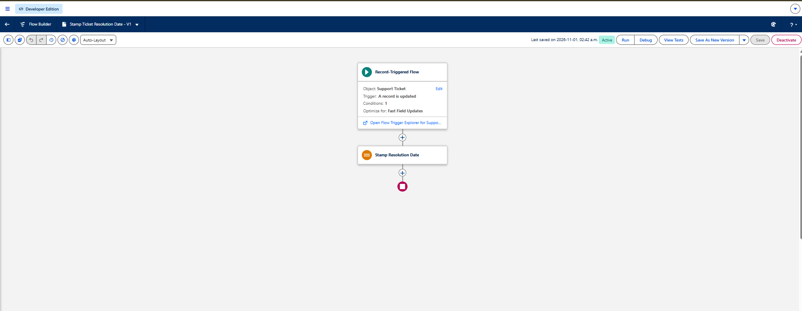
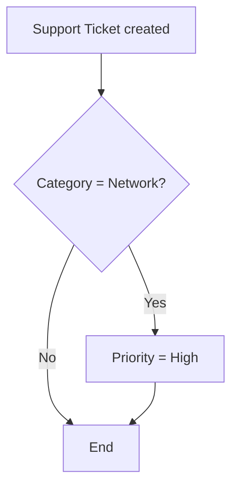
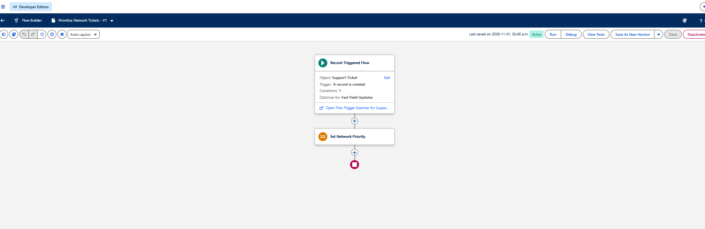

# 07 — Flow Automation

I built two record-triggered Flows in Flow Builder. Both are **Active** at version 1. Neither has a captured test showing it changed a record, so this document separates what's configured from what's verified.

| Flow | Status | Last saved | Verified on a record? |
|---|---|---|---|
| Stamp Ticket Resolution Date | Active, V1 | 2026-11-01, 2:42 a.m. | No |
| Prioritize Network Tickets | Active, V1 | 2026-11-01, 2:45 a.m. | No |

## Before-save Flows

Both Flows are set to **Optimize for: Fast Field Updates**. That makes them before-save Flows: they run before the record is written to the database, so they can change fields on the triggering record directly, through `$Record`. No Update Records element is needed, and the change is saved along with the user's edit.

That's why each Flow is just a trigger, one Assignment element, and an end.

## Flow 1: Stamp Ticket Resolution Date

Goal: when a ticket changes to Resolved, record the date and time automatically, so technicians don't have to type it and every resolved ticket gets a timestamp for reporting.

| Setting | Value | Visible in the screenshot? |
|---|---|---|
| Flow type | Record-Triggered Flow | Yes |
| Object | Support Ticket | Yes |
| Trigger | A record is updated | Yes |
| Entry condition | Status Equals Resolved | Shows "Conditions: 1". The condition itself is from my notes |
| When to run | Only when a record is updated to meet the condition requirements | From my notes |
| Optimize for | Fast Field Updates | Yes |
| Element | Assignment: Stamp Resolution Date | Element name, yes |
| Assignment | `$Record.Resolution_Date__c` Equals `$Flow.CurrentDateTime` | From my notes |

"Only when a record is updated to meet the condition requirements" means the Flow fires on the edit that changes the status to Resolved, not on every later edit of an already-resolved ticket. Without that setting, editing a resolved ticket would overwrite the original resolution time.

### What's verified

- The Flow exists, is active, and has the trigger, object, and optimization above.
- TKT-0001 and TKT-0002 were New on 2026-11-02 and Resolved by the Tickets by Status report on 2026-11-03. Both changes happened after the Flow was last saved, and it's active in the screenshot. If the Flow was active at the time and works, both tickets should have a Resolution Date.
- **No screenshot shows a Resolution Date value.** On TKT-0001 and TKT-0002, Resolution Date is empty in the screenshots taken while they were still New. On TKT-0004, the Resolution section is collapsed.

### A gap in the design

The Flow only triggers when a record is updated. A ticket **created** with Status already set to Resolved never triggers it, so it never gets a Resolution Date. TKT-0004 (Password reset request) was planned as a ticket that starts as Resolved, so it may be one of these. Changing the trigger to "A record is created or updated" would cover both cases.

## Flow 2: Prioritize Network Tickets

Goal: give newly created Network tickets High priority automatically. For example, someone can't connect to the VPN, the ticket is categorized as Network, and it saves as High.

| Setting | Value | Visible in the screenshot? |
|---|---|---|
| Flow type | Record-Triggered Flow | Yes |
| Object | Support Ticket | Yes |
| Trigger | A record is created | Yes |
| Entry condition | Category Equals Network | Shows "Conditions: 1". The condition itself is from my notes |
| Optimize for | Fast Field Updates | Yes |
| Element | Assignment: Set Network Priority | Element name, yes |
| Assignment | `$Record.Priority__c` Equals High | From my notes |

### What's verified

- The Flow exists, is active, and has the trigger, object, and optimization above.
- Both Network tickets, TKT-0002 (VPN connection failure) and TKT-0006 (Shared drive inaccessible), are High priority. Both were created after the Flow was last saved.
- **This doesn't prove the Flow ran.** My plan had TKT-0002 starting at Medium and TKT-0006 at High, but I didn't record what priority I actually entered when creating TKT-0002. If I entered High myself, the Flow had nothing to change.

### Why this rule is simple

Category alone isn't how a real service desk sets priority. That normally depends on impact, urgency, the number of people affected, and SLA commitments. A single user with a slow VPN shouldn't outrank an outage. I chose this rule to learn how record-triggered Flows read a field and update another one, not as a realistic priority model.

It also overrides whatever priority the technician picks, including Critical. A Network ticket created as Critical would be lowered to High. Adding a condition like "Priority is not Critical" would prevent that.

## How to verify both Flows

These are the tests I still need to run. Each one produces a screenshot for the [evidence checklist](../evidence-checklist.md).

**Resolution Date Flow**

1. Open TKT-0001 and expand the **Resolution** section. If Resolution Date has a value from 2026-11-03, take a screenshot. That confirms the Flow ran when the ticket was resolved.
2. If it's empty, open TKT-0003 (In Progress). Confirm Resolution Date is empty, and take a screenshot.
3. Click **Resolve Ticket**, enter a resolution note, and save.
4. Expand **Resolution** again. Resolution Date should show today's date and time. Take a screenshot.

**Network Priority Flow**

1. Go to **Support Tickets → New**.
2. Enter Subject `Wi-Fi drops in meeting room`, Category **Network**, and Priority **Low**. Take a screenshot of the form before saving.
3. Save. The new ticket (TKT-0007) should show Priority **High**. Take a screenshot.
4. Optional: create a Hardware ticket with Priority Low and confirm it stays Low. That shows the condition only matches Network.

You can also test either Flow with **Debug** in Flow Builder, which runs it against a chosen record and shows each step. A screenshot of the debug result works as evidence too.
