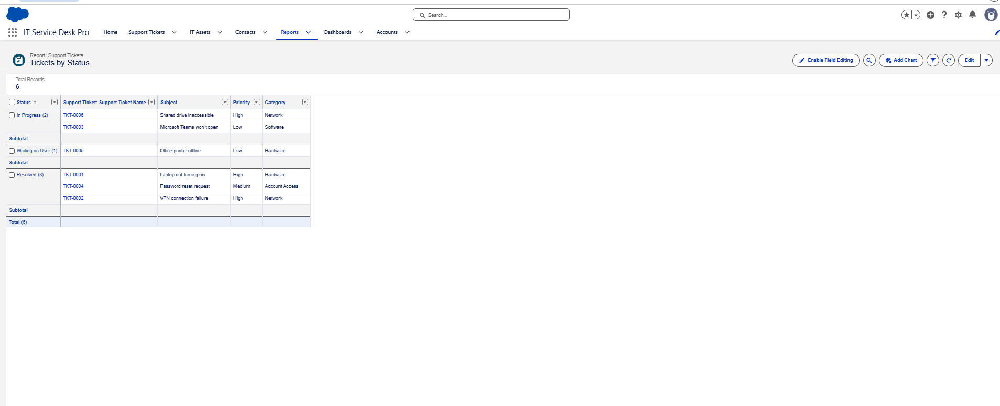
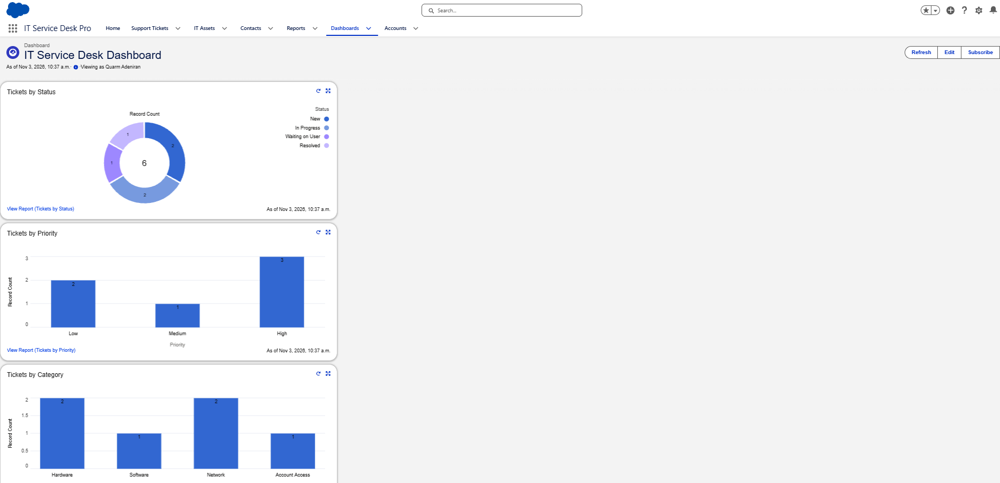
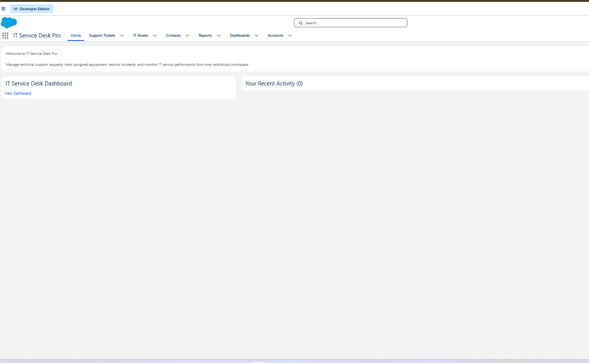

# 08 — Reports and Dashboard

## Goal

An IT manager should be able to see the desk's workload without opening every ticket: what's still open, how much of it is urgent, and what kinds of problems keep coming in.

## Reports

I built three summary reports on the Support Tickets report type:

| Report | Grouped by | Answers | Captured on its own? |
|---|---|---|---|
| Tickets by Status | Status | How much work is still open? | Yes |
| Tickets by Priority | Priority | How much of it is urgent? | No, only through the dashboard (its "View Report" link names it) |
| Tickets by Category | Category | What kinds of issues are we getting? | No, only through the dashboard. The report name is from my notes |

### Tickets by Status

The report groups all six tickets by status, with Subject, Priority, and Category columns:

| Status | Tickets |
|---|---|
| In Progress (2) | TKT-0006 Shared drive inaccessible, TKT-0003 Microsoft Teams won't open |
| Waiting on User (1) | TKT-0005 Office printer offline |
| Resolved (3) | TKT-0001 Laptop not turning on, TKT-0004 Password reset request, TKT-0002 VPN connection failure |

No tickets were New or Closed when this was captured.

## IT Service Desk Dashboard

The dashboard uses the three reports as its source:

| Component | Chart type | Values shown |
|---|---|---|
| Tickets by Status | Donut, 6 in the centre | New 2, In Progress 2, Waiting on User 1, Resolved 1 |
| Tickets by Priority | Vertical bar | Low 2, Medium 1, High 3 |
| Tickets by Category | Vertical bar | Hardware 2, Software 1, Network 2, Account Access 1 |

### The dashboard and the report don't match

The dashboard says New 2 and Resolved 1. The report says New 0 and Resolved 3. That isn't an error in either one. Salesforce dashboards show data as of their last refresh, and this one says **As of Nov 3, 2026, 10:37 a.m.** TKT-0001 and TKT-0002 were moved from New to Resolved after that, and the dashboard hadn't been refreshed when I took the screenshot.

Priority and category didn't change, so those two charts still match the report. Before replacing the screenshot, I should click **Refresh** so all three charts line up with the report.

## Custom Lightning home page

I built a home page called **IT Service Desk Home** in Lightning App Builder. It has two parts:

- A Rich Text welcome message:

  > Welcome to IT Service Desk Pro
  >
  > Manage technical support requests, track assigned equipment, resolve incidents, and monitor IT service performance from one centralized workspace.

- A Dashboard component pointing to the IT Service Desk Dashboard.

I also considered adding list views or recent items for quicker navigation. The page in the screenshot has a **Your Recent Activity** card, currently showing 0.

The page is what opens on the app's Home tab, so it's assigned to IT Service Desk Pro. The page name comes from my notes. It isn't visible in the screenshot.

### The dashboard component problem

When I first added the Dashboard component, Lightning App Builder showed an **Invalid Component** message, and searching the dashboard selector returned no matches. I worked through the usual causes:

- whether the dashboard had been saved
- which folder it was saved in
- whether my user had access to that folder
- whether the dashboard then showed up in the component's settings

I didn't record which of these fixed it.

In the final screenshot, the Invalid Component message is gone. The component shows the title **IT Service Desk Dashboard** and a **View Dashboard** link, but **no charts are visible on the home page**. I can't tell from the screenshot whether the charts failed to load, were still loading, or the component was set to show only a link. So I'm treating the home page dashboard as partly working: the component points to the right dashboard, but I haven't confirmed the charts display there.

To check:

1. Open the app's **Home** tab and wait for the page to finish loading.
2. If the charts appear in the dashboard card, take a screenshot.
3. If they don't, open **Setup → Lightning App Builder → IT Service Desk Home → Edit**, select the Dashboard component, and check which dashboard is selected and how the component is set to display. Save, refresh Home, and take a screenshot either way.
