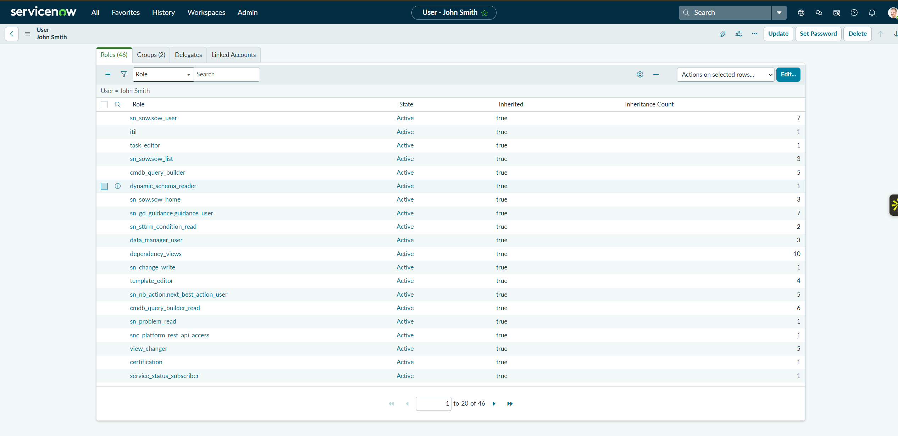
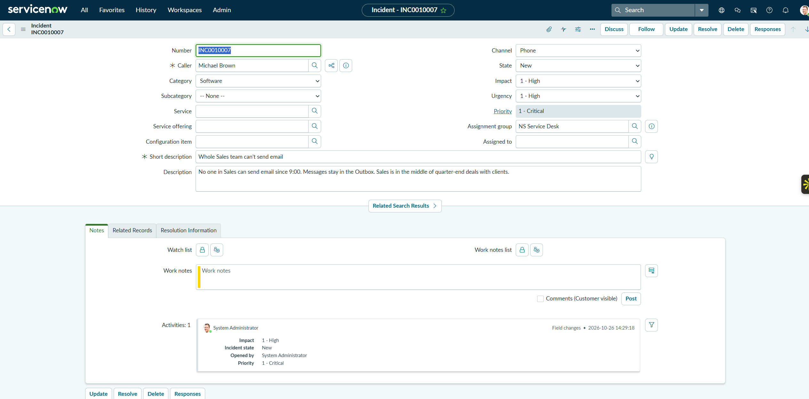
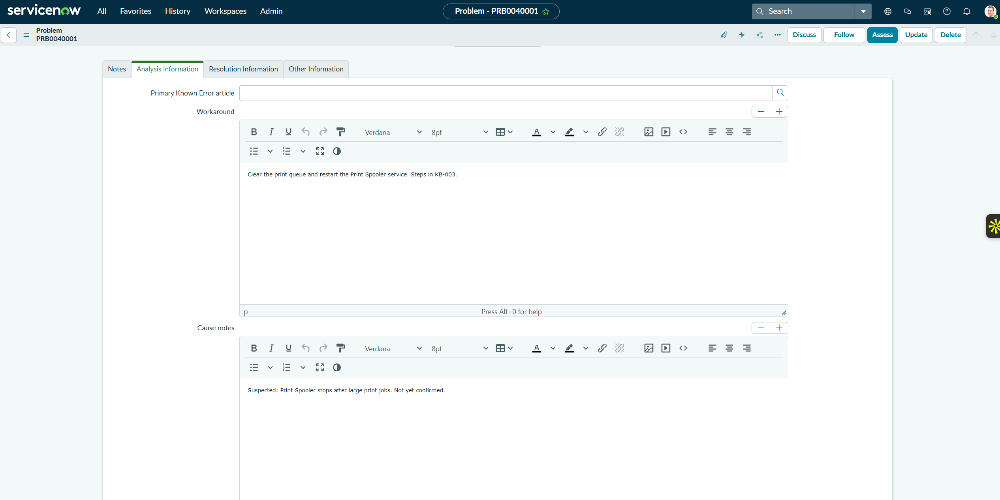

# ServiceNow ITSM Service Desk Lab

I used a ServiceNow Personal Developer Instance to practise the main IT Service Management workflows a service desk uses every day. I set up the team and its access, logged and prioritized incidents, worked a ticket to resolution while watching its SLAs, opened a problem for a recurring issue, published knowledge articles, fulfilled a catalog request, raised a standard change, and built a small reporting dashboard.

Northstar Solutions, its employees, and their issues are fictional. The ServiceNow records are real: the users, group, role assignment, incidents, SLAs, problem, knowledge articles, request, change, reports, and dashboard all exist in my developer instance, and the screenshots show them. The troubleshooting outcomes (unlocking an account, delivering a phone, restarting a print spooler) are simulated, and each lab note says where that's the case.

**This is a developer-instance simulation, not production experience.**

## Business scenario

Northstar Solutions is a fictional company of about 50 employees with a small first-line IT team, **NS Service Desk**. Over one day, the desk receives a locked account, a website access issue, a slow laptop, two reports of the same stuck printer queue, and a Sales-wide email outage during quarter-end. It also gets a request for a new company phone.

## Environment

- **Platform:** ServiceNow Personal Developer Instance, Brazil release
- **My role:** instance administrator, also acting as a Service Desk technician
- **Organization:** Northstar Solutions (fictional, about 50 simulated employees)
- **Users:** John Smith (service desk technician and group manager), Sarah Johnson, Michael Brown, Olivia Martinez, Priya Patel
- **Purpose:** hands-on ITSM practice for entry-level IT Support and Service Desk roles

## ITSM processes practised

| Process | What I did |
|---|---|
| User and access administration | Users, an assignment group, and `itil` granted through group membership |
| Incident management | Logging, categorization, impact/urgency/priority, assignment, lifecycle states |
| SLA management | Reading response and resolution SLAs, including one that breached |
| Problem management | A problem record with a workaround and a suspected cause |
| Knowledge management | Three articles through review to publication, one attached to a problem |
| Request fulfillment | Service Catalog order with approval, catalog tasks, and closure |
| Change management | A standard change from a template, linked to the problem |
| Reporting | Two incident reports and a Platform Analytics dashboard |

## Lab notes

| # | Activity | What's in it |
|---|---|---|
| 01 | [Users, groups, and roles](lab-notes/01-user-group-role-administration.md) | Five users, the NS Service Desk group, `itil` inherited through the group |
| 02 | [Incident creation and prioritization](lab-notes/02-incident-management.md) | Six incidents, and why the email outage is 1 - Critical |
| 03 | [Incident lifecycle and SLAs](lab-notes/03-incident-lifecycle-and-slas.md) | INC0010002 from New to Resolved; P4 SLA met, P1 response SLA breached |
| 04 | [Problem management](lab-notes/04-problem-management.md) | PRB0040001 for the recurring printer queue, and the form limitations I hit |
| 05 | [Knowledge management](lab-notes/05-knowledge-management.md) | Three published articles, KB0010003 attached to the problem |
| 06 | [Service Catalog fulfillment](lab-notes/06-service-catalog-fulfillment.md) | iPhone 13 request for Olivia Martinez: REQ, RITM, and SCTASK |
| 07 | [Reports and dashboard](lab-notes/07-reports-and-dashboard.md) | Incidents by priority and category, Northstar Service Desk dashboard |
| 08 | [Standard change management](lab-notes/08-standard-change-management.md) | CHG0030002 to restart the Print Spooler, linked to the problem |

## Results

| Item | Outcome | Verified by |
|---|---|---|
| Users and group | 5 users; NS Service Desk with John Smith and my admin account | Users list, group members |
| Role assignment | `itil` on the group; John shows it as Inherited | John's Roles tab |
| Incidents | INC0010002–INC0010007 logged and routed to NS Service Desk (one P1, one P3, four P4) | Incident list |
| INC0010002 | New → In Progress → On Hold → Resolved, "Resolved – Permanent Fix Applied" | Activity stream, resolution tab |
| P4 response SLA | Completed at 5.48% of 8 hours | Task SLAs |
| P1 response / resolution SLAs | Response **breached** at 266.78% of 15 minutes; resolution at 66.69% of 1 hour when captured. Not resolved | Task SLAs |
| PRB0040001 | Workaround and suspected cause recorded; still **New**, root cause not confirmed | Problem form and activity |
| Knowledge | KB0010002, KB0010003, KB0010004 published at v1.0; KB0010003 attached to PRB0040001 | Knowledge list, Attached Knowledge |
| Catalog request | REQ0010001 approved and Closed Complete; RITM0010001 Completed; SCTASK0010002 Closed Complete | REQ, RITM, SCTASK forms |
| Standard change | CHG0030002, Standard, Closed, linked to PRB0040001 | Problem's Change Requests list |
| Reporting | 2 reports on the Northstar Service Desk dashboard | Dashboard |

## Selected screenshots

John Smith's `itil` role is **inherited** from NS Service Desk, not assigned directly:

The Sales email outage: Impact 1 - High and Urgency 1 - High give Priority **1 - Critical**:

INC0010002's activity stream: assignment, internal work notes, customer-visible comments, On Hold, and resolution:

The P1 outage's SLAs: the 15-minute response SLA breached at 266.78% while the incident was still unassigned to an individual:

PRB0040001's workaround and suspected cause, which is clearly marked as not yet confirmed:

The Northstar Service Desk dashboard: incidents by priority and by category:

Each lab note includes the rest of the screenshots for that activity.

## Challenges and how I handled them

- **Problem module not in the menu.** I couldn't find Problem where I expected in the navigator, so I opened the table directly with `problem.do`.
- **Problem "Assigned to" rejected my users.** The field wouldn't accept the users I tried, so I assigned the problem to the NS Service Desk group instead.
- **No incident-to-problem field on the form.** I recorded the related incident numbers (INC0010004, INC0010006) in a problem work note. It's readable, but it isn't a formal link, and I note that in [note 04](lab-notes/04-problem-management.md).
- **No exact standard change template.** No template existed for restarting a service, so I used the closest one, **Reboot Windows Server**, and set a specific short description.
- **Reports vs. dashboards.** Reports and the dashboard live in different interfaces in this release. I built the reports, then assembled the dashboard in Platform Analytics.

## What I learned

- **Put roles on groups, not people.** Joining or leaving the team then grants or removes access in one step, and the access stays consistent across technicians.
- **Priority comes from impact and urgency.** One user with a workaround is low priority, and a whole department blocked with no workaround is critical. The priority then decides the SLA clock.
- **A P1 response SLA is very short.** Fifteen minutes is less time than it took me to work a single P4 ticket. Critical tickets have to be triaged as soon as they arrive.
- **Internal and customer notes have different audiences.** Technical detail goes in work notes; plain-language updates go in customer-visible comments; passwords go in neither.
- **Incidents restore service; problems remove causes.** A workaround and a standard change keep users working, but the problem stays open until the cause is confirmed and fixed.
- **REQ → RITM → SCTASK.** One order, one or more items, and the tasks that fulfill each item, with approval before fulfillment starts.

## Limitations

- This is a personal developer instance, not a production environment. The users, the company, and the issues are fictional, and there was no real end user on any ticket.
- The troubleshooting outcomes are simulated. No Active Directory account was unlocked, no iPhone was delivered, and no print server was restarted.
- **INC0010007 (the email outage) wasn't resolved**, and its response SLA breached.
- **PRB0040001 wasn't resolved.** The root cause is only suspected, and the problem is still in the New state.
- The incident-to-problem relationship is recorded in a work note, not in a formal reference field.
- I didn't sign in as John Smith to test the `itil` role from his side.
- Some steps aren't captured in screenshots: the procurement task (SCTASK0010001), the approval record, the knowledge article bodies and approval stages, the classic report views, and the CHG0030002 form. Each lab note marks these as evidence TODOs.

## Resume summary

> **ServiceNow ITSM Service Desk Lab** (ServiceNow Personal Developer Instance): Configured users, an assignment group, and group-inherited `itil` roles. Logged and prioritized six incidents using impact and urgency, and worked one through its full lifecycle with internal work notes, customer communication, and resolution codes. Monitored response and resolution SLAs, including a breached P1. Opened a problem record with a workaround and suspected cause, published three knowledge articles, fulfilled an approved Service Catalog request (REQ/RITM/SCTASK), raised a standard change, and built incident reports on a Platform Analytics dashboard.

## Evidence

Screenshots are in [evidence/](evidence/), and each lab note links to the ones it uses. I cropped the browser address bar from the group screenshot because it showed my developer instance URL and a record ID. No other screenshot shows the instance URL, credentials, or personal information. The `@northstar.example` email addresses are fictional. I left out a screenshot of the instance home page, because it showed no lab work, and an incident list whose filter also pulled in ServiceNow's built-in demo incidents.
