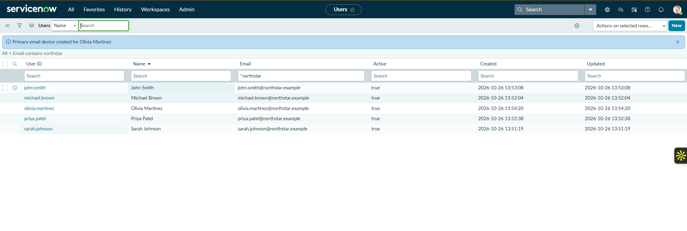
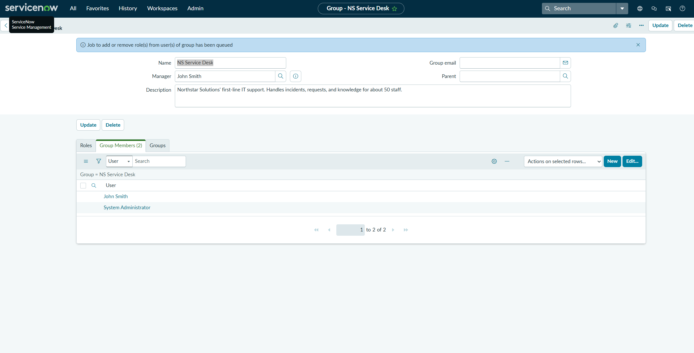

# 01 — Users, Groups, and Role Administration

## Scenario

Before Northstar's service desk could take any tickets in ServiceNow, it needed people to raise them, a team to assign them to, and the right access for that team.

## What I did

1. I created five user records for fictional Northstar employees: John Smith, Sarah Johnson, Michael Brown, Olivia Martinez, and Priya Patel. Each has a `firstname.lastname` user ID and a fictional `@northstar.example` email address.
2. I created a group called **NS Service Desk**, set John Smith as its manager, and described it as Northstar's first-line IT support team.
3. I added two members: John Smith and System Administrator (my own admin account in the instance).
4. I assigned the `itil` role to the **group**, not to John directly.
5. I opened John's user record and checked the **Roles** tab to see how the role reached him.

## What I observed

- The Users list, filtered on email containing "northstar", shows all five accounts as active.
- When I saved the role on the group, ServiceNow showed the banner "Job to add or remove role(s) from user(s) of group has been queued." Role changes on a group are pushed to its members by a background job, not instantly.
- On John's **Roles** tab, `itil` is listed as **Active**, **Inherited = true**, with an inheritance count of 1. The tab lists 46 roles in total, and every role on the first page shows Inherited = true. `itil` contains other roles, so one assignment adds more than one entry.

## Why assign roles to the group

If roles are assigned to individual users, every new service desk technician needs the same roles added by hand, and every leaver needs them removed by hand. It's easy to miss one. When the role sits on the group:

- Adding someone to NS Service Desk gives them the access the team needs, and removing them takes it away.
- Everyone on the team has the same access, so there's no drift between technicians.
- An auditor can check access by looking at the group's roles and members, instead of reviewing each user.

This is the same idea as group-based access in Active Directory and Entra ID, which I practised in my [Active Directory Help Desk Lab](../../active-directory-help-desk-lab/) and [Microsoft Entra ID Administration](../../microsoft-entra-id-administration/) projects.

## Result

Five Northstar users exist, NS Service Desk has John Smith and my admin account as members, and John holds `itil` through the group rather than as a direct assignment.

I didn't sign in as John to test what the `itil` role lets him do.

## Evidence

The five Northstar user accounts, all active, with fictional `@northstar.example` addresses:

The NS Service Desk group with John Smith as manager and two members. The banner confirms the group role change was queued for its members:

John Smith's Roles tab, showing `itil` as Active and Inherited (inheritance count 1):

