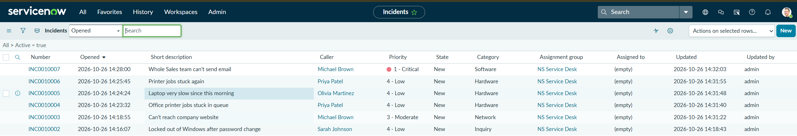

# 02 — Incident Creation and Prioritization

## Scenario

Over a few minutes, five Northstar employees reported six problems: a locked account, a website that wouldn't load, two printer queue issues, a slow laptop, and an entire department unable to send email. Each one needed to be logged, categorized, prioritized, and routed to the service desk.

## What I did

I logged six incidents and assigned each to the **NS Service Desk** group. For each, I set a caller, a category, a short description and description, and impact and urgency. ServiceNow calculates priority from impact and urgency.

| Incident | Caller | Issue | Category | Priority |
|---|---|---|---|---|
| INC0010002 | Sarah Johnson | Locked out of Windows after a password change | Inquiry | 4 - Low |
| INC0010003 | Michael Brown | Can't reach the company website | Network | 3 - Moderate |
| INC0010004 | Priya Patel | Office printer jobs stuck in the queue | Hardware | 4 - Low |
| INC0010005 | Olivia Martinez | Laptop very slow since this morning | Hardware | 4 - Low |
| INC0010006 | Priya Patel | Printer jobs stuck again (recurring) | Hardware | 4 - Low |
| INC0010007 | Michael Brown | Whole Sales team can't send email | Software | 1 - Critical |

All six started in the **New** state, assigned to the NS Service Desk group with no individual technician yet.

## How priority works

- **Impact** is how much of the business is affected: one person, a team, or the whole company.
- **Urgency** is how quickly it needs fixing: whether there's a workaround, and whether work is blocked right now.
- **Priority** is the result, looked up from the two. It decides which ticket gets worked first, and which SLA targets apply.

Most of these incidents affect one person who either has a workaround or isn't completely blocked, so they came out as **4 - Low**. The website issue came out a step higher, at **3 - Moderate**.

### Why the email outage was Critical

INC0010007 was reported by phone: "No one in Sales can send email since 9:00. Messages stay in the Outbox. Sales is in the middle of quarter-end deals with clients."

- **Impact: 1 - High.** It affects an entire department, not one user.
- **Urgency: 1 - High.** Customer communication is completely blocked, there's no workaround, and it's happening during quarter-end, when lost time can mean lost deals.

High impact and high urgency gave **1 - Critical**, the top of the priority scale. That also put the ticket on the tightest SLA targets, which I look at in [note 03](03-incident-lifecycle-and-slas.md).

## Result

Six incidents were logged, categorized, prioritized, and routed to NS Service Desk. The callers and their problems are simulated. The incident records, priorities, and assignments are real records in my developer instance.

## Evidence

The six Northstar incidents in the active incident list, all assigned to NS Service Desk, with priorities from 1 - Critical to 4 - Low:

INC0010007 at logging: Impact 1 - High and Urgency 1 - High produce Priority 1 - Critical, and the ticket is assigned to NS Service Desk:

