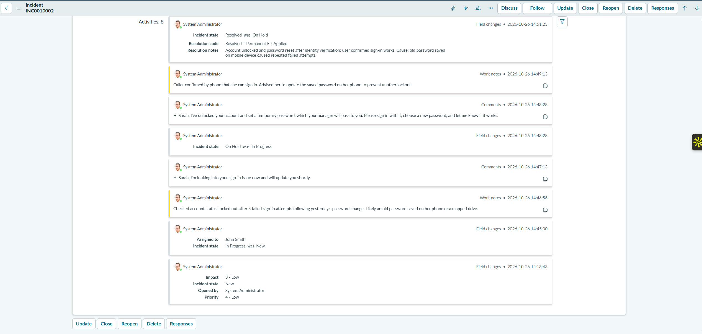
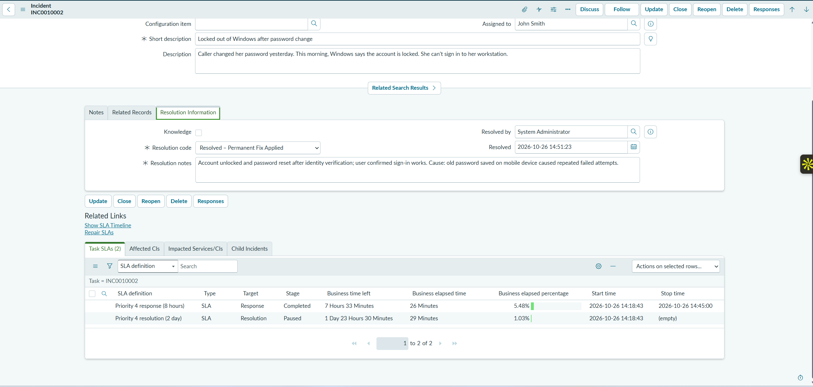
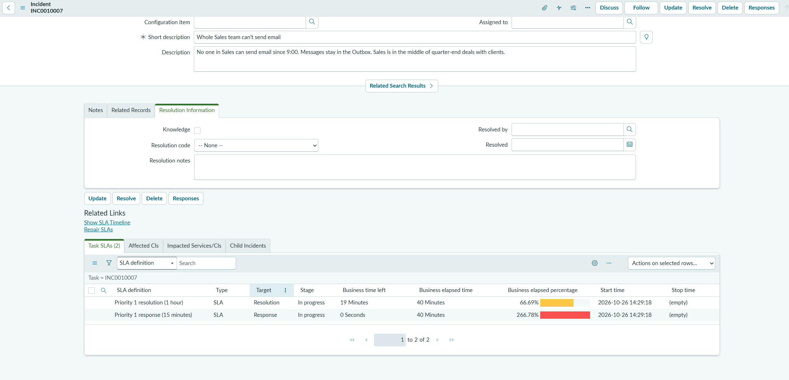

# 03 — Incident Lifecycle, Notes, and SLAs

## Scenario

Sarah Johnson changed her password the day before. The next morning, Windows told her that her account was locked and she couldn't sign in to her workstation (INC0010002, 4 - Low). Meanwhile, the Sales email outage (INC0010007, 1 - Critical) was sitting in the queue.

The troubleshooting in this ticket is simulated, since there was no real Active Directory account behind it. The ticket handling is real: the state changes, assignment, work notes, customer comments, resolution fields, and SLA records all happened in ServiceNow.

## What I did on INC0010002

I worked the ticket from **New → In Progress → On Hold → Resolved**. The activity stream records each step:

| Time (2026-10-26) | Entry type | What happened |
|---|---|---|
| 14:18:43 | Field changes | Incident opened: Impact 3 - Low, Priority 4 - Low, state New |
| 14:45:00 | Field changes | Assigned to John Smith; state New → **In Progress** |
| 14:46:56 | Work note (internal) | Account locked out after 5 failed sign-in attempts following yesterday's password change; likely an old password saved on her phone or a mapped drive |
| 14:47:13 | Comment (customer-visible) | Let Sarah know I was looking into the sign-in issue |
| 14:48:28 | Field changes + comment | State In Progress → **On Hold**; told Sarah the account was unlocked and a temporary password would come through her manager, and asked her to confirm it worked |
| 14:49:13 | Work note (internal) | Sarah confirmed by phone that she could sign in; advised her to update the saved password on her phone to stop it happening again |
| 14:51:23 | Field changes | State On Hold → **Resolved** |

**Resolution information:**

- **Resolution code:** Resolved – Permanent Fix Applied
- **Resolution notes:** Account unlocked and password reset after identity verification; user confirmed sign-in works. Cause: old password saved on mobile device caused repeated failed attempts.

I kept the two kinds of notes separate. **Work notes** are internal and hold the technical detail for other technicians. **Additional comments** are visible to the caller, so I wrote them in plain language. The temporary password went through Sarah's manager, not into the ticket.

## SLAs

ServiceNow attached two SLAs to each incident based on its priority.

- A **response SLA** measures how quickly someone starts working the ticket. In this instance it stopped when INC0010002 was assigned and moved to In Progress.
- A **resolution SLA** measures how quickly the issue is fixed. It runs until the incident is resolved, and pauses in states like On Hold or Resolved.

### INC0010002 (Priority 4)

| SLA | Stage | Elapsed | Elapsed % |
|---|---|---|---|
| Priority 4 response (8 hours) | Completed | 26 minutes | **5.48%** |
| Priority 4 resolution (2 day) | Paused | 29 minutes | 1.03% |

The response SLA started at 14:18:43 and stopped at 14:45:00, when the ticket was assigned and moved to In Progress. That used about 5% of the 8-hour allowance. The resolution SLA showed **Paused** at 1.03% when I captured it, after the incident was resolved.

### INC0010007 (Priority 1)

| SLA | Stage | Time left | Elapsed | Elapsed % |
|---|---|---|---|---|
| Priority 1 response (15 minutes) | In progress | 0 seconds | 40 minutes | **266.78%** (breached) |
| Priority 1 resolution (1 hour) | In progress | 19 minutes | 40 minutes | **66.69%** |

INC0010007 was still **New**, with no individual assignee, when I captured these SLAs. The 15-minute response target had passed long before, so the response SLA showed red at 266.78%. The 1-hour resolution SLA had already used two thirds of its time.

I didn't resolve INC0010007, and this lab doesn't claim the outage was fixed.

### What this shows

A P4 ticket has hours of slack. A P1 doesn't. The P1 response clock is 15 minutes, which is shorter than it took me to work the whole P4 ticket. On a real desk, a critical incident should be picked up, assigned, and acknowledged as soon as it arrives, and escalated if needed, before any lower-priority work. Leaving it in the queue breaches the response SLA within minutes and eats into the resolution time, while a whole department can't work.

## Result

- INC0010002 went through the full lifecycle to **Resolved** with a resolution code, resolution notes, separate internal and customer-facing notes, and its response SLA met at 5.48%.
- INC0010007 breached its response SLA (266.78%) and was at 66.69% of its resolution SLA when captured. It wasn't resolved in this lab.

## Evidence

INC0010002's activity stream, showing the state changes, assignment to John Smith, internal work notes, customer comments, and resolution:

INC0010002's resolution fields and Task SLAs. The P4 response SLA completed at 5.48%:

INC0010007's Task SLAs: response breached at 266.78% and resolution at 66.69%, with the incident still unassigned to an individual:

