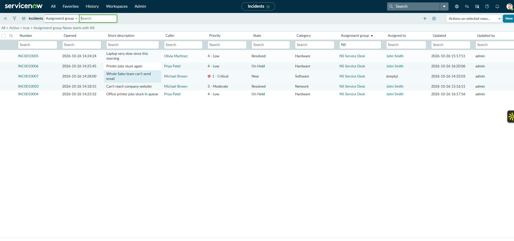

# 04 — Problem Management

## Scenario

Priya Patel reported the office printer's queue getting stuck twice: INC0010004 ("Office printer jobs stuck in queue") and INC0010006 ("Printer jobs stuck again"). The same symptom on the same printer is a sign of an underlying problem. Fixing each incident as it comes in gets the user printing again, but it doesn't stop the next one.

## What I did

I created **PRB0040001 — Office printer queue repeatedly gets stuck** with these fields:

| Field | Value |
|---|---|
| Category | Hardware |
| Impact | 2 - Medium |
| Urgency | 3 - Low |
| Priority | 4 - Low |
| Assignment group | NS Service Desk |
| State | New |

In the **Analysis Information** tab, I recorded:

- **Workaround:** "Clear the print queue and restart the Print Spooler service. Steps in KB-003."
- **Cause notes:** "Suspected: Print Spooler stops after large print jobs. Not yet confirmed."

I added a work note linking the two incidents: "Related incidents: INC0010004 and INC0010006 (same printer, same symptom)." Both incidents were assigned to John Smith and set to **On Hold**.

Later, I attached knowledge article KB0010003 ([note 05](05-knowledge-management.md)) and a standard change ([note 08](08-standard-change-management.md)) to this problem.

## Incident vs. problem

- An **incident** is about getting one user working again, as fast as possible.
- A **problem** is about finding and removing the cause behind one or more incidents, so they stop happening.

The workaround gives the service desk a quick, consistent fix while the root cause is still unknown. The cause notes say plainly that the cause is suspected, not confirmed.

## Developer-instance limitations I worked around

Several parts of the Problem form didn't behave the way I expected in this instance:

| What I expected | What happened | What I did |
|---|---|---|
| A Problem module in the application navigator | It wasn't in the menu where I expected it | Opened the Problem table directly with `problem.do` |
| Assign the problem to John Smith | The **Assigned to** field didn't accept the users I tried | Used the **NS Service Desk** assignment group only |
| Link the incidents through the incident's Problem reference field | The field wasn't on the visible form | Recorded INC0010004 and INC0010006 in a problem work note instead |

The work-note link is visible to anyone reading the problem, but it isn't a formal relationship. ServiceNow won't list those incidents under the problem's related records. With a properly configured form, I'd set the **Problem** field on each incident instead.

I didn't investigate why **Assigned to** rejected the users. It may come down to roles or a reference qualifier on that field in this instance, but I haven't confirmed that.

## Result

PRB0040001 is logged with a documented workaround, a suspected (unconfirmed) cause, the related incidents noted, and the NS Service Desk group assigned. The problem is still in the **New** state. **The root cause wasn't confirmed and the problem wasn't permanently resolved.**

## Evidence

INC0010004 and INC0010006 assigned to John Smith and On Hold:

PRB0040001's Analysis Information: the workaround (pointing to KB-003) and the cause marked "Suspected… Not yet confirmed":

PRB0040001's activity, showing the work note naming the related incidents and the initial field values (NS Service Desk, Impact 2, Urgency 3, Priority 4, state New):

