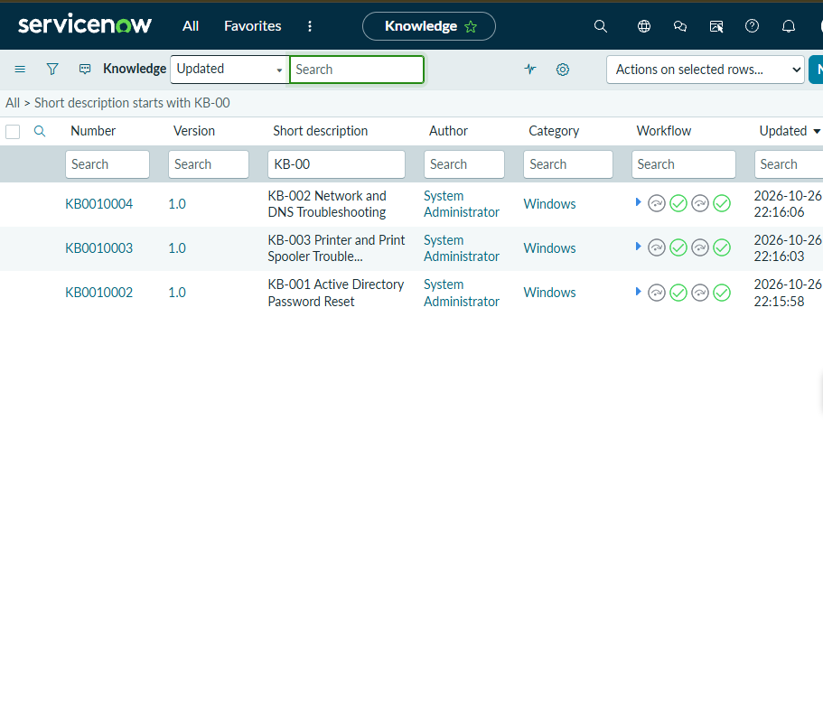
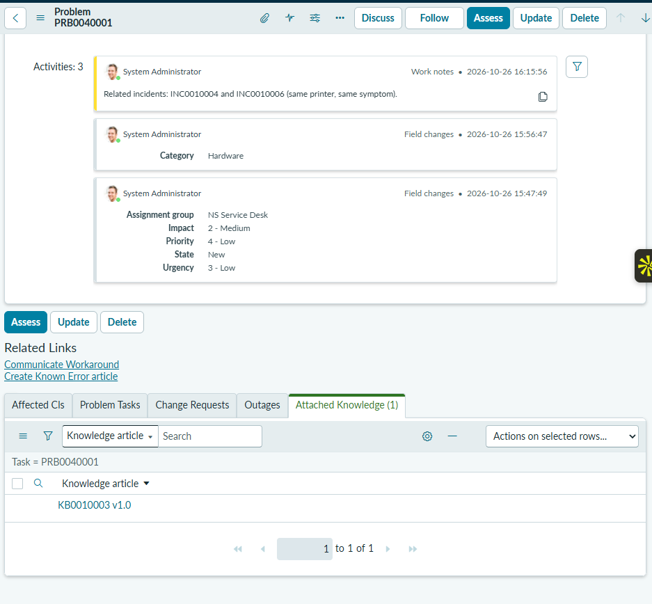

# 05 — Knowledge Management

## Scenario

The tickets in this lab keep coming back to the same three topics: password lockouts, network and website access, and printer queues. Writing the fix down once lets every technician handle the next ticket the same way, without working it out again.

## What I did

I created three knowledge articles in the Windows category:

| Number | Title | Relevant to |
|---|---|---|
| KB0010002 | KB-001 Active Directory Password Reset | INC0010002 (account lockout) |
| KB0010004 | KB-002 Network and DNS Troubleshooting | INC0010003 (can't reach company website) |
| KB0010003 | KB-003 Printer and Print Spooler Troubleshooting | INC0010004, INC0010006, PRB0040001 |

They cover the same topics as the knowledge-base articles I wrote for my [Enterprise Help Desk Simulation](../../enterprise-helpdesk-simulation/knowledge-base/) in Jira Service Management. ServiceNow numbered them in the order I created them, so the ServiceNow numbers don't match the KB-00x titles one-to-one.

I took each article through the instance's review and approval workflow and published it as **version 1.0**.

I then attached **KB0010003** to **PRB0040001**, so anyone working the printer problem finds the workaround steps from the problem record. The problem's workaround field also refers to KB-003.

## How knowledge articles help the desk

- **Consistency:** every technician follows the same tested steps, so users get the same fix whoever picks up the ticket.
- **Speed:** the technician follows the article instead of starting from scratch, which helps lower-priority tickets meet their SLAs.
- **Linking to problems:** attaching the article to the problem puts the workaround next to the issue it addresses.
- **Approval before publishing:** a review step means a wrong or unsafe procedure is less likely to be published.

## Result

Three knowledge articles were published at version 1.0, and KB0010003 is attached to PRB0040001.

> **Evidence TODO:** The article bodies and the review/approval steps aren't captured in a screenshot. The list below shows version 1.0 and the workflow indicators, but not the article content or each approval stage.

## Evidence

The three Northstar knowledge articles at version 1.0 in the Windows category, with their workflow indicators:

PRB0040001's Attached Knowledge tab showing KB0010003 v1.0:

