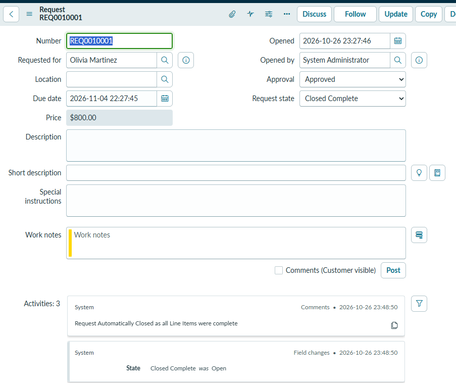
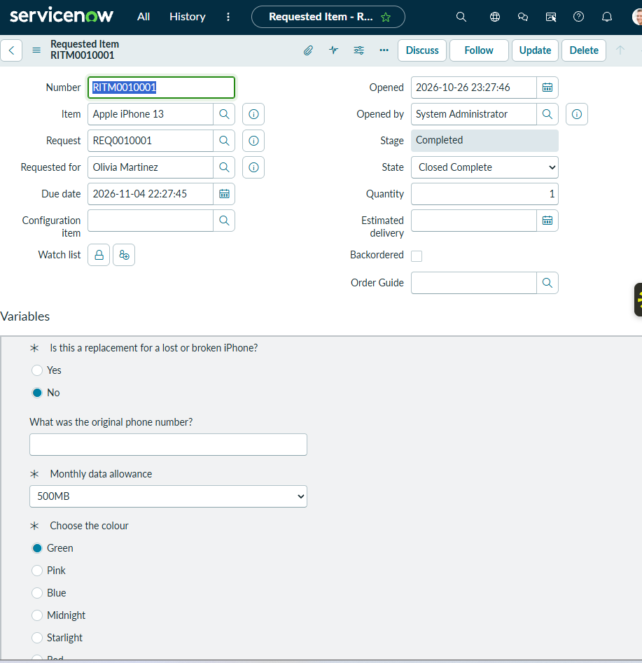
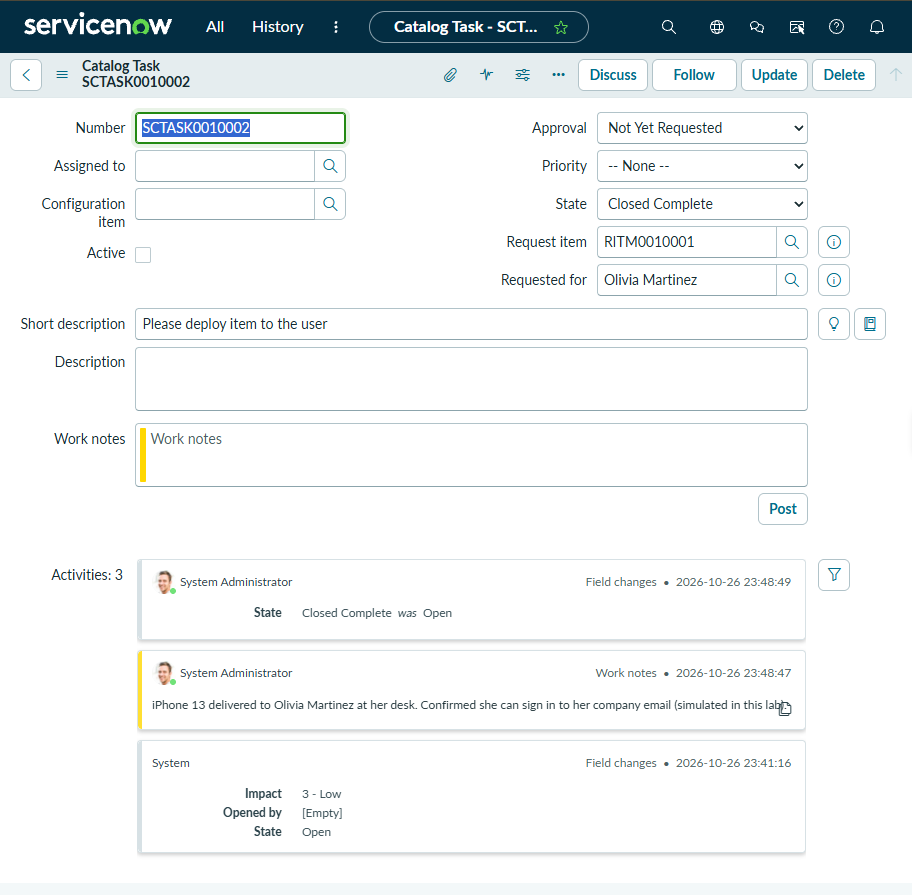

# 06 — Service Catalog Request Fulfillment

## Scenario

Olivia Martinez needed a company mobile phone. That isn't an incident, because nothing is broken. It's a **service request**, which goes through the Service Catalog, gets approved, and is then fulfilled by the right teams.

No physical device existed or was delivered. The request records, approval, and task workflow are real ServiceNow records; the delivery is simulated.

## What I did

1. I ordered **Apple iPhone 13** from the Service Catalog on Olivia Martinez's behalf. I answered the item's questions: not a replacement for a lost or broken phone, a 500MB monthly data allowance, and the colour green. The item's price was $800.00.
2. The request required **approval** before fulfillment started. Once it was approved, ServiceNow created the fulfillment tasks.
3. I worked the two catalog tasks in order:
   - **SCTASK0010001**: procurement (ordering the device), for the Procurement team
   - **SCTASK0010002**: "Please deploy item to the user", for Field Services
4. On the deployment task, I added a work note saying the iPhone 13 was delivered to Olivia at her desk and that she could sign in to her company email, marked in the note as simulated. I then closed the task as **Closed Complete**.
5. Once all its tasks were complete, the requested item closed, and the request closed automatically.

## REQ, RITM, and SCTASK

ServiceNow splits one order into three levels:

| Record | Number | What it represents | Final state |
|---|---|---|---|
| **REQ**: Request | REQ0010001 | The order as a whole (the "shopping cart"), raised for Olivia, holding the approval | Approval: Approved; Request state: **Closed Complete** |
| **RITM**: Requested Item | RITM0010001 | One catalog item in the order (Apple iPhone 13, quantity 1), with Olivia's answers | Stage: **Completed**; State: **Closed Complete** |
| **SCTASK**: Catalog Task | SCTASK0010001, SCTASK0010002 | The individual pieces of fulfillment work, each done by a team | SCTASK0010002: **Closed Complete** |

A single request can contain several items, such as a phone and a laptop, and each item can have several tasks for different teams. That's why the three levels exist.

## Approval to fulfillment

```text
Order placed (REQ + RITM created)
        │
        ▼
Approval ──► Approved
        │
        ▼
SCTASK0010001  Procurement: order the device ──► Closed Complete
        │
        ▼
SCTASK0010002  Field Services: deploy to user ──► Closed Complete
        │
        ▼
RITM0010001  Completed / Closed Complete
        │
        ▼
REQ0010001   "Request Automatically Closed as all Line Items were complete"
```

The approval happens at the request level, before any fulfillment work starts, not on the individual tasks. That's why SCTASK0010002's own Approval field shows "Not Yet Requested".

## Result

The request went from order through approval and two fulfillment tasks to **Closed Complete** at all three levels. **The device delivery was simulated, and no physical iPhone was deployed.**

> **Evidence TODO:** SCTASK0010001 (the procurement task) and the approval record aren't captured in a screenshot. The REQ shows Approval = Approved, but not who approved it or when.

## Evidence

REQ0010001 for Olivia Martinez: Approval = Approved, Request state = Closed Complete, and the system comment "Request Automatically Closed as all Line Items were complete":



RITM0010001 for an Apple iPhone 13, linked to REQ0010001, Stage = Completed, State = Closed Complete, with the catalog variables:



SCTASK0010002, the deployment task, Closed Complete, with the simulated delivery work note:


