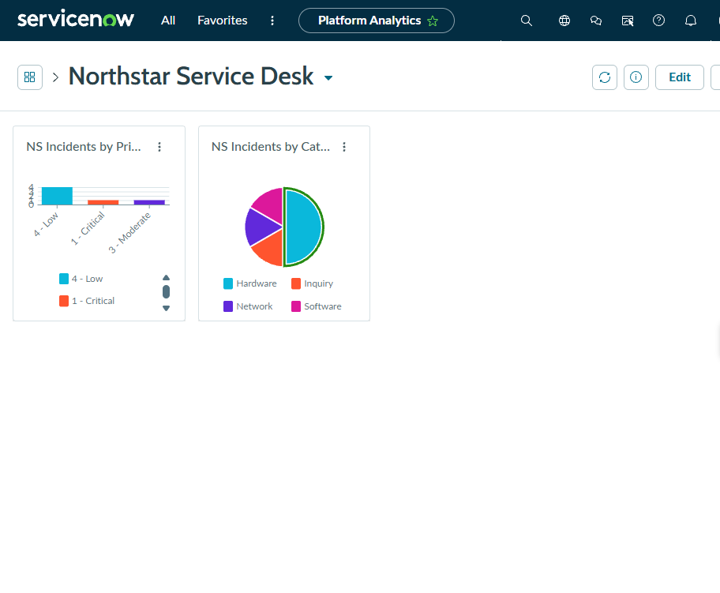

# 07 — Reports and Dashboard

## Scenario

A service desk lead needs to see what's in the queue without opening every ticket: how severe the work is, and what kinds of issues keep coming in.

## What I did

I created two reports on the Incident table:

| Report | Chart type | Answers |
|---|---|---|
| **NS Incidents by Priority** | Bar | How much of the work is urgent? |
| **NS Incidents by Category** | Pie | What kinds of issues are we getting? |

Then I created a dashboard called **Northstar Service Desk** in **Platform Analytics** and added both reports to it.

## What the dashboard shows

- **By priority:** four incidents at 4 - Low, one at 1 - Critical, and one at 3 - Moderate. That matches the six incidents from [note 02](02-incident-management.md). Most of the volume is low priority, but the single Critical ticket is the one that needs attention first.
- **By category:** half the pie is Hardware (three of the six incidents: two printer, one laptop), with Inquiry, Network, and Software making up the rest. Repeated hardware tickets, especially the same printer twice, are what prompted [PRB0040001](04-problem-management.md).

For a lead, the priority chart helps with **staffing and escalation** (is anything critical waiting?), and the category chart helps with **trends** (where do problem management and knowledge articles help most?).

## Classic reports vs. Platform Analytics

The reports and the dashboard weren't in the same place. Reports are built with ServiceNow's report designer, but in this release dashboards are created and viewed in **Platform Analytics**, a separate workspace-style interface. I had to build the reports first and then add them to the dashboard from inside Platform Analytics, instead of doing both in one screen.

On the dashboard, the widget titles are cut off ("NS Incidents by Pri…", "NS Incidents by Cat…") because the default widget size is small. The full names are the report names above.

## Result

Two incident reports were created and shown together on the **Northstar Service Desk** dashboard.

> **Evidence TODO:** The two reports aren't captured on their own in the classic report view. The only evidence is the dashboard below.

## Evidence

The Northstar Service Desk dashboard in Platform Analytics, with NS Incidents by Priority (bar) and NS Incidents by Category (pie):

