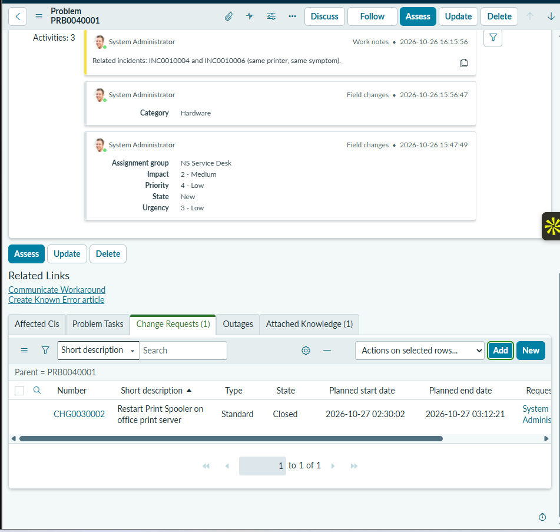

# 08 — Standard Change Management

## Scenario

The workaround for [PRB0040001](04-problem-management.md) is to restart the Print Spooler service on the office print server. Restarting a service on a shared server affects everyone who prints, so it should go through change management rather than being done ad hoc, even when it's routine.

This change is simulated. No real print server existed, and nothing was restarted.

## What I did

1. I created a change from the **Reboot Windows Server** standard change template, the closest available template to a service restart on a Windows server.
2. I set the short description to **Restart Print Spooler on office print server**. The change was numbered **CHG0030002**.
3. I linked it to **PRB0040001**, so it appears in the problem's **Change Requests** related list.
4. I moved the change through its states to **Closed**.

| Field | Value |
|---|---|
| Number | CHG0030002 |
| Type | Standard |
| State | Closed |
| Planned start | 2026-10-27 02:30:02 |
| Planned end | 2026-10-27 03:12:21 |
| Parent | PRB0040001 |

## Why a standard change

ServiceNow has three main change types:

- **Normal:** assessed and approved case by case, often by a Change Advisory Board.
- **Emergency:** needed immediately to restore service, approved on an expedited path.
- **Standard:** low-risk, repeatable, and **pre-approved**. The steps, risk, and approval are defined once in a template, so each use doesn't need a new approval.

Restarting a service on a known server, outside working hours, with a documented procedure, fits the standard model. Using a template also means every technician raises the change the same way.

## Change vs. problem

This change applies the **workaround**. It doesn't fix the **root cause**. Restarting the spooler clears the stuck queue, but if the suspected cause (the spooler stopping after large print jobs) is right, the queue will get stuck again. That's why PRB0040001 stays open: closing this change doesn't close the problem.

## Result

CHG0030002 was raised from a standard change template, linked to PRB0040001, and closed. **This was a simulated standard-change workflow. No production print server was restarted, and the recurring printer issue isn't permanently fixed.**

> **Evidence TODO:** The CHG0030002 form itself isn't captured, so the evidence doesn't show the Reboot Windows Server template, the change's state history, or its closure details. The only evidence is the problem's Change Requests list below.

## Evidence

PRB0040001's Change Requests tab showing CHG0030002 "Restart Print Spooler on office print server": Type Standard, State Closed, with its planned start and end:

