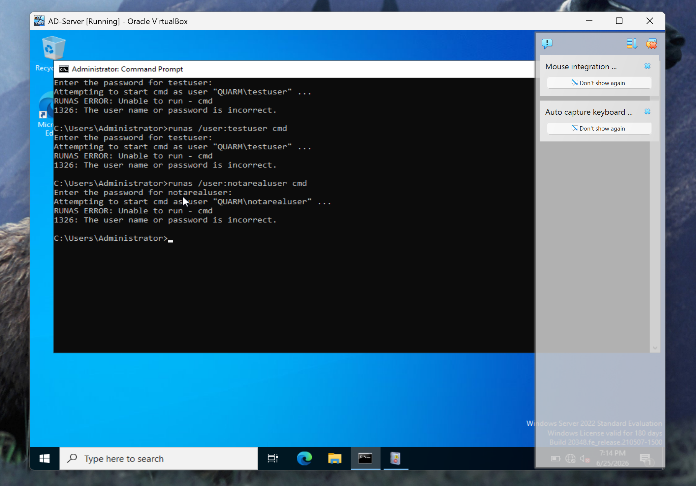
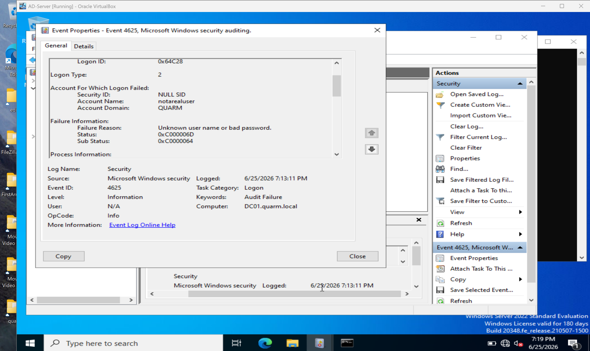
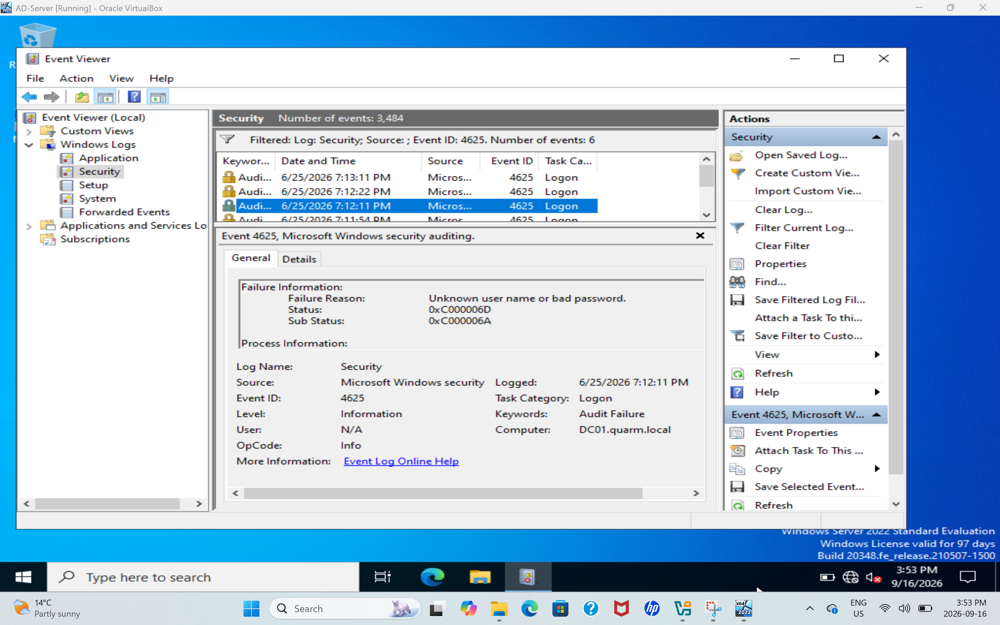
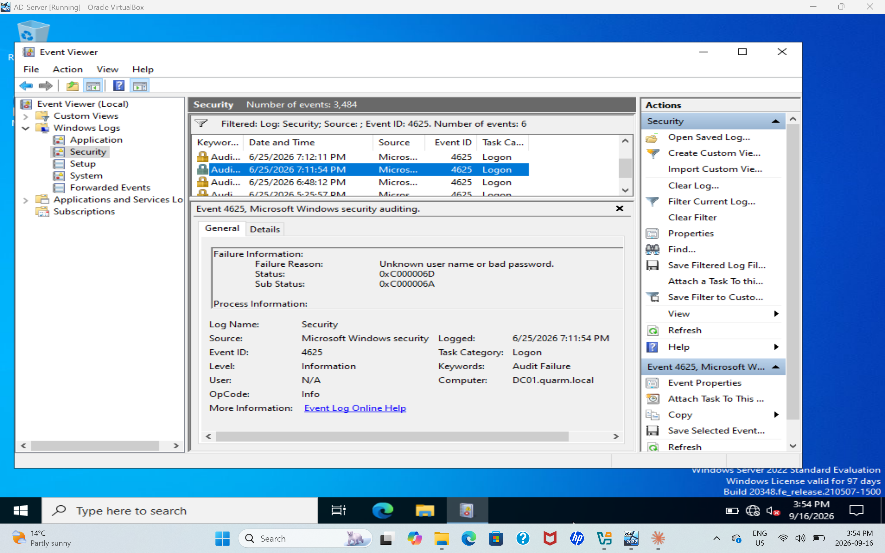
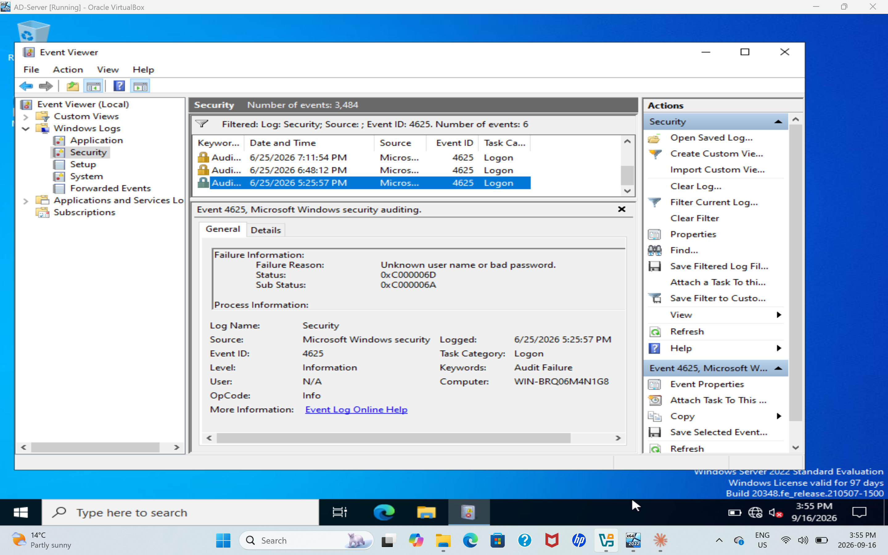
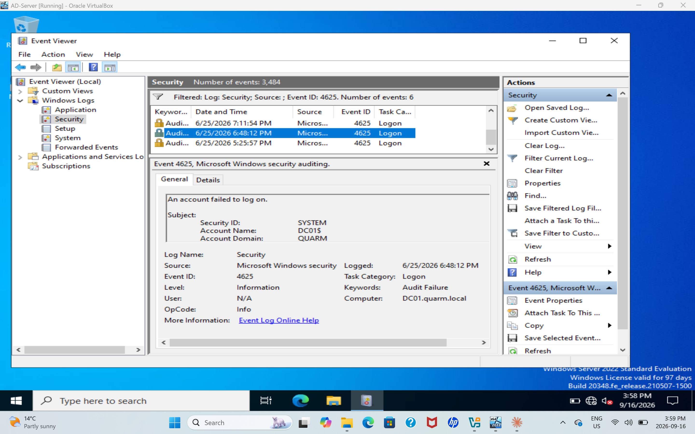
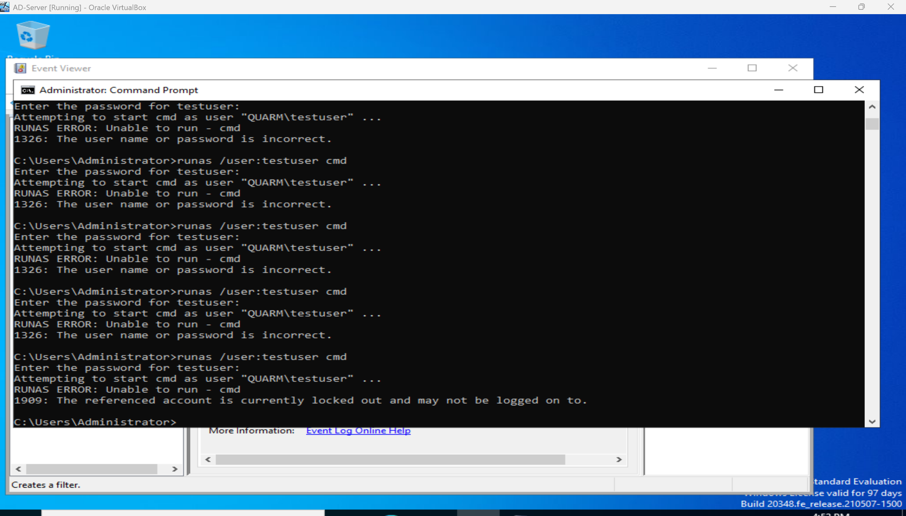
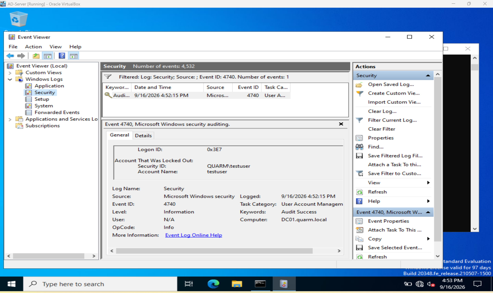

# Windows Failed Login Investigation

I created failed logons on my lab domain controller (`DC01.quarm.local`) on purpose, then investigated them in the Windows Security log the way I would if I'd found them without knowing the cause. Along the way I found that the domain had no account lockout policy, so I set one up and tested it.

The full write-up is in **[INC-001 — Failed Logon Attempts](INC-001-failed-logon-investigation.md)**.

## What I did

- Generated failed logons with `runas`: several wrong passwords for `testuser`, and one attempt with a username that doesn't exist (`notarealuser`)
- Filtered the Security log for Event ID 4625 and worked through all six matching events, recording the time, account, status codes, logon type, and computer for each
- Looked up the sub-status codes to tell a wrong password (`0xC000006A`) apart from a nonexistent user (`0xC0000064`)
- Tracked down one event that came from a different computer name, which turned out to be the server's own name before I promoted it to a domain controller
- Set an account lockout policy (5 attempts, 30-minute lockout), fixed a GPO precedence issue with `gpresult`, and confirmed the lockout with Event ID 4740
- Unlocked the account in Active Directory Users and Computers

## Tools

Event Viewer, `runas`, Group Policy Management, `gpresult /h`, `gpupdate /force`, Active Directory Users and Computers.

## Screenshots

**Generating the failures:** `runas` attempts returning error 1326 (wrong username or password):

**The nonexistent user:** 4625 event for `notarealuser`, with sub-status `0xC0000064` and logon type 2:

**Wrong-password events:** the Security log filtered to six 4625 events. These show the 7:12:11, 7:11:54, and 6:48:12 PM events, each with sub-status `0xC000006A`:

**The odd one out:** the 5:25:57 PM event logged by `WIN-BRQ06M4N1G8` in `WORKGROUP`, the server's name before promotion:

**The 6:48:12 PM event's subject:** `DC01$` in the `QUARM` domain:

**Lockout working:** after the policy change, `runas` returned error 1909 (account locked out):

**Event ID 4740:** `testuser` locked out at 4:52:15 PM on 9/16/2026:

